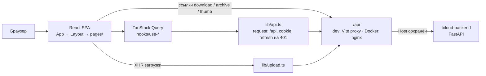

# tcloud-frontend

Веб-интерфейс для [tcloud-backend](../tcloud-backend) — файлового хранилища поверх каналов Telegram. Хранилища, папки
и файлы; загрузки с устройства (большие — частями, с продолжением), папками и по ссылкам, с шифрованием; поиск;
архивы; отслеживание задач; пользователи, доступы, API-ключи; вход в Telegram (root); дашборд с состоянием системы.
Интерфейс на русском и английском, пиксельный стиль, шесть тем.

Vite + React 19 + TypeScript, Tailwind v4 + shadcn/ui, TanStack Query, react-router.



## Основные ручки

Страницы (`src/App.tsx`): `/login`, `/dashboard`, `/files` (хранилища; `?path=` — папка), `/search`, `/tasks`,
`/account`, `/settings`, `/users`, `/users/:id` (admin), `/telegram` (root).

| Ручка бэкенда (`/api…`) | Зачем |
|---|---|
| `POST /auth/signin`, `/auth/refresh`, `/auth/logout` | вход, обновление cookie, выход |
| `GET /users/me`, `GET/PATCH/DELETE /account/settings` | текущий пользователь и его настройки |
| `GET /account`, `GET /health` | лимиты Telegram и каналов, состояние системы |
| `GET/POST /storages`, `PATCH/DELETE /storages/{id}`, `GET /storages/activity` | хранилища, лампы чтения/записи |
| `GET/POST/DELETE /folders` | листинг (курсор, сортировка), новая папка, удаление |
| `GET /files/search`, `/files/search/mimes`, `DELETE /files/{id}` | поиск, форматы, удаление файла |
| `GET /files/{id}/download`, `/files/{id}/thumb` | скачивание, миниатюра |
| `POST /uploads`, `/uploads/sessions` (+ `PUT/GET/DELETE /{id}`), `/uploads/batch` | загрузка файла, частями, по ссылкам |
| `POST /folders/archive`, `/folders/archive/selection`, `GET /tasks/{id}/archive` | архив папки или выбранного |
| `GET /tasks?ids=`, `/tasks/counts`, `POST /tasks/{id}/cancel\|retry\|priority` | задачи браузера |
| `GET/POST /users`, `/users/{id}/grants`, `/users/{id}/api-keys` | пользователи, доступы, ключи |
| `GET /telegram`, `POST /telegram/{session}/qr\|code\|sign-in\|password\|logout` | вход в три сессии Telegram |

Полный API — `../tcloud-backend/docs/`, типы ответов — `src/lib/types.ts`.

## Быстрый старт

Нужны Node 26 (как в CI и `Dockerfile`) и запущенный бэкенд. Своего `.env` нет.

```bash
(cd ../tcloud-backend && make dev-up-all)   # API на 127.0.0.1:8000
npm install
npm run dev        # http://localhost:5173, /api → http://127.0.0.1:8000 (API_URL=... чтобы сменить)
npm test           # vitest
npm run test:cov   # vitest + покрытие (coverage/)
npm run build      # tsc + сборка в dist/
npm run lint       # oxlint

docker build -t tcloud-frontend .
docker run -p 8080:80 -e API_UPSTREAM=http://app:8000 tcloud-frontend
```

Вход — пользователем tcloud (root: `ROOT_LOGIN` / `ROOT_PASSWORD` из `../tcloud-backend/.env`). В проде перед nginx
нужен HTTPS (cookie `Secure`).

## Документация

[docs/](docs/README.md): [архитектура, авторизация, nginx, i18n](docs/architecture.md) ·
[запросы, инвалидации, настройки](docs/data-flow.md) · [загрузки и задачи](docs/uploads-and-tasks.md) ·
[страницы и функции](docs/ui.md) · [темы и стиль](docs/theming.md)

```
src/lib/ логика и api · src/hooks/ запросы · src/components/ UI (ui/ — shadcn) · src/pages/ страницы · docker/ nginx
```
