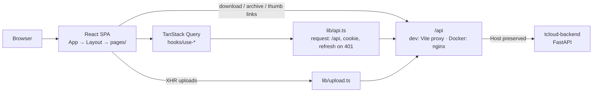

# tcloud-frontend

[](https://github.com/NikitkaZXC/tcloud-frontend/actions/workflows/ci.yml)
[](https://github.com/NikitkaZXC/tcloud-frontend/releases)
[](LICENSE)

**English** · [Русский](README.ru.md)

Web UI for [tcloud-backend](https://github.com/NikitkaZXC/tcloud-backend), a file storage built on top of Telegram
channels. Storages, folders and files; uploads from the device (large files in resumable chunks), whole folders and by
URL, with encryption; search; archives; task tracking; users, access grants, API keys; Telegram sign-in (root); a
dashboard with system health. The UI is in Russian and English, pixel style, six themes.

Vite + React 19 + TypeScript, Tailwind v4 + shadcn/ui, TanStack Query, react-router.



## Main endpoints

Pages (`src/App.tsx`): `/login`, `/dashboard`, `/files` (storages; `?path=` is a folder), `/search`, `/tasks`,
`/account`, `/settings`, `/users`, `/users/:id` (admin), `/telegram` (root).

| Backend endpoint (`/api…`) | Purpose |
|---|---|
| `POST /auth/signin`, `/auth/refresh`, `/auth/logout` | sign in, refresh the cookie, sign out |
| `GET /users/me`, `GET/PATCH/DELETE /account/settings` | current user and their settings |
| `GET /account`, `GET /health` | Telegram and channel limits, system health |
| `GET/POST /storages`, `PATCH/DELETE /storages/{id}`, `GET /storages/activity` | storages, read/write lamps |
| `GET/POST/DELETE /folders` | listing (cursor, sorting), new folder, delete |
| `GET /files/search`, `/files/search/mimes`, `DELETE /files/{id}` | search, formats, delete a file |
| `GET /files/{id}/download`, `/files/{id}/thumb` | download, thumbnail |
| `POST /uploads`, `/uploads/sessions` (+ `PUT/GET/DELETE /{id}`), `/uploads/batch` | file upload, chunked, by URL |
| `POST /folders/archive`, `/folders/archive/selection`, `GET /tasks/{id}/archive` | archive a folder or a selection |
| `GET /tasks?ids=`, `/tasks/counts`, `POST /tasks/{id}/cancel\|retry\|priority` | browser tasks |
| `GET/POST /users`, `/users/{id}/grants`, `/users/{id}/api-keys` | users, grants, keys |
| `GET /telegram`, `POST /telegram/{session}/qr\|code\|sign-in\|password\|logout` | sign-in for the three Telegram sessions |

Full API: [tcloud-backend docs](https://github.com/NikitkaZXC/tcloud-backend/tree/main/docs); response types:
`src/lib/types.ts`.

## Quick start

Requires Node 26 (same as CI and the `Dockerfile`) and a running backend. There is no `.env` of its own.

```bash
(cd ../tcloud-backend && make dev-up-all)   # API on 127.0.0.1:8000
npm install
npm run dev        # http://localhost:5173, /api → http://127.0.0.1:8000 (set API_URL=... to change)
npm test           # vitest
npm run test:cov   # vitest + coverage (coverage/)
npm run build      # tsc + build into dist/
npm run lint       # oxlint

docker build -t tcloud-frontend .
docker run -p 8080:80 -e API_UPSTREAM=http://app:8000 tcloud-frontend
```

Prebuilt image (published on every `v*.*.*` tag):

```bash
docker run -p 8080:80 -e API_UPSTREAM=http://app:8000 ghcr.io/nikitkazxc/tcloud-frontend:latest
```

Sign in as a tcloud user (root: `ROOT_LOGIN` / `ROOT_PASSWORD` from the backend `.env`). In production, put HTTPS in
front of nginx (the cookie is `Secure`).

## Documentation

[docs/](docs/README.md): [architecture, auth, nginx, i18n](docs/architecture.md) ·
[queries, invalidation, settings](docs/data-flow.md) · [uploads and tasks](docs/uploads-and-tasks.md) ·
[pages and features](docs/ui.md) · [themes and style](docs/theming.md)

```
src/lib/ logic and api · src/hooks/ queries · src/components/ UI (ui/ is shadcn) · src/pages/ pages · docker/ nginx
```

[Changelog](CHANGELOG.md) · [Security](SECURITY.md) · [MIT License](LICENSE)
