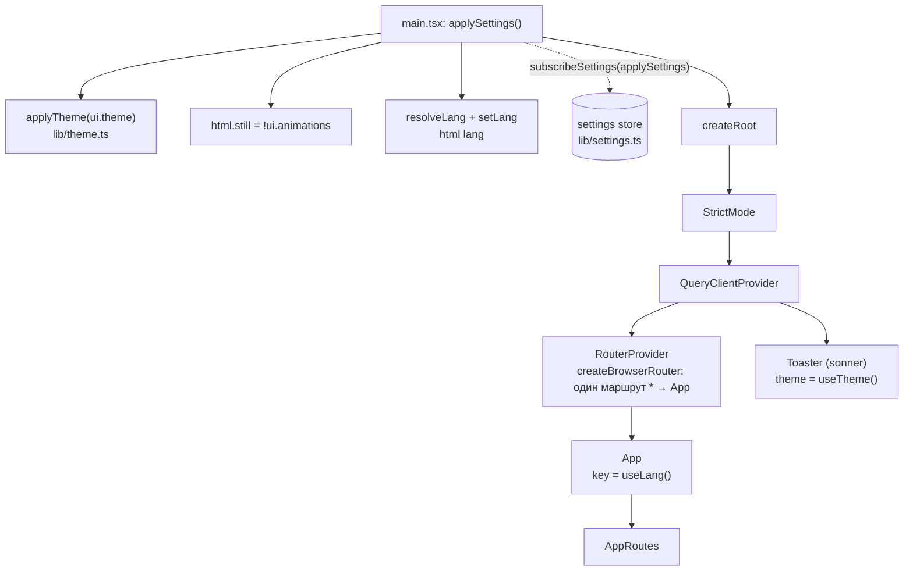
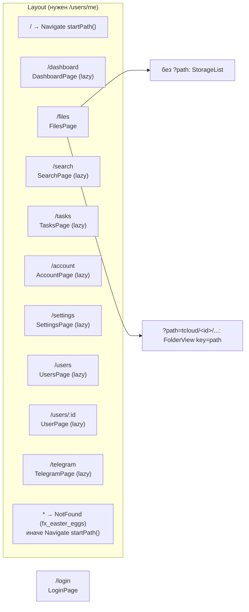
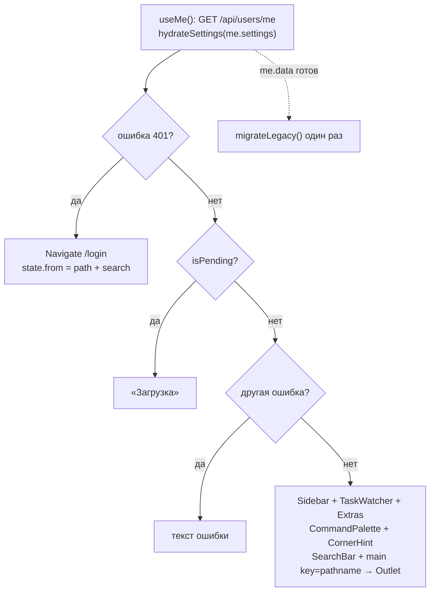
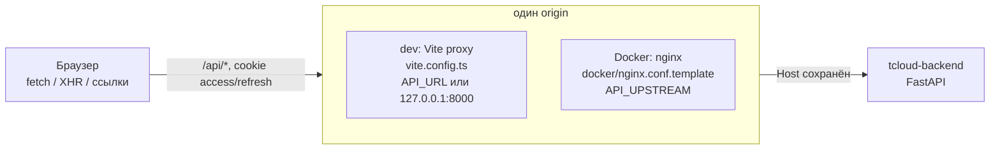
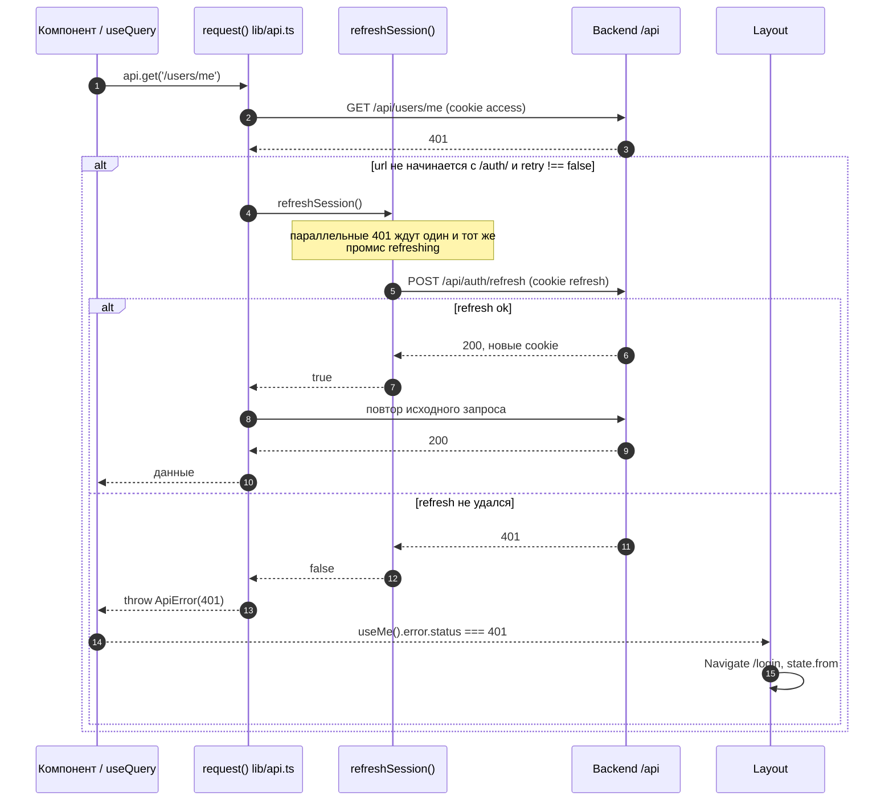
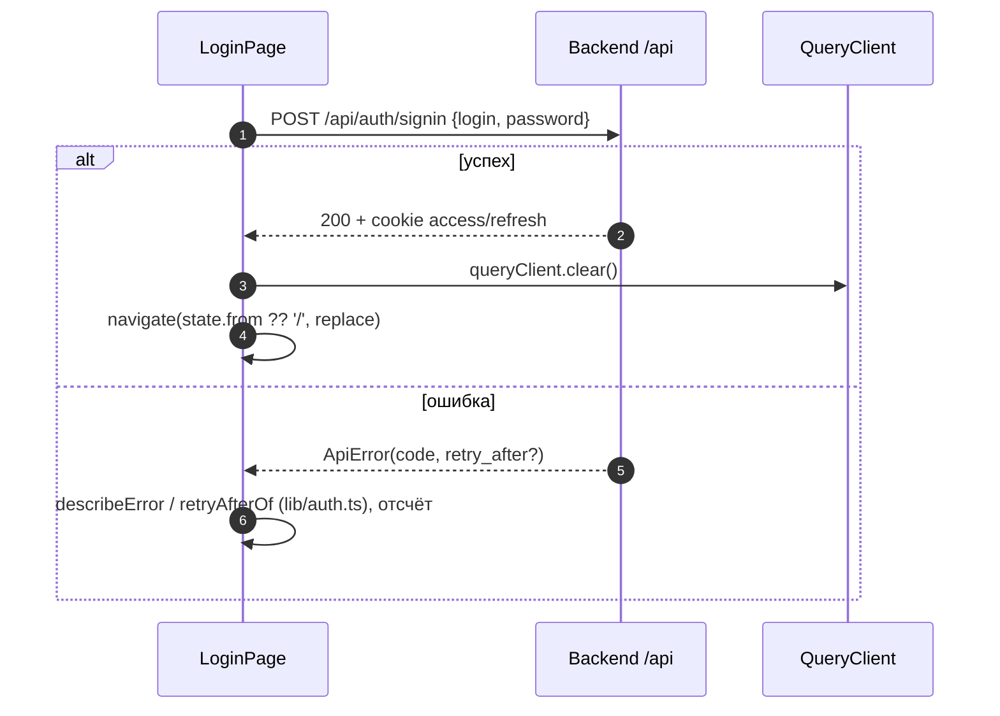
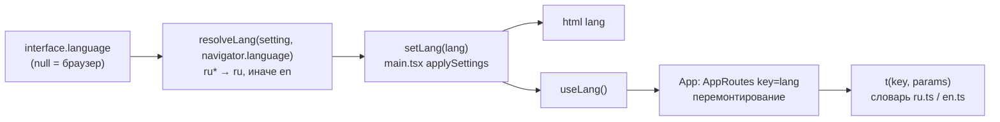

# Архитектура

Одностраничное приложение на Vite + React 19. Сервера у фронтенда нет: в dev статику отдаёт Vite, в Docker — nginx,
оба проксируют `/api` на бэкенд. Все схемы ниже сверены с кодом; при изменении потока обновляйте схему в том же коммите.

## Запуск приложения

`src/main.tsx` до первого рендера применяет настройки интерфейса (тема, `still`, язык) из стора `lib/settings.ts` и
подписывается на его изменения. Затем монтируется дерево провайдеров.

- `QueryClient` (`src/main.tsx`): ретраи только для сетевых ошибок и `5xx` (не больше двух), `ApiError` со статусом
  `< 500` не повторяется; `refetchOnWindowFocus: false`.
- Роутер — data router (`createBrowserRouter`) с одним маршрутом `*`, внутри которого `<Routes>` из `App`: он нужен
  для `useBlocker` (дашборд спрашивает подтверждение перед уходом с несохранённым порядком блоков).
- `App` (`src/App.tsx`) монтирует `AppRoutes` с `key={useLang()}`: смена языка пересоздаёт всё дерево маршрутов.
- Отдельного провайдера темы и i18n нет: оба — модульные сторы на `useSyncExternalStore` (`lib/theme.ts`,
  `lib/i18n.ts`, `lib/settings.ts`).

## Маршруты

`src/App.tsx`. Всё, кроме `/login`, рендерится внутри `Layout` (`src/components/layout.tsx`).

- `startPath` (`lib/settings.ts`): `interface.start_page` `dashboard|storages|tasks` → `/dashboard|/files|/tasks`.
- Маршруты не охраняются по роли: в боковой панели `/users` скрыт не для admin/root (`isAdmin`), `/telegram` — не для
  root; прямой заход получит `403` от бэкенда.

### Разбиение бандла

- `/login` и `/files` (стартовые) — в основном чанке; остальные страницы — `React.lazy` в `App.tsx`, каждая своим чанком
  (`/telegram` тянет `qrcode.react` только к себе). `Suspense` вокруг `<Outlet />` в `Layout` показывает «Загрузка…»
  (`common.loading`) в стиле остальных загрузок, боковая панель остаётся.
- `vite.config.ts` → `build.rolldownOptions.output.codeSplitting.groups`: `react` (react, react-dom, scheduler,
  react-router) и `vendor` (весь остальной `node_modules`, кроме `qrcode.react`). Новую тяжёлую зависимость, нужную
  только ленивой странице, тоже исключать из `vendor`, иначе она попадёт в начальную загрузку.
- Было: один `index.js` 751 kB (gzip 227 kB). Стало: `react` 257 kB, `vendor` 244 kB, `index` 113 kB, общий код
  страниц 71 kB, страницы 3–26 kB; предупреждения о чанке > 500 kB нет.

## Оболочка `Layout`

- `TaskWatcher`, `CommandPalette`, `SearchBar` смонтированы вне `<main key={location.pathname}>`, поэтому живут при
  переходах между страницами (строка поиска не теряет фокус).
- Выход: `POST /api/auth/logout` → `queryClient.clear()` → `/login`.

## Связь с бэкендом

- Фронт и API всегда на одном origin, поэтому cookie `access`/`refresh` ходят без CORS (`credentials: same-origin`).
- Прокси обязан сохранять `Host` (Vite по умолчанию, nginx — `proxy_set_header Host $http_host`): бэкенд сравнивает
  `Origin` с `Host`, иначе изменяющие запросы получают `403 cross_site_request`.
- nginx для `/api/` выключает буферизацию запроса и ответа, `client_max_body_size 0`, таймауты 1 ч — загрузки и
  скачивания идут потоком.
- Заголовки безопасности — `docker/security-headers.conf`, `include` в `server` и в каждом `location` с собственным
  `add_header` (`/assets/`, `/`): `add_header` в `location` отменяет унаследованные с уровня `server`.
- gzip: статика (`text/html`, CSS, JS, SVG, JSON) от 1 КБ с `Vary: Accept-Encoding`; в `/api/` `gzip_types` сужен до
  `application/json`; `/files/{id}/download`, `/files/{id}/thumb` и `/tasks/{id}/archive` идут через отдельный
  regex-`location` с `gzip off` (те же настройки прокси), даже если файл сам JSON (ответы `206` nginx не сжимает вовсе).

### Клиент API

`src/lib/api.ts`: `request(method, url, {query, json, body, retry})` добавляет префикс `/api`, сериализует `json`,
`204` → `undefined`, ошибка → `ApiError(status, body.error)` (`code`, `message`, `details` из ответа бэкенда; без
тела — `http_error`). Обёртки `api.get/post/put/patch/del`. Тексты ошибок: `errorMessage` (по `error.<code>` из
словаря, иначе `message (code)`, `TypeError` → «нет сети»), `errorText` для тела ошибки задачи.

### Авторизация и обновление сессии

- Только `401` от `/users/me` уводит на `/login` (через `Layout`); другие запросы после неудачного refresh просто
  показывают ошибку.
- Загрузка файла через XHR (`uploadFile`, `lib/upload.ts`) делает тот же один `refreshSession()` и повтор.
- Скачивания и превью — обычные ссылки `/api/files/{id}/download`, `/api/tasks/{id}/archive`, `/api/files/{id}/thumb`:
  cookie уходят сами, refresh для них не делается.

## События окна

Связь между несвязанными частями дерева без общего состояния.

| Событие | Кто шлёт | Кто слушает |
|---|---|---|
| `tcloud:folder-action` (`FOLDER_ACTION`, `lib/commands.ts`) | `CommandPalette` (`runFolderAction`) | `FolderView`: загрузить файлы/папку/по ссылке, новая папка, архив |
| `tcloud:palette` (`OPEN_PALETTE`) | кнопки в шапке/панели (`openPalette`) | `CommandPalette` |
| `tcloud:task-finished` (`TASK_EVENT`, `lib/features.ts`) | `TaskWatcher` при завершении задачи | `components/extras.tsx` (звуки) |

## Языки (i18n)

Свой модуль без зависимостей, `src/lib/i18n.ts`. `<html translate="no">` в `index.html` (`lang` ставит `applySettings` в `main.tsx`): автоперевод браузера переписывает DOM-узлы, и React падает на следующем обновлении (`removeChild`/`insertBefore`); интерфейс и так на двух языках.

- Словари: `src/lib/locales/ru.ts` задаёт тип `Key`, `en.ts` — `Record<Key, Entry>`; совпадение ключей и подстановок
  проверяют `tsc` и `src/lib/i18n.test.ts`.
- `translate`: нет ключа в языке → русский → сам ключ. Множественное число — объект `{one, few, many, other}`, форма
  по `Intl.PluralRules(lang)` от `params.n`. Подстановки `{name}`.
- Константы модулей хранят ключи, а не текст (текст вычисляется после перемонтирования). `tAll` склеивает перевод на
  обоих языках — для `keywords` команд Ctrl+K.
- До ответа `/users/me` язык берётся из `tcloud.mirror` (см. [data-flow.md](data-flow.md#настройки)) или браузера.
