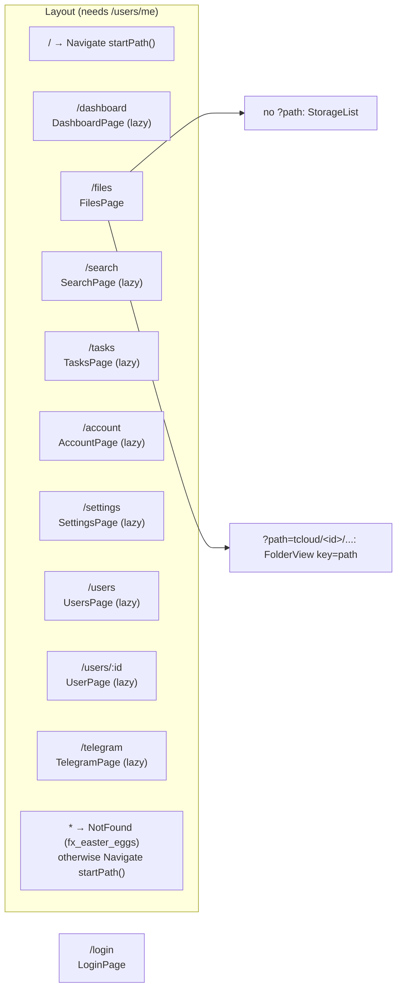
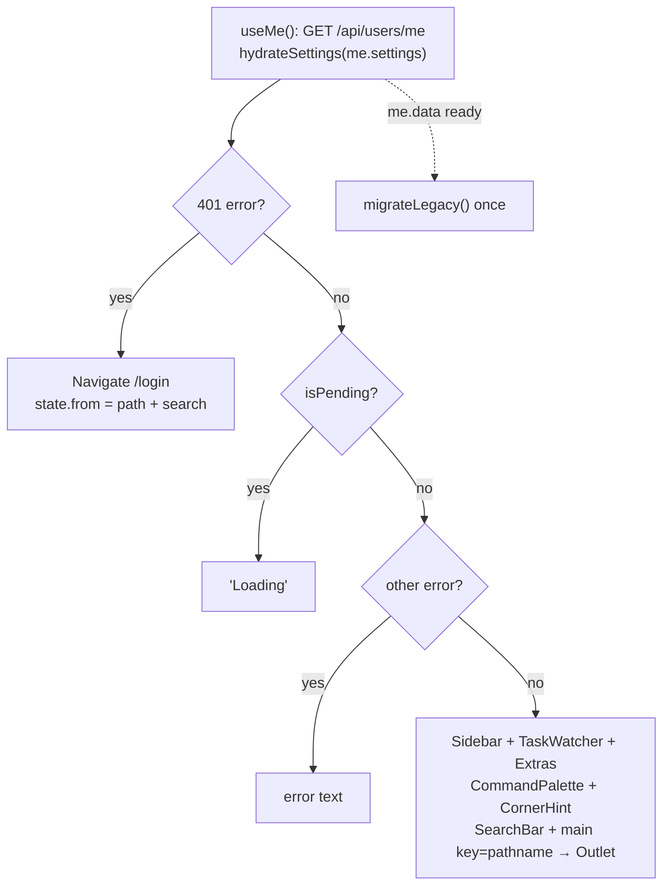
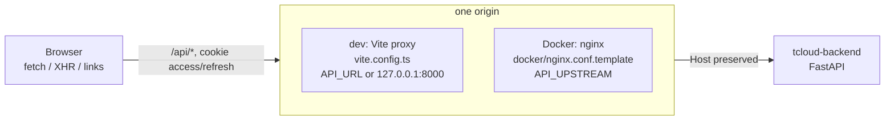
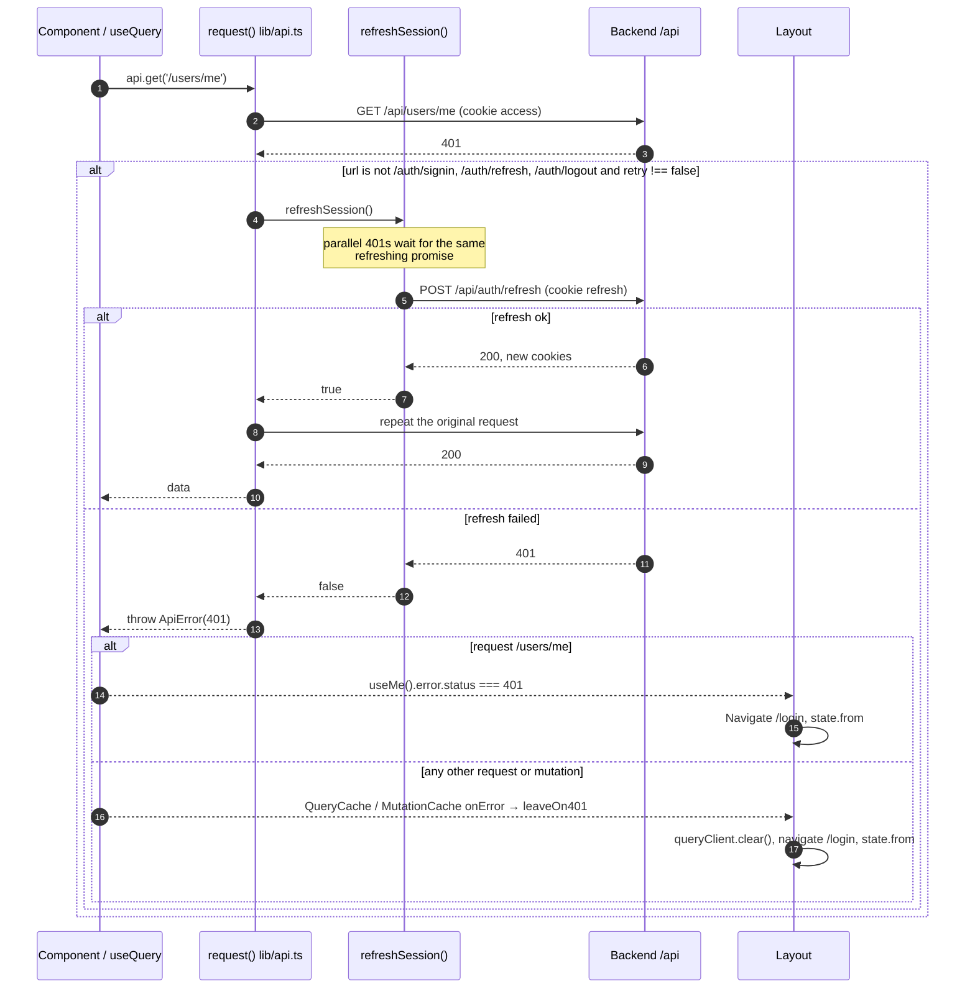
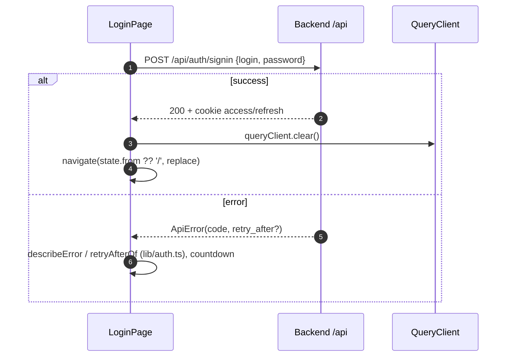
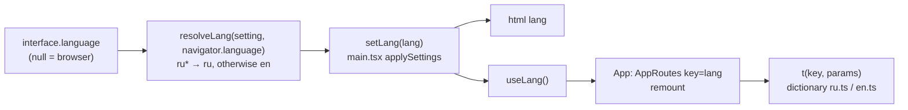

# Architecture

A single-page app on Vite + React 19. The frontend has no server of its own: in dev Vite serves the static files, in
Docker nginx does, and both proxy `/api` to the backend. All diagrams below are checked against the code; when a flow
changes, update its diagram in the same commit.

## App startup

Before the first render, `src/main.tsx` applies the interface settings (theme, `still`, language) from the
`lib/settings.ts` store and subscribes to its changes. Then the provider tree is mounted.


- `QueryClient` (`src/main.tsx`): retries only network errors and `5xx` (at most two); an `ApiError` with status
  `< 500` is not retried; `refetchOnWindowFocus: false`.
- The router is a data router (`createBrowserRouter`) with a single `*` route that renders the `<Routes>` of `App`: it
  is needed for `useBlocker` (the dashboard asks for confirmation before leaving with an unsaved block order). The route
  has an `errorElement` (`RouteError` from `components/extras.tsx`): a render error shows "Something went wrong" and a
  reload button instead of the default React Router page.
- `App` (`src/App.tsx`) mounts `AppRoutes` with `key={useLang()}`: changing the language recreates the whole route tree.
- There is no separate theme or i18n provider: both are module stores on `useSyncExternalStore` (`lib/theme.ts`,
  `lib/i18n.ts`, `lib/settings.ts`).

## Routes

`src/App.tsx`. Everything except `/login` renders inside `Layout` (`src/components/layout.tsx`).



- `startPath` (`lib/settings.ts`): `interface.start_page` `dashboard|storages|tasks` → `/dashboard|/files|/tasks`.
- Routes are not guarded by role: the sidebar hides `/users` from non-admin/root users (`isAdmin`) and `/telegram` from
  non-root users; opening them directly gets a `403` from the backend.

### Bundle splitting

- `/login` and `/files` (the start pages) are in the main chunk; the other pages are `React.lazy` in `App.tsx`, each in
  its own chunk (`/telegram` pulls `qrcode.react` into its own chunk only). `Suspense` around `<Outlet />` in `Layout`
  shows "Loading…" (`common.loading`) in the same style as other loading states, and the sidebar stays.
- `vite.config.ts` → `build.rolldownOptions.output.codeSplitting.groups`: `react` (react, react-dom, scheduler,
  react-router) and `vendor` (the rest of `node_modules` except `qrcode.react`). A new heavy dependency needed only by a
  lazy page must also be excluded from `vendor`, or it ends up in the initial load.
- Before: one `index.js` of 751 kB (gzip 227 kB). After: `react` 257 kB, `vendor` 244 kB, `index` 113 kB, shared page
  code 71 kB, pages 3–26 kB; no warning about a chunk > 500 kB.

## The `Layout` shell



- `TaskWatcher`, `CommandPalette` and `SearchBar` are mounted outside `<main key={location.pathname}>`, so they survive
  page changes (the search bar keeps its focus).
- Sign-out (`logout(send)` + `useSignedOut` in `hooks/use-me.ts`; the sidebar sends `POST /auth/logout`, "Sign out
  everywhere" on `/account` sends `POST /auth/logout/all`, "End" on the current session on `/account` sends
  `DELETE /auth/sessions/{id}`): first `abortUploads()` (`lib/upload.ts`: aborts sending and waits until the chunked
  upload sessions are deleted on the server, with the `DELETE` still sent with the cookie, for at most `ABORT_WAIT_MS`
  3 s, `Promise.allSettled` + a timer), then the sign-out request (a `401` counts as already signed out) →
  `forgetLocalUser()` (clears `tcloud.tasks`, `tcloud.tasks.pending`, `tcloud.uploads.sessions`, the `hintTask` hints)
  → `queryClient.clear()` → `/login`. Convenience settings (`tcloud.mirror`, `tcloud.sidebar`, the `interface.*`
  copies) stay. A failed sign-out shows a toast through `useAction`, and the user stays on the page.

## Connection to the backend



- The frontend and the API are always on one origin, so the `access`/`refresh` cookies are sent without CORS
  (`credentials: same-origin`).
- The proxy must preserve `Host` (Vite does by default, nginx via `proxy_set_header Host $http_host`): the backend
  compares `Origin` with `Host`, otherwise state-changing requests get `403 cross_site_request`.
- For `/api/`, nginx turns off response buffering and uses 1 h timeouts, so downloads stream. The request body in
  `/api/` is limited by `client_max_body_size 1m` (larger gets `413` from nginx and never reaches the backend):
  otherwise anyone, even without auth, could send a gigabyte of JSON, for example to `/api/auth/signin`. Only the
  routes that read the body as a stream have no limit and no request buffering (`client_max_body_size 0`,
  `proxy_request_buffering off`), in a separate regex `location`
  `^/api/(uploads|uploads/sessions/[^/]+|storages/[^/]+/photo)$`: `POST /api/uploads` (exactly this path;
  `/api/uploads/sessions`, `/from-url` and the others are under the limit), `PUT /api/uploads/sessions/{id}` (chunks)
  and `PUT /api/storages/{id}/photo`. A new streaming backend route must be added to this regex.
- Security headers live in `docker/security-headers.conf`, included in `server` and in every `location` that has its
  own `add_header` (`/assets/`, `/fonts/`, `/`): an `add_header` in a `location` cancels the ones inherited from
  `server`. Every `add_header` uses `always` (also on 4xx/5xx). The backend sends the same headers, so the same file
  hides them with `proxy_hide_header`: each header appears exactly once in `/api/` responses (from nginx). The exception
  is `Content-Security-Policy`: the backend CSP (`default-src 'none'`, `sandbox` on downloads) is not hidden, and the
  browser applies both policies at once, so the strictest one wins.
- Also in `security-headers.conf`: `Permissions-Policy: camera=(), microphone=(), geolocation=(), payment=()` and
  `Cross-Origin-Opener-Policy: same-origin` (the backend has its own, also hidden). `server_tokens off` removes the
  nginx version from `Server` and error pages.
- `X-Forwarded-Proto` to the backend: the outer proxy's value if one arrived, otherwise `$scheme` (`map
  $http_x_forwarded_proto $forwarded_proto` at the top of the template), so behind a TLS proxy the backend sees
  `https`.
- CSP for static files: `default-src 'self'` (scripts, the font, `/api` via `connect-src` all come from the same
  origin, with no CDN, `eval` or workers); `style-src 'self' 'unsafe-inline'`, because sonner, Radix Select and
  `react-remove-scroll` insert `<style>` at runtime; `img-src`/`media-src` with `data:`/`blob:` for previews;
  `frame-ancestors 'none'`, `object-src 'none'`, `base-uri 'none'`, `form-action 'self'`. HSTS:
  `max-age=31536000; includeSubDomains` (browsers honour it only over HTTPS). A new external source (CDN, font,
  iframe) needs a CSP change.
- gzip: static files (`text/html`, CSS, JS, SVG, JSON) from 1 KB with `Vary: Accept-Encoding`; in `/api/`
  `gzip_types` is narrowed to `application/json`; `/files/{id}/download`, `/files/{id}/thumb` and
  `/tasks/{id}/archive` go through a separate regex `location` with `gzip off` (same proxy settings), even if the file
  itself is JSON (nginx never compresses `206` responses): they are sent as is, with `Content-Length` and `Range`.
- The image has two stages (`Dockerfile`): `node` builds `dist/`, `nginx` serves it; the `docker/nginx.conf.template`
  template fills in `API_UPSTREAM` at startup. `/assets/` are cached for a year (hashed names), `/fonts/` too
  (`immutable`, a `?v=` version in the font URL), everything else is `no-cache` with a fallback to `index.html` (SPA
  routes).
- In production, put HTTPS in front of nginx: the auth cookies are `Secure`.
- The frontend has no `.env`, and the API address is not baked into the build: requests always go to the same origin,
  `/api`.

### API client

`src/lib/api.ts`: `request(method, url, {query, json, body, retry})` adds the `/api` prefix, serializes `json`, maps
`204` → `undefined`, and turns an error into `ApiError(status, errorBody(...))` (`code`, `message`, `details` from the
backend `{"error": …}`; a bare FastAPI `detail` string → `http_error`, a list → `validation_error`; no body →
`http_error` with the status; the same in the XHR upload). Wrappers: `api.get/post/put/patch/del`. Error texts:
`errorMessage` (`validation_error` → "Field "loc": msg" from the first `details` entry, otherwise "Check the entered
data"; `http_error` → the backend `message`; others by `error.<code>` from the dictionary, otherwise `message (code)`;
`TypeError` → "no network"), `errorText` for a task's error body.

### 429 rate_limited

Any endpoint can answer `429` with the body `{"error": {"code": "rate_limited", "message", "retry_after": N}}` and the
header `Retry-After: N`. `toError` puts the value from the body into `body.retry_after`, otherwise the one from the
header (at least 1 s); `retryAfter(error)` returns N only for 429. There is one notification for the whole app:
`notifyRateLimit` is a `toast.error` with a fixed `id` (`RATE_LIMIT_TOAST`), so repeated 429s update the same toast
instead of adding new ones. Regular error notifications (`showError`, `useAction`) skip 429. Only `/auth/signin` shows no
toast: sign-in shows `rate_limited` itself with a countdown; the other `/auth/*` calls (password, sessions) show the
shared toast. Sending a file (XHR in `lib/upload.ts`) shows the same toast.

Quotas are not rate limits: `429 send_quota_exceeded` (`retry_after`, `limit`, `window`; the Telegram send quota) and
`429 too_many_upload_sessions` (`limit`) are not counted by `retryAfter` (`QUOTA_CODES`): no shared toast and no
retries, the error is shown by the usual `showError`/`useAction` with its own phrase. `errorParams` fills `limit` (as a
number for `send_quota_exceeded`/`too_many_upload_sessions`/`too_many_items`, otherwise as a size), `used` (a size),
`window` and `retry` (`formatSpan`: in words, at most two units, such as "1 d", "1 min 30 s") into the phrases; the
same goes for `507 temp_quota_exceeded` (`limit`, `used`). A `413` without a JSON body (nginx cuts `/api/` at 1 MiB) is
read as `body_too_large`, like the API's answer to a body over `APP_MAX_BODY_SIZE`.

```mermaid
sequenceDiagram
    autonumber
    participant Q as useQuery (polling)
    participant R as request()
    participant B as Backend
    participant T as sonner
    Q->>R: queryFn
    R->>B: GET …
    B-->>R: 429, retry_after = N
    R->>T: toast id=rate-limited "retry in N s"
    R-->>Q: throw ApiError(429)
    Note over Q: queryRetry: 429 gets up to RATE_LIMIT_RETRIES (3) retries,<br/>queryRetryDelay = N s; while a retry is pending,<br/>refetchInterval sends no new requests (a fetch is in flight)
    Q->>R: retry after N s
```

`main.tsx` sets `retry: queryRetry`, `retryDelay: queryRetryDelay` for all queries; other errors behave as before (4xx
not retried, 5xx/network up to two times, delay 2ⁿ s). Mutations are not retried.

### Auth and session refresh





- A `401` from `/users/me` leads to `/login` through `Layout` (`Navigate`, `state.from`). A `401` from any other query or
  mutation (after the refresh already failed) is caught by `QueryCache`/`MutationCache` `onError` in `main.tsx` →
  `leaveOn401` (`lib/api.ts`): `queryClient.clear()` and `router.navigate('/login', {replace, state.from})`. It does not
  fire for `invalid_credentials` (wrong password) or when already on `/login`, so there is no double navigation.
- `GET /api/health` without a valid access cookie answers with the public `{status}` (200, no `workers`): `fetchHealth`
  (`hooks/use-health.ts`) then calls `refreshSession()` and repeats the request once, and if the answer is public again,
  throws `ApiError(401, token_expired)`.
- A file upload over XHR (`uploadFile`, `lib/upload.ts`) does the same single `refreshSession()` and retry.
- Downloads and previews are plain links `/api/files/{id}/download`, `/api/tasks/{id}/archive`,
  `/api/files/{id}/thumb`: the cookies go along on their own, and no refresh is done for them.

## Window events

Communication between unrelated parts of the tree without shared state.

| Event | Sent by | Listened to by |
|---|---|---|
| `tcloud:folder-action` (`FOLDER_ACTION`, `lib/commands.ts`) | `CommandPalette` (`runFolderAction`) | `FolderView`: upload files/folder/by URL, new folder, archive |
| `tcloud:palette` (`OPEN_PALETTE`) | buttons in the header/panel (`openPalette`) | `CommandPalette` |
| `tcloud:task-finished` (`TASK_EVENT`, `lib/features.ts`) | `TaskWatcher` when a task finishes | `components/extras.tsx` (sounds) |

## Languages (i18n)

An in-house module without dependencies, `src/lib/i18n.ts`. `<html translate="no">` in `index.html` (`lang` is set by
`applySettings` in `main.tsx`): browser auto-translation rewrites DOM nodes, and React then crashes on the next update
(`removeChild`/`insertBefore`); the UI is bilingual anyway.



- Dictionaries: `src/lib/locales/ru.ts` defines the `Key` type, `en.ts` is a `Record<Key, Entry>`; `tsc` and
  `src/lib/i18n.test.ts` check that keys and placeholders match.
- `translate`: a key missing in the language → Russian → the key itself. Plurals are an object
  `{one, few, many, other}`, the form picked by `Intl.PluralRules(lang)` from `params.n`. Placeholders are `{name}`.
- Module constants store keys, not text (the text is computed after the remount). `tAll` joins the translation in both
  languages, for the `keywords` of Ctrl+K commands.
- Dates (`formatDate`), sizes (`formatBytes`, decimal separator) and name sorting (`Intl.Collator`) follow the current
  language. The RU/EN switch is in the sidebar profile next to the theme, plus the "Language" item on `/settings`.
- Backend errors are translated by `code` (`error.<code>` in `errorMessage`/`errorText`, own phrases in
  `describeError`, `archiveError`, `settingsError`); an unknown code is shown as is. Departure Mono covers Latin and
  Cyrillic (including ё, №, «», —, arrows).
- Before the `/users/me` answer, the language comes from `tcloud.mirror` (see [data-flow.md](data-flow.md#settings)) or
  the browser.
