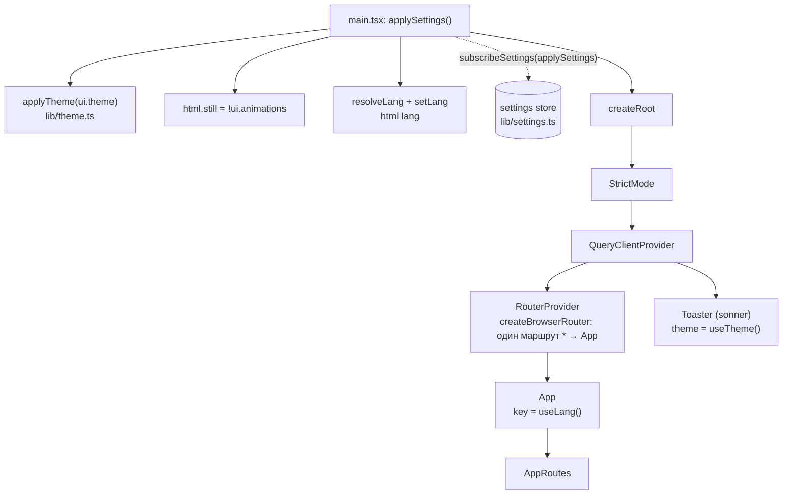
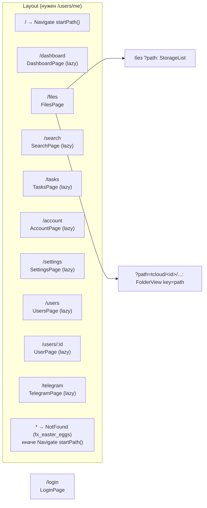
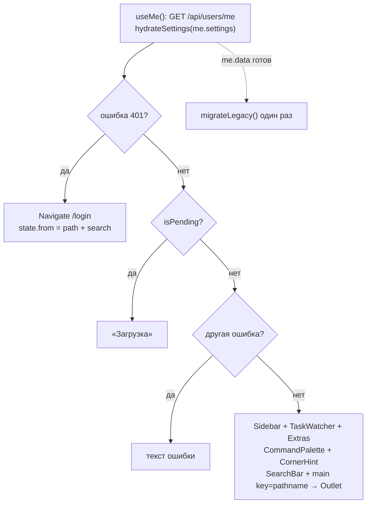
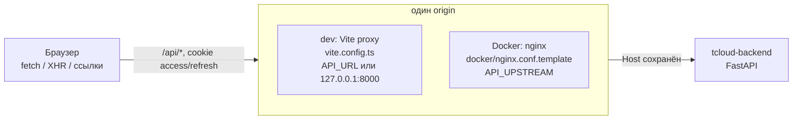
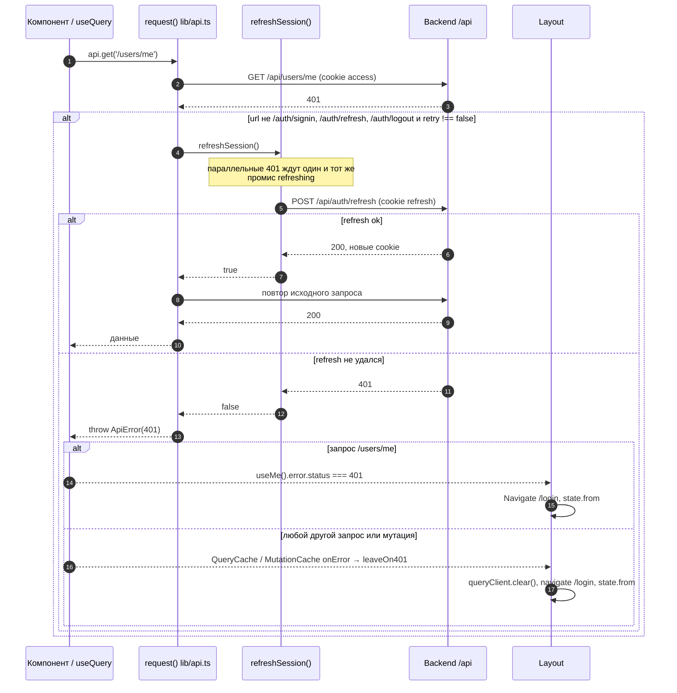
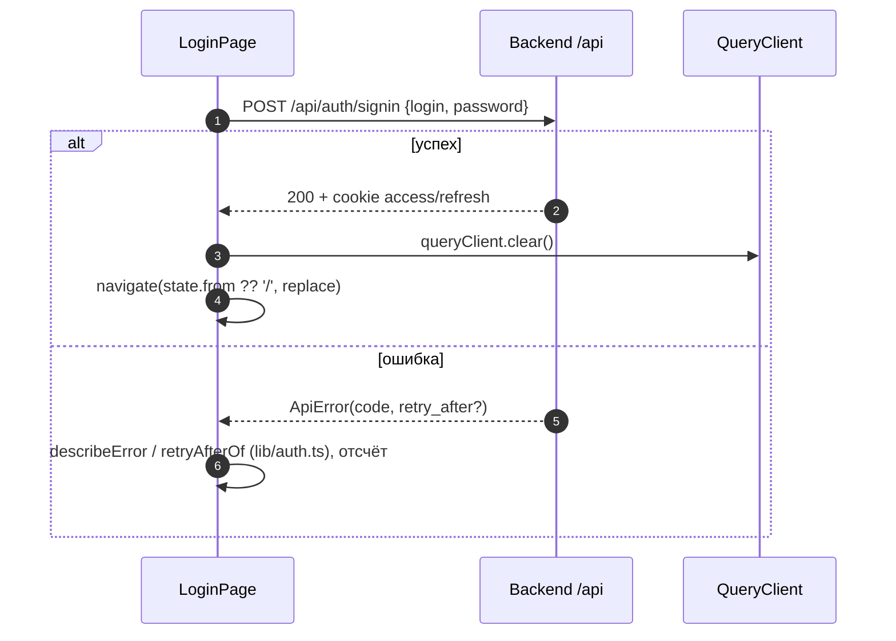
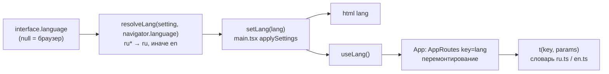

# Архитектура

Одностраничное приложение на Vite + React 19. Сервера у фронтенда нет: в dev статику отдаёт Vite, в Docker — nginx,
оба проксируют `/api` на бэкенд. Все схемы ниже сверены с кодом; при изменении потока обновляйте схему в том же коммите.

## Запуск приложения

`src/main.tsx` до первого рендера применяет настройки интерфейса (тема, `still`, язык) из стора `lib/settings.ts` и
подписывается на его изменения. Затем монтируется дерево провайдеров.



- `QueryClient` (`src/main.tsx`): ретраи только для сетевых ошибок и `5xx` (не больше двух), `ApiError` со статусом
  `< 500` не повторяется; `refetchOnWindowFocus: false`.
- Роутер — data router (`createBrowserRouter`) с одним маршрутом `*`, внутри которого `<Routes>` из `App`: он нужен
  для `useBlocker` (дашборд спрашивает подтверждение перед уходом с несохранённым порядком блоков). У маршрута есть
  `errorElement` (`RouteError` из `components/extras.tsx`): ошибка рендера показывает «Что-то пошло не так» и кнопку
  перезагрузки вместо стандартной страницы React Router.
- `App` (`src/App.tsx`) монтирует `AppRoutes` с `key={useLang()}`: смена языка пересоздаёт всё дерево маршрутов.
- Отдельного провайдера темы и i18n нет: оба — модульные сторы на `useSyncExternalStore` (`lib/theme.ts`,
  `lib/i18n.ts`, `lib/settings.ts`).

## Маршруты

`src/App.tsx`. Всё, кроме `/login`, рендерится внутри `Layout` (`src/components/layout.tsx`).



- `startPath` (`lib/settings.ts`): `interface.start_page` `dashboard|storages|tasks` → `/dashboard|/files|/tasks`.
- Маршруты не охраняются по роли: в боковой панели `/users` скрыт не для admin/root (`isAdmin`), `/telegram` — не для
  root; прямой заход получит `403` от бэкенда.

### Разбиение бандла

- `/login` и `/files` (стартовые) — в основном чанке; остальные страницы — `React.lazy` в `App.tsx`, каждая своим чанком
  (`/telegram` тянет `qrcode.react` только к себе). `Suspense` вокруг `<Outlet />` в `Layout` показывает «Загрузка…»
  (`common.loading`) в стиле остальных загрузок, боковая панель остаётся.
- `vite.config.ts` → `build.rolldownOptions.output.codeSplitting.groups`: `react` (react, react-dom, scheduler,
  react-router) и `vendor` (весь остальной `node_modules`, кроме `qrcode.react`). Новую тяжёлую зависимость, нужную
  только ленивой странице, тоже исключать из `vendor`, иначе она попадёт в начальную загрузку.
- Было: один `index.js` 751 kB (gzip 227 kB). Стало: `react` 257 kB, `vendor` 244 kB, `index` 113 kB, общий код
  страниц 71 kB, страницы 3–26 kB; предупреждения о чанке > 500 kB нет.

## Оболочка `Layout`



- `TaskWatcher`, `CommandPalette`, `SearchBar` смонтированы вне `<main key={location.pathname}>`, поэтому живут при
  переходах между страницами (строка поиска не теряет фокус).
- Выход (`logout(url)` + `useSignedOut` в `hooks/use-me.ts`; сайдбар — `/auth/logout`, «Выйти везде» на `/account` —
  `/auth/logout/all`): сначала `abortUploads()` (`lib/upload.ts`: обрывает отправки и ждёт, пока сессии загрузок
  частями удалятся на сервере — `DELETE` ещё с cookie, не дольше `ABORT_WAIT_MS` 3 с, `Promise.allSettled` + таймер),
  затем `POST` выхода (`401` считается уже выполненным выходом) → `forgetLocalUser()` (очищает `tcloud.tasks`,
  `tcloud.tasks.pending`, `tcloud.uploads.sessions`, подсказки `hintTask`) → `queryClient.clear()` →
  `/login`. Настройки-удобства (`tcloud.mirror`, `tcloud.sidebar`, копии `interface.*`) остаются. Ошибка выхода —
  тост через `useAction`, пользователь остаётся на странице.

## Связь с бэкендом



- Фронт и API всегда на одном origin, поэтому cookie `access`/`refresh` ходят без CORS (`credentials: same-origin`).
- Прокси обязан сохранять `Host` (Vite по умолчанию, nginx — `proxy_set_header Host $http_host`): бэкенд сравнивает
  `Origin` с `Host`, иначе изменяющие запросы получают `403 cross_site_request`.
- nginx для `/api/` выключает буферизацию ответа, таймауты 1 ч — скачивания идут потоком. Тело запроса в `/api/`
  ограничено `client_max_body_size 1m` (больше — `413` от nginx, до бэкенда не доходит): иначе любой, ещё без
  авторизации, мог бы слать гигабайтный JSON, например в `/api/auth/signin`. Без лимита и без буферизации запроса
  (`client_max_body_size 0`, `proxy_request_buffering off`) — только маршруты, читающие тело потоком, в отдельном
  regex-`location` `^/api/(uploads|uploads/sessions/[^/]+|storages/[^/]+/photo)$`: `POST /api/uploads` (ровно этот
  путь, `/api/uploads/sessions`, `/from-url` и прочие под лимитом), `PUT /api/uploads/sessions/{id}` (чанки) и
  `PUT /api/storages/{id}/photo`. Новый потоковый маршрут бэкенда нужно добавить в этот regex.
- Заголовки безопасности — `docker/security-headers.conf`, `include` в `server` и в каждом `location` с собственным
  `add_header` (`/assets/`, `/fonts/`, `/`): `add_header` в `location` отменяет унаследованные с уровня `server`.
  Все `add_header` с `always` (и на 4xx/5xx). Бэкенд ставит те же заголовки, поэтому тот же файл скрывает их через
  `proxy_hide_header`: в ответах `/api/` каждый заголовок ровно один раз (от nginx). Исключение —
  `Content-Security-Policy`: CSP бэкенда (`default-src 'none'`, `sandbox` у скачиваний) не скрывается, браузер применяет
  обе политики сразу, то есть строжайшую.
- Ещё в `security-headers.conf`: `Permissions-Policy: camera=(), microphone=(), geolocation=(), payment=()` и
  `Cross-Origin-Opener-Policy: same-origin` (у бэкенда свои, тоже скрываются). `server_tokens off` — без версии nginx в
  `Server` и страницах ошибок.
- `X-Forwarded-Proto` к бэкенду: значение внешнего прокси, если оно пришло, иначе `$scheme` (`map
  $http_x_forwarded_proto $forwarded_proto` в начале шаблона), чтобы за TLS-прокси бэкенд видел `https`.
- CSP статики: `default-src 'self'` (скрипты, шрифт, `/api` через `connect-src` — всё с того же origin, без CDN, `eval`
  и воркеров); `style-src 'self' 'unsafe-inline'`, потому что sonner, Radix Select и `react-remove-scroll` вставляют
  `<style>` во время работы; `img-src`/`media-src` с `data:`/`blob:` для превью; `frame-ancestors 'none'`,
  `object-src 'none'`, `base-uri 'none'`, `form-action 'self'`. HSTS: `max-age=31536000; includeSubDomains` (браузер
  учитывает его только по HTTPS). Новый внешний источник (CDN, шрифт, iframe) потребует правки CSP.
- gzip: статика (`text/html`, CSS, JS, SVG, JSON) от 1 КБ с `Vary: Accept-Encoding`; в `/api/` `gzip_types` сужен до
  `application/json`; `/files/{id}/download`, `/files/{id}/thumb` и `/tasks/{id}/archive` идут через отдельный
  regex-`location` с `gzip off` (те же настройки прокси), даже если файл сам JSON (ответы `206` nginx не сжимает вовсе):
  они идут как есть, с `Content-Length` и `Range`.
- Образ двухэтапный (`Dockerfile`): `node` собирает `dist/`, `nginx` отдаёт его; шаблон `docker/nginx.conf.template`
  подставляет `API_UPSTREAM` при старте. `/assets/` кэшируются на год (имена с хэшем), `/fonts/` тоже (`immutable`,
  версия `?v=` в адресе шрифта), остальное — `no-cache` с откатом на `index.html` (маршруты SPA).
- В проде перед nginx нужен HTTPS: cookie авторизации — `Secure`.
- Своего `.env` у фронтенда нет, адрес API в сборку не зашивается: запросы всегда идут на тот же origin, `/api`.

### Клиент API

`src/lib/api.ts`: `request(method, url, {query, json, body, retry})` добавляет префикс `/api`, сериализует `json`,
`204` → `undefined`, ошибка → `ApiError(status, errorBody(...))` (`code`, `message`, `details` из `{"error": …}`
бэкенда; голый FastAPI `detail` — строка → `http_error`, список → `validation_error`; без тела — `http_error` со
статусом; то же в XHR-загрузке). Обёртки `api.get/post/put/patch/del`. Тексты ошибок: `errorMessage` (`validation_error`
→ «Поле «loc»: msg» из первого `details`, иначе «Проверьте введённые данные»; `http_error` → `message` бэкенда; прочие —
по `error.<code>` из словаря, иначе `message (code)`; `TypeError` → «нет сети»), `errorText` для тела ошибки задачи.

### 429 rate_limited

Любой эндпоинт может ответить `429` с телом `{"error": {"code": "rate_limited", "message", "retry_after": N}}` и
заголовком `Retry-After: N`. `toError` кладёт в `body.retry_after` значение из тела, иначе из заголовка (минимум 1 с);
`retryAfter(error)` отдаёт N только для 429. Уведомление одно на всё приложение: `notifyRateLimit` — `toast.error` с
фиксированным `id` (`RATE_LIMIT_TOAST`), повторные 429 обновляют тот же тост, а не добавляют новые. Обычные
уведомления об ошибке (`showError`, `useAction`) 429 пропускают. Только `/auth/signin` тост не показывает: вход сам выводит
`rate_limited` с обратным отсчётом; остальные `/auth/*` (пароль, сессии) показывают общий тост. Отправка файла (XHR в `lib/upload.ts`) показывает тот же тост.

Квоты — не rate limit: `429 send_quota_exceeded` (`retry_after`, `limit`, `window`; квота отправок в Telegram) и
`429 too_many_upload_sessions` (`limit`) `retryAfter` не считает (`QUOTA_CODES`): общего тоста и повторов нет, ошибка
показывается обычным `showError`/`useAction` своей фразой. `errorParams` подставляет в фразы `limit` (числом для
`send_quota_exceeded`/`too_many_upload_sessions`/`too_many_items`, иначе размером), `used` (размер), `window` и
`retry` (`formatSpan`: словами, не больше двух единиц — «1 д», «1 мин 30 с»): так же `507 temp_quota_exceeded` (`limit`, `used`). `413` без JSON-тела (nginx режет
`/api/` на 1 МиБ) читается как `body_too_large`, как и ответ API на тело больше `APP_MAX_BODY_SIZE`.

```mermaid
sequenceDiagram
    autonumber
    participant Q as useQuery (опрос)
    participant R as request()
    participant B as Backend
    participant T as sonner
    Q->>R: queryFn
    R->>B: GET …
    B-->>R: 429, retry_after = N
    R->>T: toast id=rate-limited «повторите через N с»
    R-->>Q: throw ApiError(429)
    Note over Q: queryRetry: 429 — до RATE_LIMIT_RETRIES (3) повторов,<br/>queryRetryDelay = N с; пока идёт ожидание повтора,<br/>refetchInterval не шлёт новых запросов (fetch уже идёт)
    Q->>R: повтор через N с
```

`main.tsx` ставит `retry: queryRetry`, `retryDelay: queryRetryDelay` для всех запросов; остальные ошибки как раньше
(4xx — без повторов, 5xx/сеть — до двух, задержка 2ⁿ с). Мутации не повторяются.

### Авторизация и обновление сессии





- `401` от `/users/me` уводит на `/login` через `Layout` (`Navigate`, `state.from`). `401` любого другого запроса или
  мутации (refresh уже не удался) ловят `QueryCache`/`MutationCache` `onError` в `main.tsx` → `leaveOn401`
  (`lib/api.ts`): `queryClient.clear()` и `router.navigate('/login', {replace, state.from})`. Не срабатывает для
  `invalid_credentials` (неверный пароль) и когда мы уже на `/login`, поэтому двойного перехода нет.
- `GET /api/health` без действующего access cookie отвечает публичным `{status}` (200, без `workers`): `fetchHealth`
  (`hooks/use-health.ts`) тогда делает `refreshSession()` и повторяет запрос один раз, а если ответ снова публичный,
  бросает `ApiError(401, token_expired)`.
- Загрузка файла через XHR (`uploadFile`, `lib/upload.ts`) делает тот же один `refreshSession()` и повтор.
- Скачивания и превью — обычные ссылки `/api/files/{id}/download`, `/api/tasks/{id}/archive`, `/api/files/{id}/thumb`:
  cookie уходят сами, refresh для них не делается.

## События окна

Связь между несвязанными частями дерева без общего состояния.

| Событие | Кто шлёт | Кто слушает |
|---|---|---|
| `tcloud:folder-action` (`FOLDER_ACTION`, `lib/commands.ts`) | `CommandPalette` (`runFolderAction`) | `FolderView`: загрузить файлы/папку/по ссылке, новая папка, архив |
| `tcloud:palette` (`OPEN_PALETTE`) | кнопки в шапке/панели (`openPalette`) | `CommandPalette` |
| `tcloud:task-finished` (`TASK_EVENT`, `lib/features.ts`) | `TaskWatcher` при завершении задачи | `components/extras.tsx` (звуки) |

## Языки (i18n)

Свой модуль без зависимостей, `src/lib/i18n.ts`. `<html translate="no">` в `index.html` (`lang` ставит `applySettings` в `main.tsx`): автоперевод браузера переписывает DOM-узлы, и React падает на следующем обновлении (`removeChild`/`insertBefore`); интерфейс и так на двух языках.



- Словари: `src/lib/locales/ru.ts` задаёт тип `Key`, `en.ts` — `Record<Key, Entry>`; совпадение ключей и подстановок
  проверяют `tsc` и `src/lib/i18n.test.ts`.
- `translate`: нет ключа в языке → русский → сам ключ. Множественное число — объект `{one, few, many, other}`, форма
  по `Intl.PluralRules(lang)` от `params.n`. Подстановки `{name}`.
- Константы модулей хранят ключи, а не текст (текст вычисляется после перемонтирования). `tAll` склеивает перевод на
  обоих языках — для `keywords` команд Ctrl+K.
- Даты (`formatDate`), размеры (`formatBytes`, десятичный разделитель) и сортировка имён (`Intl.Collator`) идут по
  текущему языку. Переключатель RU/EN — в профиле боковой панели рядом с темой и пункт «Язык» на `/settings`.
- Ошибки бэкенда переводятся по `code` (`error.<code>` в `errorMessage`/`errorText`, свои фразы — `describeError`,
  `archiveError`, `settingsError`); неизвестный код показывается как есть. Departure Mono покрывает латиницу и
  кириллицу (включая ё, №, «», —, стрелки).
- До ответа `/users/me` язык берётся из `tcloud.mirror` (см. [data-flow.md](data-flow.md#настройки)) или браузера.
