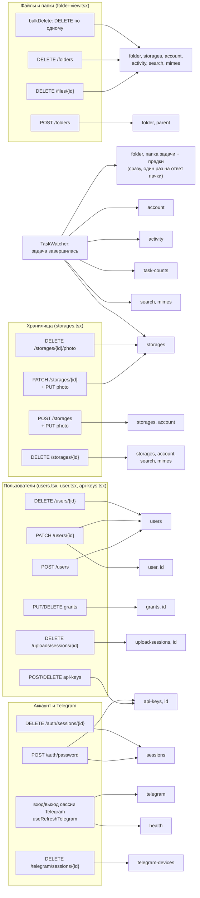
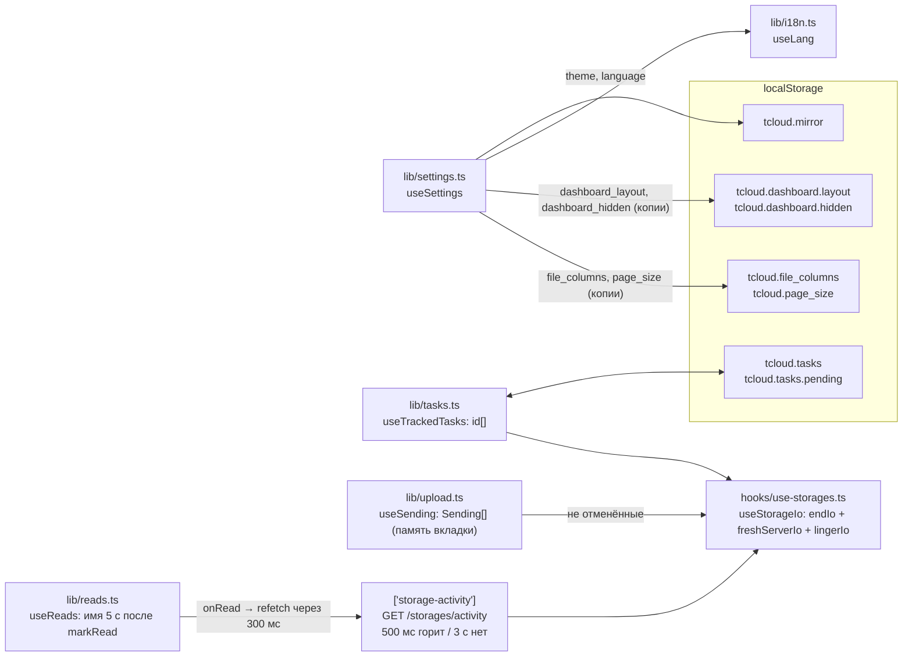
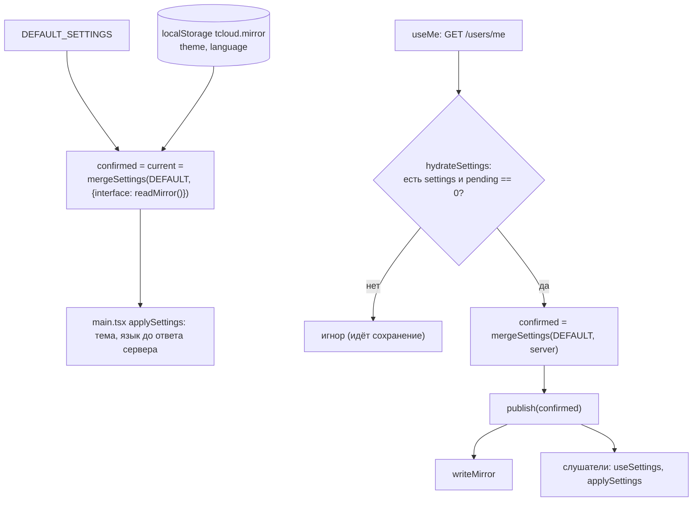
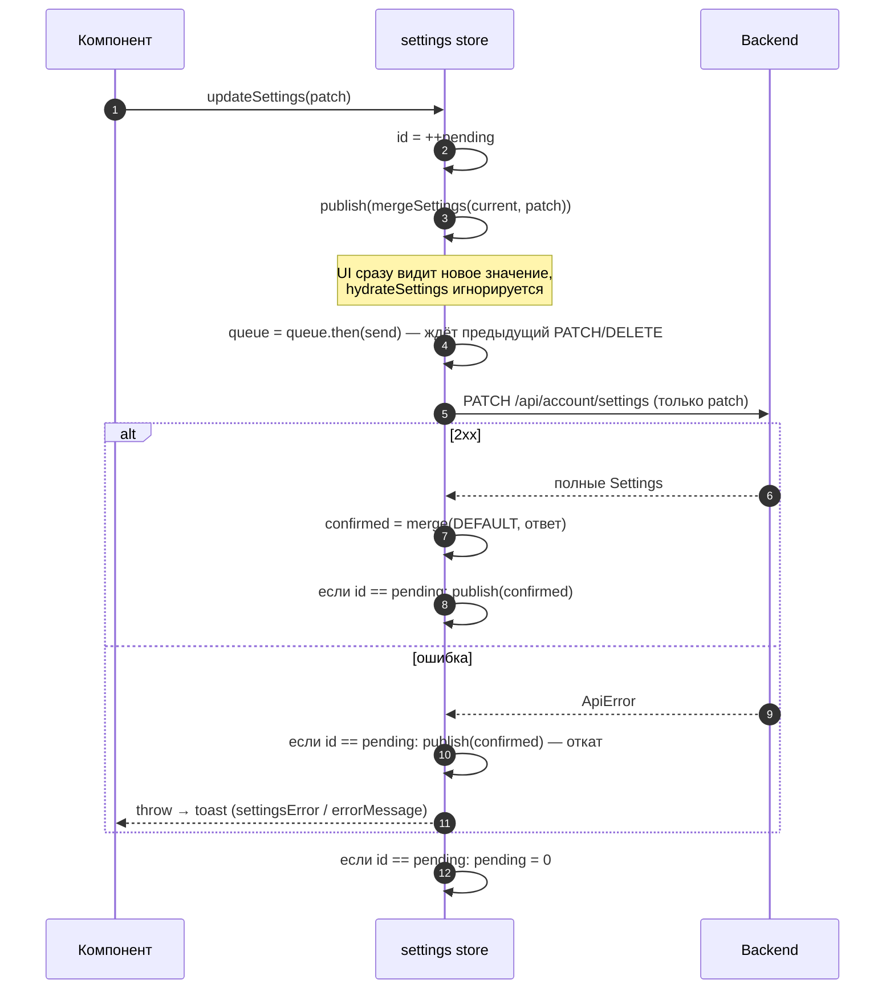
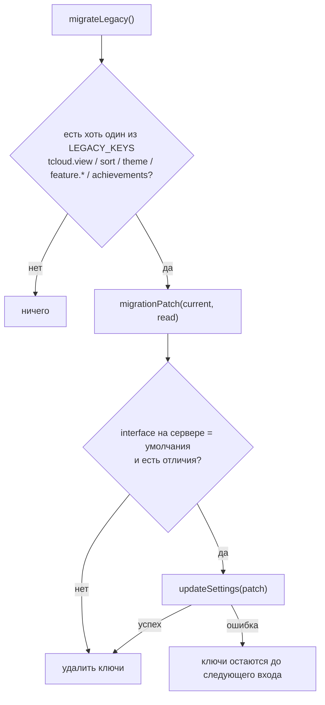

# Данные: запросы, инвалидация, настройки

Серверное состояние живёт в TanStack Query. То, чего нет на сервере или что нужно мгновенно, — в маленьких
модульных сторах на `useSyncExternalStore`.

## Ключи запросов

Все запросы идут через `api.*` (`src/lib/api.ts`). Умолчания `QueryClient` — в [architecture.md](architecture.md#запуск-приложения).

| Ключ | Запрос | Где | Особенности |
|---|---|---|---|
| `['me']` | `GET /users/me` | `hooks/use-me.ts` | `queryFn` вызывает `hydrateSettings(me.settings)` |
| `['storages']` | `GET /storages` | `hooks/use-storages.ts` | `staleTime` 5 с (`STORAGES_STALE_MS`): свои изменения инвалидируют сразу, чужие видны не позже чем через 5 с при следующем монтировании |
| `['folder', path, {sort_by, sort_order, folders_first, lang, limit}]` (`listingKey`) | `GET /folders?path=&sort_by=&sort_order=&folders_first=&lang=&limit=&cursor=` | `components/folder-view.tsx` (`useInfiniteQuery`) | страницы по `limit` = `interface.page_size` (20/50/100/200, по умолчанию 20; `pageSizeOf`, пока сервер не отдаёт поле — копия `tcloud.page_size`), следующая — по `next_cursor`, когда «часовой» под списком входит в `IntersectionObserver` с запасом 600 px (или кнопкой «Показать ещё»); порядок — от бэкенда, клиент не сортирует; итоги (`size`, `total_files`, `total_folders`, `direct_files`) есть только в первой странице, на страницах по курсору — `null`, шапка и «выбрано N из M» берут их через `listingTotals`; смена сортировки/языка/размера страницы = новый ключ = снова с первой страницы (`placeholderData` держит старый список до ответа); инвалидация перезапрашивает загруженные страницы последовательно с первой (курсоры заново), прокрутка не сбрасывается; палитра читает кэш по `listingKey` текущей сортировки; наведение мыши (`pointerType === 'mouse'`, не на тач) или фокус с клавиатуры (`:focus-visible`) на ссылке папки делает `prefetchInfiniteQuery` её первой страницы с теми же `listingKey`/`limit`/сортировкой (`listingOf`, свежесть `PREFETCH_STALE_MS` 10 с — повторное наведение не шлёт запрос); при переходе страница рисуется из кэша и обновляется фоном |
| `['task', id]` | `GET /tasks?ids=…` (пачкой через `taskLoader`) | `hooks/use-tasks.ts` (`useQueries`) | `refetchInterval` 5 с для `queued`, 1 с иначе (`pollInterval`), пока не `done/failed/cancelled`; завершённые — `staleTime: Infinity` |
| `['task-counts']` | `GET /tasks/counts` | `hooks/use-tasks.ts` (`useTaskCounts`), `pages/dashboard.tsx` | `refetchInterval` 5 с; `TaskWatcher` инвалидирует пачкой |
| `['storage-activity']` | `GET /storages/activity` | `hooks/use-storages.ts` (`useStorageIo`) | `refetchInterval` 500 мс, пока горит любая лампа, иначе 3 с (в фоне не опрашивается); `markRead` → `refetch` через 300 мс; сливается с локальными лампами `mergeIo`, после конца локальной операции её вид игнорируется до ответа позже конца + 1 с (`freshServerIo`) |
| `['search', apiQuery]` | `GET /files/search?…` | `hooks/use-search.ts` (`useInfiniteQuery`) | `enabled: hasCriteria`, `retry: false`, страницы по `offset`; `lang` (язык интерфейса) входит в `apiQuery`, порядок по имени — от бэкенда |
| `['search', 'palette', term]` | `GET /files/search?…&limit=8` | `components/command-palette.tsx` | от 2 символов, `retry: false` |
| `['mimes', path]` | `GET /files/search/mimes` | `hooks/use-search.ts` | `retry: false`; без `staleTime`, чтобы фасеты форматов сразу видели новые/удалённые файлы |
| `['activity', path]` | `GET /files/activity` | `hooks/use-activity.ts` | `retry: false`; не монтируется, если блок `activity_map` скрыт (`interface.dashboard_hidden`) |
| `['account']` | `GET /account` | `useAccount` (`hooks/use-storages.ts`) на дашборде, в `components/storages.tsx`, `pages/telegram.tsx` | `staleTime` 60 с (`ACCOUNT_STALE_MS`; задачи, создание и удаление хранилища (`storageChangeKeys`, кольцо каналов сразу) и переключатель превью инвалидируют сразу); всегда `200`; до входа в Telegram `telegram_connected: false` и `null` в остальных полях |
| `['health']` | `GET /health` | `hooks/use-health.ts` (`useHealth`) → `components/health.tsx` (`HealthRack`) на `pages/dashboard.tsx`, `pages/telegram.tsx` | `refetchInterval` 15 с; `details` (задержка проб, возраст пульса воркеров) — метрики стойки |
| `['telegram']` | `GET /telegram` | `pages/dashboard.tsx` (root), `pages/telegram.tsx` | на `/telegram` опрос 2 с, пока шаг `qr`/`starting` |
| `['telegram-devices']` | `GET /telegram/sessions` | `pages/telegram.tsx` | `retry: false` |
| `['users']` | `GET /users` | `pages/users.tsx`, `pages/dashboard.tsx` (admin) | |
| `['user', id]` | `GET /users/{id}` | `pages/user.tsx` | |
| `['grants', userId]` | `GET /users/{id}/grants` | `pages/user.tsx` | |
| `['api-keys', userId]` | `GET /users/{id}/api-keys` | `components/api-keys.tsx` | |
| `['upload-sessions', userId]` | `GET /uploads/sessions?user_id=` | `pages/user.tsx` | карточка «Незаконченные загрузки» (root — любой, admin — роль `user`), крестик — `DELETE /uploads/sessions/{id}` |
| `['sessions']` | `GET /auth/sessions` | `pages/account.tsx` | |

## Мутации и инвалидация

Мутации — `useAction` (`hooks/use-action.ts`): `useMutation`, на успех `invalidateQueries` по каждому ключу из
`invalidate` (префиксное совпадение: `['folder']` задевает все `['folder', path, …]`, `['folder', path]` — все сортировки этой папки), `toast.success`, `onSuccess`; на
ошибку `toast.error(describe ?? errorMessage)`.

Без инвалидации:

- Действия на «Задачах» (`pages/tasks.tsx`: отмена, приоритет, повтор) и отмена в виджете загрузок (`FolderUploads`) кладут ответ прямо в кэш
  `setQueryData(['task', id], task)`; отмена сразу перезапрашивает задачу (`invalidateQueries(['task', id])`), повтор ещё и `trackTask`.
- Загрузка с устройства (после XHR load) и по ссылкам кладут ответ-задачу в кэш (`setQueryData`) перед `trackTask`.
- Архивы (`POST /folders/archive`, `/folders/archive/selection`) только `trackTask`: листинг обновит `TaskWatcher`.
- Вход и выход: `queryClient.clear()` (`pages/login.tsx`, `Layout.logout`, «Выйти везде» и завершение текущей сессии в
  `pages/account.tsx`).
- `search`/`mimes` инвалидируют удаления (`DELETED` в `folder-view.tsx`, удаление хранилища) и `TaskWatcher` при
  завершении задач с папкой (загрузки); иначе они перезапрашиваются при смене ключа (новый запрос) или монтировании.

## Сторы вне TanStack Query

Каждый стор — модульная переменная + `Set` слушателей + `useSyncExternalStore`. Прочие ключи `localStorage`
(`tcloud.sidebar`, `tcloud.onboarding.dismissed`, `tcloud.dashboard.layout` / `tcloud.dashboard.hidden` — копии
`interface.dashboard_layout` / `interface.dashboard_hidden`, `tcloud.file_columns` / `tcloud.page_size` — копии `interface.file_columns` / `interface.page_size`; все читаются, только если сервер не отдал поле) — удобства, через `lib/prefs.ts` или
`try/catch`.

## Настройки

`src/lib/settings.ts`. Источник правды — сервер (`GET/PATCH/DELETE /api/account/settings`, `settings` в
`/users/me`). Стор держит два значения: `confirmed` (последний ответ сервера) и `current` (то, что видит UI).

### Загрузка и слияние

`mergeSettings` сливает по группам (`uploads`, `archives`, `interface`, `telegram`) поверх значений по умолчанию,
поэтому отсутствующие на сервере ключи получают умолчания.

### Оптимистичное сохранение

- Только последнее из одновременных сохранений публикует результат; промежуточные ответы обновляют `confirmed`.
- Запросы уходят строго по одному (`queue` в `commit`): бэкенд сливает патч с сохранённым read-modify-write без
  блокировки, и два параллельных PATCH теряли одно изменение (так «Готово» на дашборде теряло `dashboard_layout`,
  отправленный вместе с `dashboard_hidden`).
- `resetSettings()` — то же с `DEFAULT_SETTINGS` и `DELETE /api/account/settings`.
- Кто пишет: `pages/settings.tsx` (каждое поле сразу, вебхук — кнопкой), `FolderView` (сортировка `sortPatch`, вид
  `folder_view`), `Layout` (тема `setTheme`, язык).

### Перенос старых ключей

`migrateLegacy()` вызывается `Layout` один раз, когда `me.data` готов.

