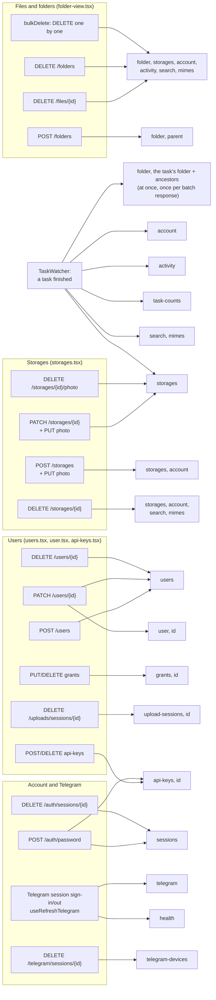
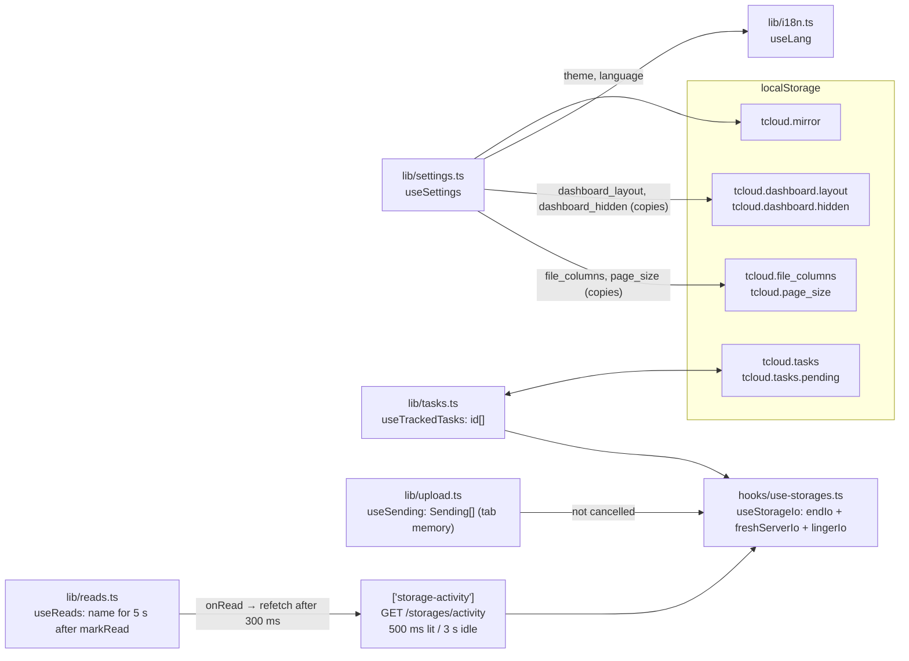
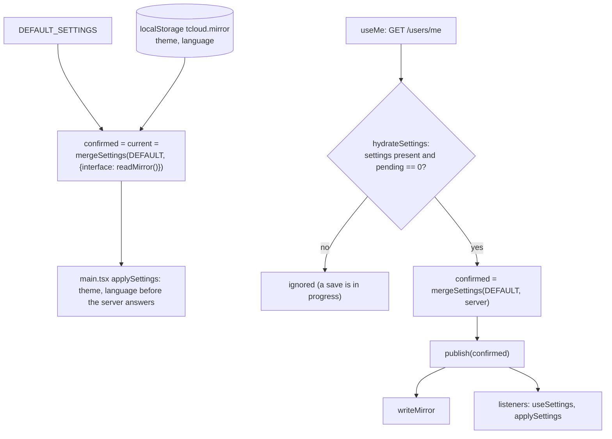
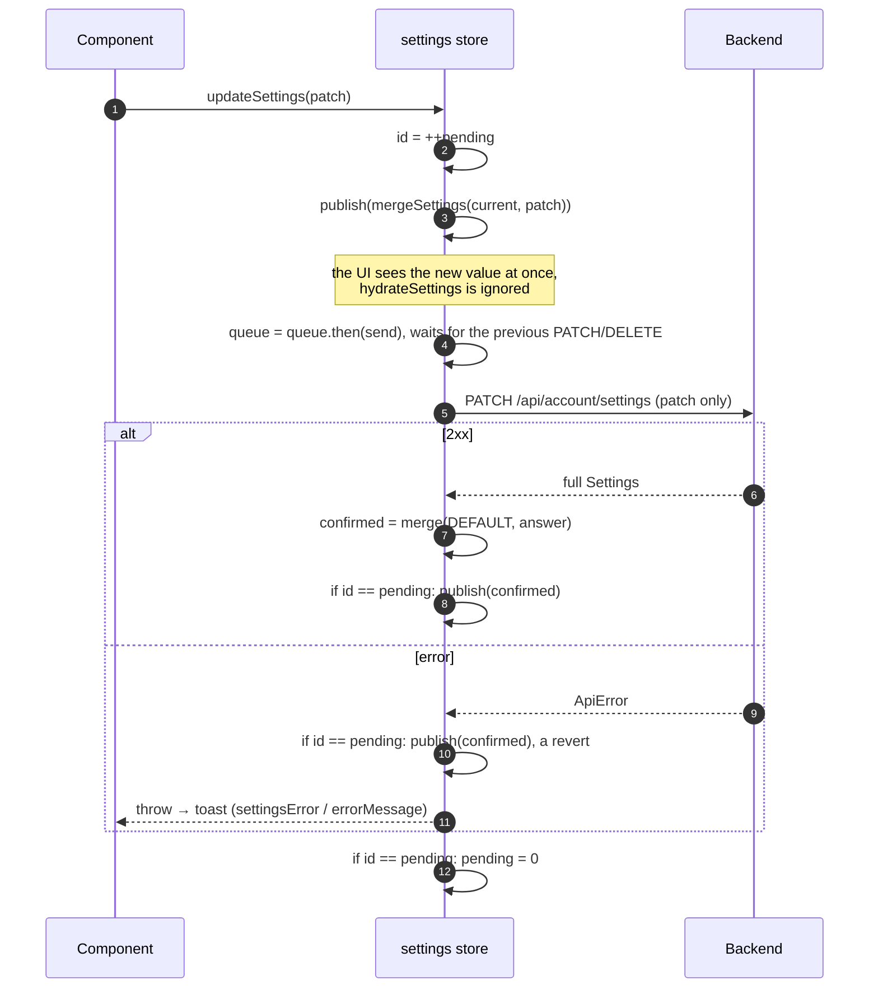
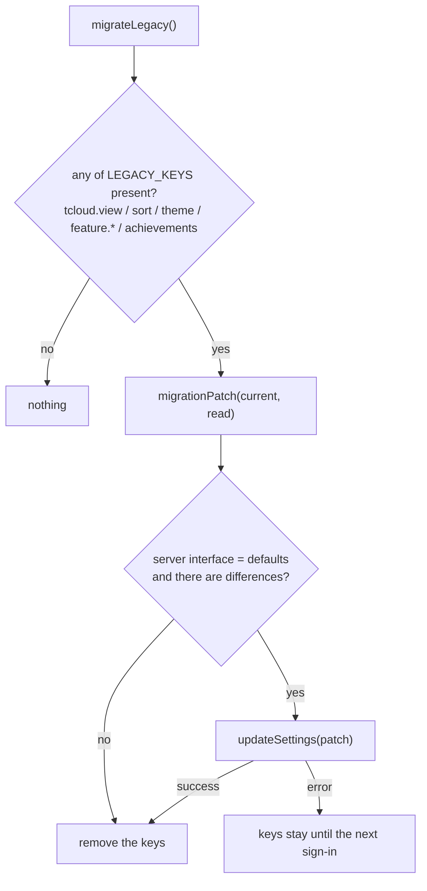

# Data: queries, invalidation, settings

Server state lives in TanStack Query. What the server does not have, or what is needed instantly, lives in small module
stores on `useSyncExternalStore`.

## Query keys

Every request goes through `api.*` (`src/lib/api.ts`). The `QueryClient` defaults are in
[architecture.md](architecture.md#app-startup).

| Key | Request | Where | Notes |
|---|---|---|---|
| `['me']` | `GET /users/me` | `hooks/use-me.ts` | `queryFn` calls `hydrateSettings(me.settings)` |
| `['storages']` | `GET /storages` | `hooks/use-storages.ts` | `staleTime` 5 s (`STORAGES_STALE_MS`): own changes invalidate at once, other people's show up within 5 s on the next mount |
| `['folder', path, {sort_by, sort_order, folders_first, lang, limit}]` (`listingKey`) | `GET /folders?path=&sort_by=&sort_order=&folders_first=&lang=&limit=&cursor=` | `components/folder-view.tsx` (`useInfiniteQuery`) | pages of `limit` = `interface.page_size` (20/50/100/200, default 20; `pageSizeOf`, the `tcloud.page_size` copy while the server omits the field), the next one by `next_cursor` when the sentinel under the list enters the `IntersectionObserver` with a 600 px margin (or via the "Show more" button); the order comes from the backend, the client does not sort; totals (`size`, `total_files`, `total_folders`, `direct_files`) are only in the first page, cursor pages carry `null`, and the header and "N of M selected" read them through `listingTotals`; a new sort/language/page size = a new key = back to the first page (`placeholderData` keeps the old list until the answer); invalidation refetches the loaded pages one by one from the first (fresh cursors) without resetting the scroll; the palette reads the cache by the `listingKey` of the current sort; mouse hover (`pointerType === 'mouse'`, not touch) or keyboard focus (`:focus-visible`) on a folder link runs `prefetchInfiniteQuery` for its first page with the same `listingKey`/`limit`/sort (`listingOf`, freshness `PREFETCH_STALE_MS` 10 s, so hovering again sends no request); on navigation the page renders from the cache and refreshes in the background |
| `['task', id]` | `GET /tasks?ids=…` (batched by `taskLoader`) | `hooks/use-tasks.ts` (`useQueries`) | `refetchInterval` 5 s for `queued`, 1 s otherwise (`pollInterval`), until `done/failed/cancelled`; finished ones get `staleTime: Infinity` |
| `['task-counts']` | `GET /tasks/counts` | `hooks/use-tasks.ts` (`useTaskCounts`), `pages/dashboard.tsx` | `refetchInterval` 5 s; `TaskWatcher` invalidates per batch |
| `['storage-activity']` | `GET /storages/activity` | `hooks/use-storages.ts` (`useStorageIo`) | `refetchInterval` 500 ms while any lamp is lit, otherwise 3 s (not polled in the background); `markRead` → `refetch` after 300 ms; merged with the local lamps by `mergeIo`; after a local operation ends, the server's view of it is ignored until an answer later than the end + 1 s (`freshServerIo`) |
| `['search', apiQuery]` | `GET /files/search?…` | `hooks/use-search.ts` (`useInfiniteQuery`) | `enabled: hasCriteria`, `retry: false`, pages by `offset`; `lang` (the UI language) is part of `apiQuery`, the name order comes from the backend |
| `['search', 'palette', term]` | `GET /files/search?…&limit=8` | `components/command-palette.tsx` | from 2 characters, `retry: false` |
| `['mimes', path]` | `GET /files/search/mimes` | `hooks/use-search.ts` | `retry: false`; no `staleTime`, so the format facets see new/deleted files at once |
| `['activity', path]` | `GET /files/activity` | `hooks/use-activity.ts` | `retry: false`; not mounted if the `activity_map` block is hidden (`interface.dashboard_hidden`) |
| `['account']` | `GET /account` | `useAccount` (`hooks/use-storages.ts`) on the dashboard, in `components/storages.tsx`, `pages/telegram.tsx` | `staleTime` 60 s (`ACCOUNT_STALE_MS`; tasks, storage create and delete (`storageChangeKeys`, so the channels ring updates at once) and the previews switch invalidate at once); always `200`; before Telegram sign-in `telegram_connected: false` and `null` in the other fields |
| `['health']` | `GET /health` | `hooks/use-health.ts` (`useHealth`) → `components/health.tsx` (`HealthRack`) on `pages/dashboard.tsx`, `pages/telegram.tsx` | `refetchInterval` 15 s; `details` (probe latency, worker heartbeat age) are the rack metrics |
| `['telegram']` | `GET /telegram` | `pages/dashboard.tsx` (root), `pages/telegram.tsx` | on `/telegram` polled every 2 s while the step is `qr`/`starting` |
| `['telegram-devices']` | `GET /telegram/sessions` | `pages/telegram.tsx` | `retry: false` |
| `['users']` | `GET /users` | `pages/users.tsx`, `pages/dashboard.tsx` (admin) | |
| `['user', id]` | `GET /users/{id}` | `pages/user.tsx` | |
| `['grants', userId]` | `GET /users/{id}/grants` | `pages/user.tsx` | |
| `['api-keys', userId]` | `GET /users/{id}/api-keys` | `components/api-keys.tsx` | |
| `['upload-sessions', userId]` | `GET /uploads/sessions?user_id=` | `pages/user.tsx` | the "Unfinished uploads" card (root sees anyone, admin the `user` role), the cross sends `DELETE /uploads/sessions/{id}` |
| `['sessions']` | `GET /auth/sessions` | `pages/account.tsx` | |

## Mutations and invalidation

Mutations use `useAction` (`hooks/use-action.ts`): `useMutation`; on success `invalidateQueries` for every key in
`invalidate` (prefix match: `['folder']` hits every `['folder', path, …]`, `['folder', path]` every sort of that
folder), `toast.success`, `onSuccess`; on error `toast.error(describe ?? errorMessage)`.

Without invalidation:

- Actions on Tasks (`pages/tasks.tsx`: cancel, priority, retry) and cancel in the upload widget (`FolderUploads`) put the
  answer straight into the cache with `setQueryData(['task', id], task)`; cancel also refetches the task at once
  (`invalidateQueries(['task', id])`), retry also calls `trackTask`.
- Uploads from the device (after the XHR load) and by URL put the task answer into the cache (`setQueryData`) before
  `trackTask`.
- Archives (`POST /folders/archive`, `/folders/archive/selection`) only call `trackTask`: `TaskWatcher` refreshes the
  listing.
- Sign-in and sign-out: `queryClient.clear()` (`pages/login.tsx`, `Layout.logout`, "Sign out everywhere" and ending the
  current session in `pages/account.tsx`).
- `search`/`mimes` are invalidated by deletes (`DELETED` in `folder-view.tsx`, storage delete) and by `TaskWatcher` when
  tasks with a folder (uploads) finish; otherwise they refetch when the key changes (a new query) or on mount.

## Stores outside TanStack Query

Each store is a module variable + a `Set` of listeners + `useSyncExternalStore`. The other `localStorage` keys
(`tcloud.sidebar`, `tcloud.onboarding.dismissed`, `tcloud.dashboard.layout` / `tcloud.dashboard.hidden` as copies of
`interface.dashboard_layout` / `interface.dashboard_hidden`, `tcloud.file_columns` / `tcloud.page_size` as copies of
`interface.file_columns` / `interface.page_size`; all read only when the server omitted the field) are conveniences,
accessed through `lib/prefs.ts` or `try/catch`.

## Settings

`src/lib/settings.ts`. The source of truth is the server (`GET/PATCH/DELETE /api/account/settings`, `settings` in
`/users/me`). The store holds two values: `confirmed` (the last server answer) and `current` (what the UI shows).

### Loading and merging

`mergeSettings` merges per group (`uploads`, `archives`, `interface`, `telegram`) over the defaults, so keys missing on
the server get their defaults.

### Optimistic saving

- Only the last of concurrent saves publishes its result; intermediate answers update `confirmed`.
- Requests go strictly one at a time (`queue` in `commit`): the backend merges the patch with the stored value as a
  read-modify-write without a lock, and two parallel PATCHes lost one change (that is how "Done" on the dashboard lost
  `dashboard_layout` sent together with `dashboard_hidden`).
- `resetSettings()` does the same with `DEFAULT_SETTINGS` and `DELETE /api/account/settings`.
- Who writes: `pages/settings.tsx` (each field at once, the webhook via a button), `FolderView` (sort `sortPatch`, view
  `folder_view`), `Layout` (theme `setTheme`, language).

### Migrating old keys

`Layout` calls `migrateLegacy()` once, when `me.data` is ready.

