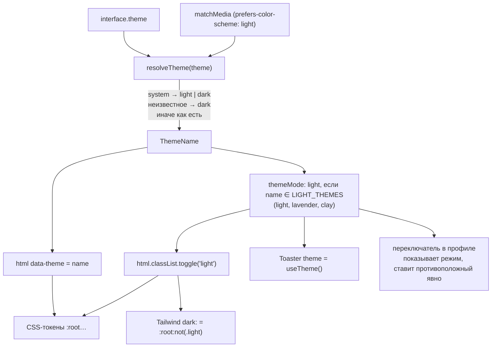
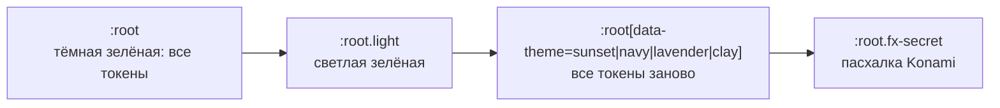

# Темы

Значение темы — `interface.theme` настроек аккаунта: `dark`, `light`, `system` или пресет `sunset`, `navy`,
`lavender`, `clay` (`THEMES` и тип `Theme` в `src/lib/settings.ts`). Логика — `src/lib/theme.ts`, токены — `src/index.css`.

| id | режим | палитра |
|---|---|---|
| `dark` (умолчание) | тёмный | зелёная #051F20 → #DAF1DE |
| `light` | светлый | та же зелёная, мятный фон |
| `system` | `dark` или `light` по `prefers-color-scheme` | — |
| `sunset` | тёмный | #1D1A39 → #F39F5A |
| `navy` | тёмный | #0D1B2A → #D4C4A8 |
| `lavender` | светлый | #F7EEF2 → #4A355E |
| `clay` | светлый | #FFF4E6 → #A2533D |

## Как тема попадает в DOM

- `applyTheme` (`lib/theme.ts`) вызывает `main.tsx` до рендера и при каждом изменении стора настроек. При первом
  вызове он один раз подписывается на `matchMedia(...).change`, поэтому `system` меняется вместе с ОС без перезагрузки.
- `useTheme()` возвращает режим (`dark`/`light`) и тоже подписан на `matchMedia`.
- До ответа `/users/me` тема берётся из `localStorage` `tcloud.mirror`, чтобы не мигала (см.
  [data-flow.md](data-flow.md#настройки)). `<meta name="theme-color">` в `index.html` статичен.
- Переключатель в профиле (`ThemeSwitch`, `components/layout.tsx`) с пресета переводит в `light`/`dark`; выбор всех
  тем с превью (`THEME_SWATCHES`) — на `/settings` (`THEME_LABELS`, `pages/settings.tsx`).

## Каскад CSS

`:root.light` и `:root[data-theme=…]` имеют одинаковую специфичность, поэтому выигрывает порядок в файле: блоки
пресетов идут после `:root.light` и переопределяют его даже у светлых пресетов (которые тоже получают `.light`).
`data-theme="dark"`/`"light"` отдельных правил не имеют.

## Токены

- Цвета shadcn: `--background`, `--foreground`, `--card(-foreground)`, `--popover(-foreground)`,
  `--primary(-foreground)`, `--secondary(-foreground)`, `--muted(-foreground)`, `--accent(-foreground)`,
  `--destructive`, `--border`, `--input`, `--ring`, `--chart-1…5`, `--sidebar*`. В `@theme inline` они проброшены в
  утилиты Tailwind (`--color-*`).
- Свои: `--success`, `--warning` (запись/занято), `--read` (чтение), `--dots` (точечные разделители), `--track` и
  `--dither` (дорожки колец, дизеринг), `--ring-from`/`--ring-to` (градиент колец), `--glow` (свечение фона),
  `--backdrop` (градиент фона страницы), `color-scheme`.
- Шрифты и кегли (`--font-heading`, `--font-pixel` = Tiny5, `--font-sans` = Handjet, `--text-xs…lg`) — в `@theme inline`,
  от темы не зависят.

## Анимации

Класс `still` на `<html>` ставит `main.tsx`, когда `interface.animations = false`; правила `:root.still …` в
`index.css` повторяют правила `@media (prefers-reduced-motion: reduce)`. В JS — `prefersReducedMotion()` (`src/lib/fx.ts`).

## Как добавить тему

1. `src/lib/settings.ts`: id в `THEMES`.
2. `src/lib/theme.ts`: id в `LIGHT_THEMES`, если тема светлая; цвета превью в `THEME_SWATCHES`.
3. `src/index.css`: блок `:root[data-theme=<id>]` после `:root.light` со всеми токенами из списка выше, включая
   `--backdrop`, `--ring-from`/`--ring-to`, `--glow` и `color-scheme`; пары текст/фон — не ниже WCAG AA (4.5:1).
4. `src/pages/settings.tsx`: подпись в `THEME_LABELS`; ключ `settings.theme<Name>` в `src/lib/locales/ru.ts` и `en.ts`.
5. Тест в `src/lib/theme.test.ts` (`resolveTheme`/`themeMode`).
6. Бэкенд должен принимать id в `interface.theme` (`src/application/schemas/settings.py` там), иначе `PATCH`
   отвечает ошибкой и фронт откатывает выбор.
