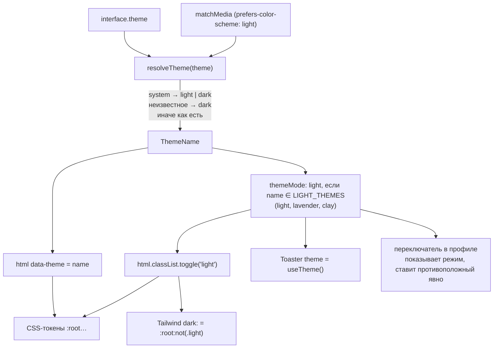
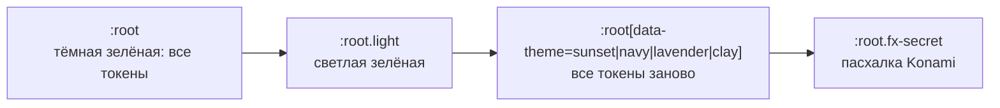

# Темы

Значение темы — `interface.theme` настроек аккаунта: `dark`, `light`, `system` или пресет `sunset`, `navy`,
`lavender`, `clay` (`THEMES` и тип `Theme` в `src/lib/settings.ts`). Логика — `src/lib/theme.ts`, токены — `src/index.css`.

| id | режим | палитра |
|---|---|---|
| `dark` (умолчание) | тёмный | зелёная #051F20 → #DAF1DE |
| `light` | светлый | та же зелёная, мятный фон |
| `system` | `dark` или `light` по `prefers-color-scheme` | — |
| `sunset` | тёмный | #1D1A39 → #F39F5A |
| `navy` | тёмный | #0D1B2A → #D4C4A8 |
| `lavender` | светлый | #F7EEF2 → #4A355E |
| `clay` | светлый | #FFF4E6 → #A2533D |

## Как тема попадает в DOM

- `applyTheme` (`lib/theme.ts`) вызывает `main.tsx` до рендера и при каждом изменении стора настроек. При первом
  вызове он один раз подписывается на `matchMedia(...).change`, поэтому `system` меняется вместе с ОС без перезагрузки.
- `useTheme()` возвращает режим (`dark`/`light`) и тоже подписан на `matchMedia`.
- До ответа `/users/me` тема берётся из `localStorage` `tcloud.mirror`, чтобы не мигала (см.
  [data-flow.md](data-flow.md#настройки)). `applyTheme` ставит `<meta name="theme-color">` в фон
  темы — первый цвет `THEME_SWATCHES` (равен `--background` пресета).
- Переключатель в профиле (`ThemeSwitch`, `components/layout.tsx`) с пресета переводит в `light`/`dark`; выбор всех
  тем с превью (`THEME_SWATCHES`) — на `/settings` (`THEME_LABELS`, `pages/settings.tsx`).

## Каскад CSS

`:root.light` и `:root[data-theme=…]` имеют одинаковую специфичность, поэтому выигрывает порядок в файле: блоки
пресетов идут после `:root.light` и переопределяют его даже у светлых пресетов (которые тоже получают `.light`).
`data-theme="dark"`/`"light"` отдельных правил не имеют.

## Токены

- Цвета shadcn: `--background`, `--foreground`, `--card(-foreground)`, `--popover(-foreground)`,
  `--primary(-foreground)`, `--secondary(-foreground)`, `--muted(-foreground)`, `--accent(-foreground)`,
  `--destructive`, `--border`, `--input`, `--ring`, `--chart-1…5`, `--sidebar*`. В `@theme inline` они проброшены в
  утилиты Tailwind (`--color-*`).
- Свои: `--success`, `--warning` (запись/занято), `--read` (чтение), `--dots` (точечные разделители), `--track` и
  `--dither` (дорожки колец, дизеринг), `--ring-from`/`--ring-to` (градиент колец), `--glow` (свечение фона),
  `--backdrop` (градиент фона страницы), `color-scheme`.
- Шрифт и кегли (`--font-sans` и `--font-mono` = Departure Mono, `--text-xs…lg`) — в `@theme inline`, от темы не
  зависят (см. «Типографика»).

## Типографика

- **Один шрифт на всё — Departure Mono.** Без исключений: текст, таблицы, кнопки, поля и плейсхолдеры, подписи,
  заголовки страниц, логотип «tcloud», крупные цифры, центры колец, табло `fx-flap`, тосты sonner, диалоги, меню и
  селекты (порталы Radix наследуют от `html`), подсказки, палитра Ctrl+K, `code`/`kbd`, QR-страница, 404. Других
  шрифтов в проекте нет; в стеке только общий запасной `monospace`. Новых `font-family` не добавлять.
- Шрифт свой: `public/fonts/DepartureMono-Regular.woff2` (v1.500, лицензия OFL — `DepartureMono-LICENSE.txt` рядом),
  `@font-face` с `font-display: swap` в начале `src/index.css`, `<link rel="preload" as="font" crossorigin>` в
  `index.html`. Внешних запросов за шрифтами нет. `--font-sans` ставится на `html`; sonner задаёт свой шрифт и кегль
  вне слоёв, поэтому `[data-sonner-toaster]`/`[data-sonner-toast][data-styled=true]` переопределены отдельно.
- **Только Regular.** На `html` стоит `font-synthesis: none` (браузер не рисует поддельный жирный/курсив), классов
  `font-medium/semibold/bold` нет. Акцент — кеглем, прописными с трекингом (`fx-label`, заголовки карточек и диалогов,
  кнопки) или цветом токенов (`text-foreground` против `text-muted-foreground`, `text-primary`, `text-warning`).
- **Кегли по пиксельной сетке 11 px/em** (кегль кратен 11 — пиксель шрифта ложится на целые пиксели экрана):
  - 11 px (`text-xs`) — вторичное: даты, размеры, подписи `fx-label`/`fx-vlabel`/шапки таблиц, кнопки и бейджи
    прописными, плашки `fx-io`, малые кольца;
  - 16.5 px (`text-sm`/`text-base`) — основной текст: имена файлов, формы, сайдбар, палитра, диалоги, тосты,
    заголовки карточек/диалогов (прописные), хлебные крошки;
  - 22 px (`text-lg`, `fx-pixel`) — логотип, центры колец, табло, «пусто»; 33 — цифры `Stat`, большое кольцо,
    заголовки страниц на узких экранах; 44 — заголовки страниц от `md`; 66/88 — только герой: «tcloud» на входе,
    «Дашборд» от `md`, 404.
  - Ничего мельче 11 px и никаких промежуточных кеглей (`text-[13px]`, `0.8rem` и т. п.).
- **Поля форм.** Подпись поля (`Label`) — 11 px прописными с трекингом, приглушённым цветом; значение — 16.5 px.
  Пояснение — 11 px приглушённым строкой под полем, а не в тексте подписи или пункта списка: пункты селектов
  короткие («файл», «медиа», «оставить оба»). Селект занимает всю ячейку, значение обрезается многоточием, у шеврона
  своё место (`[data-slot=select-value]` в `index.css`). В диалогах — два селекта в ряд, на узком экране один.
  Чекбокс — короткая подпись 16.5 px и пояснение 11 px под ней; недоступный вариант показан выключенным, а не скрыт.
- **Почему 16.5 для текста.** Сравнивали основной текст 11 / 13.75 / 16.5 px на списке папки и дашборде
  (сглаживание включено). 11 px чёткий, но мелкий — читать списки тяжело (владельцу мелкие пиксельные шрифты были
  мучительны). 13.75 px (×1.25) ни на одном экране не ложится на сетку — штрихи неровные. 16.5 px (×1.5) на
  Retina (2×) даёт ровно 3 физических пикселя на пиксель шрифта — чёткий и самый читаемый; к тому же поля ввода
  ≥ 16 px, и iOS не зумит их при фокусе. Цена — шире строки: длинные имена раньше обрезаются (полное имя в `title`),
  а моноширинные цифры шире, поэтому `Stat` — 33 px, центр кольца переносится по словам (`padding` у `fx-ring-center`), а число в центре от 10 000 сокращается (`formatCount`: «12 тыс.», «1.2M»).
- Сглаживание браузера везде (`antialiased` на `body`); на кеглях, кратных 11, оно и так не размывает.
- Отклонено: Tiny5 (дисплей) + IBM Plex Mono (текст) — смесь двух шрифтов, Plex не пиксельный; Handjet — узкий и
  рваный; Pixelify Sans — нет кириллических `О` и `П`; JetBrains Mono и Manrope — не тот стиль; вообще любое
  смешение шрифтов.

## Раскладка

- Проверено в Chrome и Safari (WebKit); Firefox не проверялся.
- Любой `.grid` без своих колонок получает одну колонку `minmax(0, 1fr)` (`@layer base` в `index.css`; `grid-cols-*`
  перекрывают): иначе неявная колонка `auto` растягивается под длинное имя без пробелов, и страница уезжает вбок.
- `body` — 16.5 px (`text-base`), поэтому текст без своего класса тоже попадает в шкалу кеглей.
- Мобильная шапка `sticky!`: у `.fx-panel` есть `position: relative` вне слоёв, он перебивает утилиту `sticky`.
  Панель выделения в папке прилипает сразу под шапкой.
- Иконки lucide — `shape-rendering: crispEdges` (пиксельные штрихи в Chrome). WebKit/Safari с ним утолщает штрихи до
  залитых фигур, поэтому там `auto` через `@supports (font: -apple-system-body)` — условие верно только в WebKit
  (проверено Playwright: Chrome и WebKit).
- Нативные части полей скрыты одинаково для Chrome и Safari: крестик `type=search` (свой есть), стрелки `type=number`,
  маркер `
` (свой `▸`/`▾`); пустое поле даты — приглушённым цветом (Safari показывает в нём сегодняшнюю дату).
- Тосты sonner (`richColors`) берут цвета из токенов (`--success`, `--destructive`, `--warning`, `--read` на `--popover`).

## Логотип

Пиксельный знак 24×24 (облако с вырезанным бумажным самолётиком над накопителем с лампами чтения/записи) —
компонент `Logo` в `src/components/fx.tsx`: два `` из `public/`, `logo-dark.svg` на тёмных темах (dark, sunset,
navy), `logo-light.svg` на светлых (light, lavender, clay) — переключает вариант `dark:` (нет класса `.light`). Только
целые масштабы 24 (сайдбар, мобильная шапка, свёрнутый сайдбар без надписи) и 48 px (вход), `image-rendering: pixelated`.
Фавиконки в `public/`: `favicon.svg` (вариант с тёмным фоном — прозрачный не виден на светлой вкладке),
`favicon-48.png`, `favicon-96.png`, `apple-touch-icon.png` (192 px); манифеста нет. Ссылки на них в `index.html`
несут версию `?v=2`: браузеры (особенно Chrome) долго кешируют фавиконку, поэтому при смене иконки поднимайте `?v=`. Исходники — у владельца, вне репо.

QR входа в Telegram (`pages/telegram.tsx`, `QR_LOGO`) несёт знак в центре: `favicon.svg` (с тёмным фоном, чтобы
читался на модулях) 48 px на QR 216 px (22 %), `excavate` вырезает модули под ним, коррекция `level="H"` (30 %)
восстанавливает закрытое. Цвета QR всегда чёрный на белом (`fgColor`/`bgColor`, белая рамка `p-4` — тихая зона) во
всех темах: сканерам нужен контраст. Знак — `image-rendering: pixelated`. Проверено декодированием (resvg + jsQR,
вне репо) для URL `tg://login?token=…` длиной 60–97 символов.

## Анимации

Класс `still` на `<html>` ставит `main.tsx`, когда `interface.animations = false`; правила `:root.still …` в
`index.css` повторяют правила `@media (prefers-reduced-motion: reduce)`. В JS — `prefersReducedMotion()` (`src/lib/fx.ts`).

## Выделение плиток

Плитка папки/файла (`fx-tile` в `folder-view.tsx`) с `data-selected` получает рамку `--primary` внутри панели
(`::after`, `inset: 3px`, без сдвига вёрстки) с пиксельными уголками-скобками и ступенчатым `clip-path`, а миниатюра —
рамку и полупрозрачный тинт `--primary` 16% (картинка остаётся видна). Флажок лежит в углу миниатюры на своей
подложке `--card` (`fx-tile-check`), при фокусе с клавиатуры — пунктир `--foreground`. На устройствах с hover флажок
невыбранной плитки виден только при наведении/фокусе или когда что-то уже выбрано (`data-selecting` на `<ul>`);
на тач-экранах виден всегда. Появление — только `opacity`, под `prefers-reduced-motion` и `still` мгновенно.

## Как добавить тему

1. `src/lib/settings.ts`: id в `THEMES`.
2. `src/lib/theme.ts`: id в `LIGHT_THEMES`, если тема светлая; цвета превью в `THEME_SWATCHES`, первый — `--background` темы.
3. `src/index.css`: блок `:root[data-theme=<id>]` после `:root.light` со всеми токенами из списка выше, включая
   `--backdrop`, `--ring-from`/`--ring-to`, `--glow` и `color-scheme`; пары текст/фон — не ниже WCAG AA (4.5:1).
4. `src/pages/settings.tsx`: подпись в `THEME_LABELS`; ключ `settings.theme<Name>` в `src/lib/locales/ru.ts` и `en.ts`.
5. Тест в `src/lib/theme.test.ts` (`resolveTheme`/`themeMode`).
6. Бэкенд должен принимать id в `interface.theme` (`src/application/schemas/settings.py` там), иначе `PATCH`
   отвечает ошибкой и фронт откатывает выбор.
