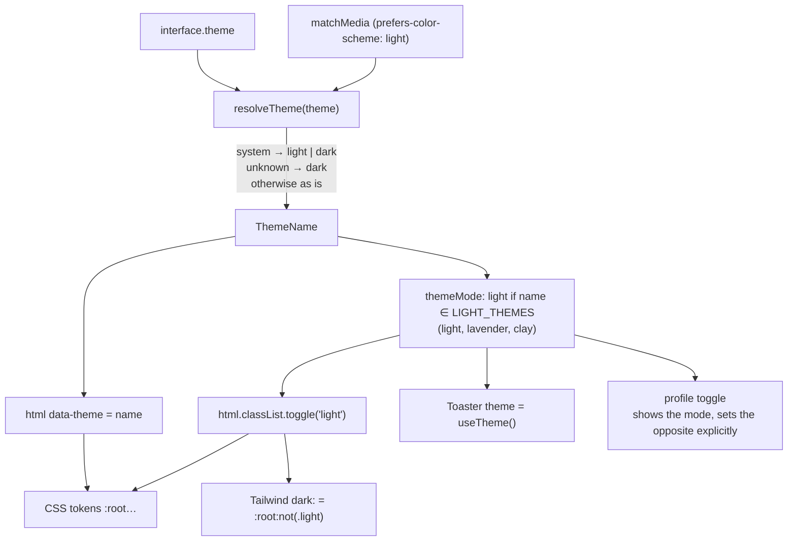
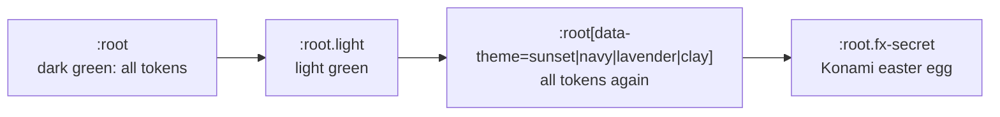

# Themes

The theme value is `interface.theme` in the account settings: `dark`, `light`, `system` or a preset `sunset`, `navy`,
`lavender`, `clay` (`THEMES` and the `Theme` type in `src/lib/settings.ts`). Logic in `src/lib/theme.ts`, tokens in
`src/index.css`.

| id | mode | palette |
|---|---|---|
| `dark` (default) | dark | green #051F20 → #DAF1DE |
| `light` | light | the same green, mint background |
| `system` | `dark` or `light` by `prefers-color-scheme` | — |
| `sunset` | dark | #1D1A39 → #F39F5A |
| `navy` | dark | #0D1B2A → #D4C4A8 |
| `lavender` | light | #F7EEF2 → #4A355E |
| `clay` | light | #FFF4E6 → #A2533D |

## Style

- Lo-fi pixel in the spirit of EX8. Square and "stepped" corners via `clip-path` (`fx-panel`, cards, buttons, fields),
  2 px borders, `fx-dotted` dotted dividers, vertical section labels (`Section`), rows of numbers (`Stat`), outline
  buttons with a ↗ arrow on links and one solid button for the main action. Focus is a dashed outline.
- Rings (`Ring`) have 24 segments with a dithered track and a `--ring-from → --ring-to` gradient; a new value tweens
  from the current one (`useTween`), not from zero.
- Colour only for signals: green "ok", amber "busy/write", cold white/teal "read", red "error/delete". A destructive
  action is a red outline button + a confirmation.
- The background is a soft glow at the top left with ordered dithering (`--glow`; presets have their own `--backdrop`
  gradient) and wireframe cubes (`WireCubes`). No glitch, scanline or CRT effects.

## How the theme reaches the DOM

- `applyTheme` (`lib/theme.ts`) is called by `main.tsx` before rendering and on every change of the settings store. On
  the first call it subscribes once to `matchMedia(...).change`, so `system` follows the OS without a reload.
- `useTheme()` returns the mode (`dark`/`light`) and is also subscribed to `matchMedia`.
- Before the `/users/me` answer, the theme comes from `localStorage` `tcloud.mirror` so it does not flicker (see
  [data-flow.md](data-flow.md#settings)). `applyTheme` sets `<meta name="theme-color">` to the theme background, the
  first colour of `THEME_SWATCHES` (equal to the preset's `--background`).
- The profile toggle (`ThemeSwitch`, `components/layout.tsx`) switches from a preset to `light`/`dark`; picking any
  theme with a preview (`THEME_SWATCHES`) is on `/settings` (`THEME_LABELS`, `pages/settings.tsx`).

## CSS cascade

`:root.light` and `:root[data-theme=…]` have the same specificity, so the order in the file wins: the preset blocks
come after `:root.light` and override it, even for light presets (which also get `.light`). `data-theme="dark"`/`"light"`
have no rules of their own.

## Tokens

- shadcn colours: `--background`, `--foreground`, `--card(-foreground)`, `--popover(-foreground)`,
  `--primary(-foreground)`, `--secondary(-foreground)`, `--muted(-foreground)`, `--accent(-foreground)`,
  `--destructive`, `--border`, `--input`, `--ring`, `--chart-1…5`, `--sidebar*`. In `@theme inline` they are exposed
  as Tailwind utilities (`--color-*`).
- Our own: `--success`, `--warning` (write/busy), `--read` (read), `--dots` (dotted dividers), `--track` and
  `--dither` (ring tracks, dithering), `--ring-from`/`--ring-to` (ring gradient), `--glow` (background glow),
  `--backdrop` (page background gradient), `color-scheme`.
- The font and sizes (`--font-sans` and `--font-mono` = Departure Mono, `--text-xs…lg`) are in `@theme inline` and do
  not depend on the theme (see "Typography").

## Typography

- **One font for everything: Departure Mono.** No exceptions: text, tables, buttons, fields and placeholders, labels,
  page titles, the "tcloud" logo, large numbers, ring centers, sonner toasts, dialogs, menus and selects (Radix portals
  inherit from `html`), tooltips, the Ctrl+K palette, `code`/`kbd`, the QR page, 404. The project has no other fonts;
  the stack has only the generic `monospace` fallback. Do not add new `font-family` rules.
- The font is self-hosted: `public/fonts/DepartureMono-Regular.woff2` (v1.500, OFL license in
  `DepartureMono-LICENSE.txt` next to it), `@font-face` with `font-display: swap` at the top of `src/index.css`,
  `<link rel="preload" as="font" crossorigin>` in `index.html`, both at the `?v=1` URL: nginx serves `/fonts/` with
  `max-age=31536000, immutable`, so when the file changes `v` is bumped in both places at once (otherwise the preload
  does not match the `@font-face`). There are no external font requests. `--font-sans` is set on `html`; sonner sets its
  own font and size outside layers, so `[data-sonner-toaster]`/`[data-sonner-toast][data-styled=true]` are overridden
  separately.
- **Regular only.** `html` has `font-synthesis: none` (the browser does not draw fake bold/italic), and there are no
  `font-medium/semibold/bold` classes. Emphasis comes from size, uppercase with tracking (`fx-label`, card and dialog
  titles, buttons) or token colours (`text-foreground` versus `text-muted-foreground`, `text-primary`,
  `text-warning`).
- **Sizes on the 11 px/em pixel grid** (a size that is a multiple of 11 puts each font pixel on whole screen pixels):
  - 11 px (`text-xs`): secondary text such as dates, sizes, `fx-label`/`fx-vlabel` labels/table headers, uppercase
    buttons and badges, `fx-io` tags, small rings;
  - 16.5 px (`text-sm`/`text-base`): body text such as file names, forms, the sidebar, the palette, dialogs, toasts,
    card/dialog titles (uppercase), breadcrumbs;
  - 22 px (`text-lg`, `fx-pixel`): the logo, ring centers, "empty"; 33: `Stat` numbers, the large ring, page titles on
    narrow screens; 44: page titles from `md`; 66/88: hero only, "tcloud" on sign-in, "Dashboard" from `md`, 404.
  - Nothing smaller than 11 px and no in-between sizes (`text-[13px]`, `0.8rem` and so on).
- **Form fields.** A field label (`Label`) is 11 px uppercase with tracking in a muted colour; the value is 16.5 px. A
  hint is an 11 px muted line under the field, not part of the label or a list item: select items are short ("file",
  "media", "keep both"). A select fills its whole cell, the value is cut with an ellipsis, and the chevron has its own
  space (`[data-slot=select-value]` in `index.css`). Dialogs have two selects per row, one on a narrow screen. A
  checkbox has a short 16.5 px label and an 11 px hint under it; an unavailable option is shown disabled, not hidden.
- **Why 16.5 for text.** We compared body text at 11 / 13.75 / 16.5 px on the folder list and the dashboard (with
  smoothing on). 11 px is crisp but small, and lists are hard to read (the owner found small pixel fonts painful).
  13.75 px (×1.25) does not land on the grid on any screen, so strokes are uneven. 16.5 px (×1.5) gives exactly 3
  physical pixels per font pixel on Retina (2×), which is crisp and the most readable; also, inputs ≥ 16 px are not
  zoomed by iOS on focus. The price is wider lines: long names are cut earlier (full name in `title`), and monospace
  digits are wider, so `Stat` is 33 px, the ring center wraps by words (`padding` on `fx-ring-center`), and the number
  in the center is compacted from 10,000 (`formatCount`, `Intl.NumberFormat` compact notation, e.g. "12K", "1.2M").
- Browser smoothing everywhere (`antialiased` on `body`); at sizes that are multiples of 11 it does not blur anyway.
- Rejected: Tiny5 (display) + IBM Plex Mono (text), a mix of two fonts, and Plex is not pixel; Handjet, narrow and
  ragged; Pixelify Sans, no Cyrillic `О` and `П`; JetBrains Mono and Manrope, the wrong style; and any font mixing at
  all.

## Layout

- Tested in Chrome and Safari (WebKit); Firefox has not been tested.
- Any `.grid` without its own columns gets one `minmax(0, 1fr)` column (`@layer base` in `index.css`; `grid-cols-*`
  override it): otherwise the implicit `auto` column stretches to fit a long name without spaces and the page shifts
  sideways.
- `body` is 16.5 px (`text-base`), so text without its own class also lands on the size scale.
- The mobile header is `sticky!`: `.fx-panel` has `position: relative` outside layers, which beats the `sticky`
  utility. The selection toolbar in a folder sticks right under the header.
- lucide icons use `shape-rendering: crispEdges` (pixel strokes in Chrome). WebKit/Safari thickens the strokes into
  filled shapes with it, so there it is `auto` via `@supports (font: -apple-system-body)`, a condition true only in
  WebKit (checked with Playwright: Chrome and WebKit).
- Native field parts are hidden the same way in Chrome and Safari: the `type=search` cross (we have our own), the
  `type=number` arrows, the `
` marker (our own `▸`/`▾`); an empty date field uses a muted colour (Safari shows
  today's date in it).
- The sidebar navigation list scroll (`fx-scroll`): a thin 6 px bar without arrows, a `--border` thumb,
  `--muted-foreground` on hover, a transparent track, via `::-webkit-scrollbar` (the same in Chrome and Safari); where it
  is missing, `scrollbar-width: thin` and `scrollbar-color`.
- sonner toasts (`richColors`) take their colours from tokens (`--success`, `--destructive`, `--warning`, `--read` on
  `--popover`).

## Logo

A 24×24 pixel mark (a cloud with a cut-out paper plane over a storage unit with read/write lamps) is the `Logo`
component in `src/components/fx.tsx`: two `` from `public/`, `logo-dark.svg` on dark themes (dark, sunset, navy),
`logo-light.svg` on light ones (light, lavender, clay), switched by the `dark:` variant (no `.light` class). Only whole
scales of 24 (sidebar, mobile header, collapsed sidebar without the wordmark) and 48 px (sign-in),
`image-rendering: pixelated`. Favicons in `public/`: `favicon.svg` (the variant with a dark background, since a
transparent one is invisible on a light tab), `favicon-48.png`, `favicon-96.png`, `apple-touch-icon.png` (192 px); no
manifest. Their links in `index.html` carry the `?v=2` version: browsers (Chrome especially) cache favicons for a long
time, so bump `?v=` when the icon changes. The sources are with the owner, outside the repo.

The Telegram sign-in QR (`pages/telegram.tsx`, `QR_LOGO`) carries the mark in the center: `favicon.svg` (with a dark
background so it reads over the modules) 48 px on a 216 px QR (22 %); `excavate` cuts out the modules under it, and
error correction `level="H"` (30 %) restores what is covered. QR colours are always black on white
(`fgColor`/`bgColor`, a white `p-4` frame as the quiet zone) in every theme: scanners need contrast. The mark uses
`image-rendering: pixelated`. Verified by decoding (resvg + jsQR, outside the repo) for `tg://login?token=…` URLs of 60–97
characters.

## Animations

Smooth curves (`cubic-bezier(0.2, 0.8, 0.2, 1)` / `ease-in-out`), only `transform`/`opacity` move (the flow strip is a
shifted `::before`, the menu "pill" uses `translate`); only the read/write and "busy" lamps blink in `steps(1)`. Sending
progress (`updateSending`) updates at most once per `SENDING_TICK_MS` (250 ms, the last byte always) so XHR events do
not re-render the whole app.

Everything is off under `prefers-reduced-motion` or with the "Animations" setting off. `main.tsx` puts the `still`
class on `<html>` when `interface.animations = false`; the `:root.still …` rules in `index.css` repeat the
`@media (prefers-reduced-motion: reduce)` rules. In JS, `prefersReducedMotion()` (`src/lib/fx.ts`).

## Tile selection

A folder/file tile (`fx-tile` in `folder-view.tsx`) with `data-selected` gets a `--primary` frame inside the panel
(`::after`, `inset: 3px`, no layout shift) with pixel bracket corners and a stepped `clip-path`, and the thumbnail gets a
frame and a translucent 16% `--primary` tint (the image stays visible). The checkbox sits in the thumbnail corner on its
own `--card` backing (`fx-tile-check`), with a `--foreground` dashed outline on keyboard focus. On devices with hover,
the checkbox of an unselected tile shows only on hover/focus or when something is already selected (`data-selecting` on
the `<ul>`); on touch screens it is always visible. It appears with `opacity` only, instantly under
`prefers-reduced-motion` and `still`.

## How to add a theme

1. `src/lib/settings.ts`: the id in `THEMES`.
2. `src/lib/theme.ts`: the id in `LIGHT_THEMES` if the theme is light; preview colours in `THEME_SWATCHES`, the first
   one is the theme's `--background`.
3. `src/index.css`: a `:root[data-theme=<id>]` block after `:root.light` with every token from the list above,
   including `--backdrop`, `--ring-from`/`--ring-to`, `--glow` and `color-scheme`; text/background pairs at least WCAG
   AA (4.5:1).
4. `src/pages/settings.tsx`: the label in `THEME_LABELS`; the `settings.theme<Name>` key in `src/lib/locales/ru.ts` and
   `en.ts`.
5. A test in `src/lib/theme.test.ts` (`resolveTheme`/`themeMode`).
6. The backend must accept the id in `interface.theme` (`src/application/schemas/settings.py` there), otherwise the
   `PATCH` returns an error and the frontend reverts the choice.
