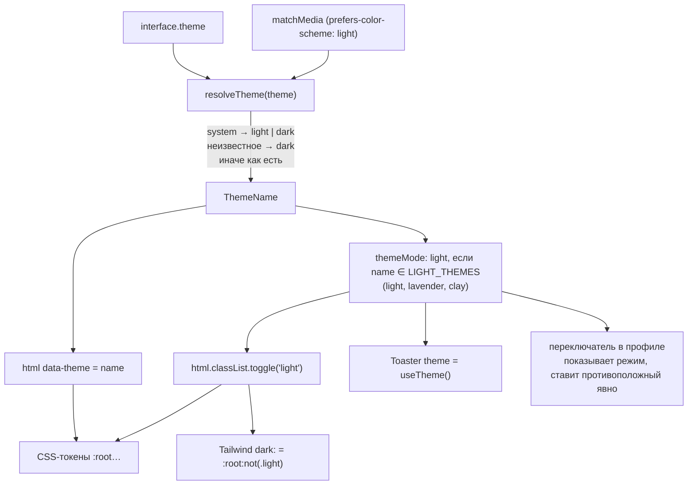
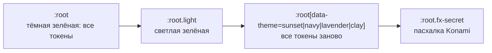

# Темы

Значение темы — `interface.theme` настроек аккаунта: `dark`, `light`, `system` или пресет `sunset`, `navy`,
`lavender`, `clay` (`THEMES` и тип `Theme` в `src/lib/settings.ts`). Логика — `src/lib/theme.ts`, токены — `src/index.css`.

| id | режим | палитра |
|---|---|---|
| `dark` (умолчание) | тёмный | зелёная #051F20 → #DAF1DE |
| `light` | светлый | та же зелёная, мятный фон |
| `system` | `dark` или `light` по `prefers-color-scheme` | — |
| `sunset` | тёмный | #1D1A39 → #F39F5A |
| `navy` | тёмный | #0D1B2A → #D4C4A8 |
| `lavender` | светлый | #F7EEF2 → #4A355E |
| `clay` | светлый | #FFF4E6 → #A2533D |

## Как тема попадает в DOM

- `applyTheme` (`lib/theme.ts`) вызывает `main.tsx` до рендера и при каждом изменении стора настроек. При первом
  вызове он один раз подписывается на `matchMedia(...).change`, поэтому `system` меняется вместе с ОС без перезагрузки.
- `useTheme()` возвращает режим (`dark`/`light`) и тоже подписан на `matchMedia`.
- До ответа `/users/me` тема берётся из `localStorage` `tcloud.mirror`, чтобы не мигала (см.
  [data-flow.md](data-flow.md#настройки)). `applyTheme` ставит `<meta name="theme-color">` в фон
  темы — первый цвет `THEME_SWATCHES` (равен `--background` пресета).
- Переключатель в профиле (`ThemeSwitch`, `components/layout.tsx`) с пресета переводит в `light`/`dark`; выбор всех
  тем с превью (`THEME_SWATCHES`) — на `/settings` (`THEME_LABELS`, `pages/settings.tsx`).

## Каскад CSS

`:root.light` и `:root[data-theme=…]` имеют одинаковую специфичность, поэтому выигрывает порядок в файле: блоки
пресетов идут после `:root.light` и переопределяют его даже у светлых пресетов (которые тоже получают `.light`).
`data-theme="dark"`/`"light"` отдельных правил не имеют.

## Токены

- Цвета shadcn: `--background`, `--foreground`, `--card(-foreground)`, `--popover(-foreground)`,
  `--primary(-foreground)`, `--secondary(-foreground)`, `--muted(-foreground)`, `--accent(-foreground)`,
  `--destructive`, `--border`, `--input`, `--ring`, `--chart-1…5`, `--sidebar*`. В `@theme inline` они проброшены в
  утилиты Tailwind (`--color-*`).
- Свои: `--success`, `--warning` (запись/занято), `--read` (чтение), `--dots` (точечные разделители), `--track` и
  `--dither` (дорожки колец, дизеринг), `--ring-from`/`--ring-to` (градиент колец), `--glow` (свечение фона),
  `--backdrop` (градиент фона страницы), `color-scheme`.
- Шрифты и кегли (`--font-heading` и `--font-sans` = IBM Plex Mono, `--font-pixel` = Tiny5, `--text-xs…lg`) — в `@theme inline`,
  от темы не зависят (см. «Типографика»).

## Типографика

- **Текст — IBM Plex Mono со сглаживанием** (400/500/600). Всё, что читают: списки, таблицы, формы, кнопки,
  подсказки, диалоги, сайдбар, палитра Ctrl+K, заголовки карточек и диалогов (`[data-slot=*-title]`, 14 px/600), подписи
  `fx-label`/`fx-vlabel`/таблиц (12 px), плашки `fx-io` (11 px), малые кольца, подпись `/ лимит` в кольце каналов, имена
  хранилищ. Кегли `text-xs/sm/base/lg` = 12/14/15/17 px (межстрочный 1.5–1.55); у прописных подписей трекинг
  0.04–0.1em (моноширинный шрифт и так широкий); ничего мельче 11 px. Даты, размеры и тип в списке папки — `text-xs`,
  чтобы колонке имени оставалось место.
- **Дисплей — Tiny5 без сглаживания**, только от 20 px и кратно 5 px: `fx-pixel` (заголовки страниц, логотип, крупные
  цифры), центры колец (`fx-ring-center`, кроме `data-size=sm`), табло `fx-flap`. Для них
  `-webkit-font-smoothing: none`, для остального сглаживание браузера (`antialiased` на `body`).
- Почему IBM Plex Mono: пиксельные шрифты на мелком кегле читаются тяжело даже со сглаживанием (Handjet — узкий
  и рваный, владелец его отклонил); моноширинный Plex держит «терминальный» вид рядом с пиксельным дисплеем, у него
  полная кириллица и ровный ритм цифр в таблицах. JetBrains Mono и Manrope владелец отклонил раньше. Pixelify Sans не
  подходит: нет кириллических `О` и `П` (U+041E, U+041F), `ь`/`в`/`з` похожи на `b`/`e`/`э`; остальные мягкие
  пиксельные шрифты Google Fonts без кириллицы или с кириллицей во всю ширину (DotGothic16).
- Google Fonts грузится в `index.html` с `preconnect` и `display=swap`, только нужные веса: IBM Plex Mono
  400/500/600 и Tiny5. Handjet больше не используется.

## Логотип

Пиксельный знак 24×24 (облако с вырезанным бумажным самолётиком над накопителем с лампами чтения/записи) —
компонент `Logo` в `src/components/fx.tsx`: два `` из `public/`, `logo-dark.svg` на тёмных темах (dark, sunset,
navy), `logo-light.svg` на светлых (light, lavender, clay) — переключает вариант `dark:` (нет класса `.light`). Только
целые масштабы 24 (сайдбар, мобильная шапка, свёрнутый сайдбар без надписи) и 48 px (вход), `image-rendering: pixelated`.
Фавиконки в `public/`: `favicon.svg` (вариант с тёмным фоном — прозрачный не виден на светлой вкладке),
`favicon-48.png`, `favicon-96.png`, `apple-touch-icon.png` (192 px); манифеста нет. Исходники — у владельца, вне репо.

QR входа в Telegram (`pages/telegram.tsx`, `QR_LOGO`) несёт знак в центре: `favicon.svg` (с тёмным фоном, чтобы
читался на модулях) 48 px на QR 216 px (22 %), `excavate` вырезает модули под ним, коррекция `level="H"` (30 %)
восстанавливает закрытое. Цвета QR всегда чёрный на белом (`fgColor`/`bgColor`, белая рамка `p-4` — тихая зона) во
всех темах: сканерам нужен контраст. Знак — `image-rendering: pixelated`. Проверено декодированием (resvg + jsQR,
вне репо) для URL `tg://login?token=…` длиной 60–97 символов.

## Анимации

Класс `still` на `<html>` ставит `main.tsx`, когда `interface.animations = false`; правила `:root.still …` в
`index.css` повторяют правила `@media (prefers-reduced-motion: reduce)`. В JS — `prefersReducedMotion()` (`src/lib/fx.ts`).

## Выделение плиток

Плитка папки/файла (`fx-tile` в `folder-view.tsx`) с `data-selected` получает рамку `--primary` внутри панели
(`::after`, `inset: 3px`, без сдвига вёрстки) с пиксельными уголками-скобками и ступенчатым `clip-path`, а миниатюра —
рамку и полупрозрачный тинт `--primary` 16% (картинка остаётся видна). Флажок лежит в углу миниатюры на своей
подложке `--card` (`fx-tile-check`), при фокусе с клавиатуры — пунктир `--foreground`. На устройствах с hover флажок
невыбранной плитки виден только при наведении/фокусе или когда что-то уже выбрано (`data-selecting` на `<ul>`);
на тач-экранах виден всегда. Появление — только `opacity`, под `prefers-reduced-motion` и `still` мгновенно.

## Как добавить тему

1. `src/lib/settings.ts`: id в `THEMES`.
2. `src/lib/theme.ts`: id в `LIGHT_THEMES`, если тема светлая; цвета превью в `THEME_SWATCHES`, первый — `--background` темы.
3. `src/index.css`: блок `:root[data-theme=<id>]` после `:root.light` со всеми токенами из списка выше, включая
   `--backdrop`, `--ring-from`/`--ring-to`, `--glow` и `color-scheme`; пары текст/фон — не ниже WCAG AA (4.5:1).
4. `src/pages/settings.tsx`: подпись в `THEME_LABELS`; ключ `settings.theme<Name>` в `src/lib/locales/ru.ts` и `en.ts`.
5. Тест в `src/lib/theme.test.ts` (`resolveTheme`/`themeMode`).
6. Бэкенд должен принимать id в `interface.theme` (`src/application/schemas/settings.py` там), иначе `PATCH`
   отвечает ошибкой и фронт откатывает выбор.
