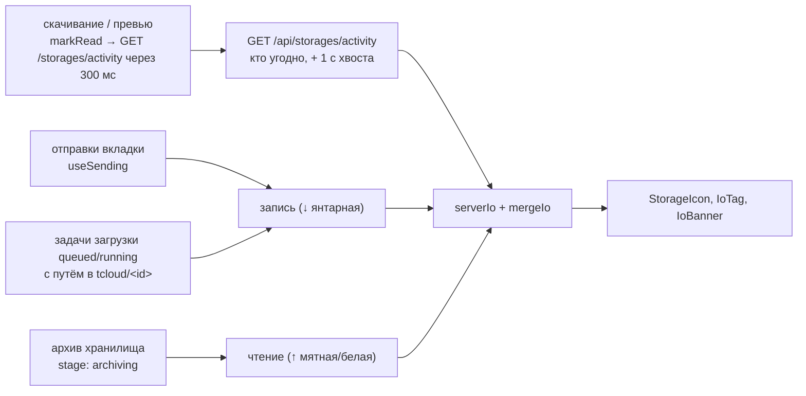

# Интерфейс: страницы и функции

Что видит пользователь и где это в коде. Механику запросов и настроек см. в [data-flow.md](data-flow.md), загрузок и
задач — в [uploads-and-tasks.md](uploads-and-tasks.md), стиля — в [theming.md](theming.md).

## Общие правила

- **Права** не дублируются на фронте: кнопки видны всем, отказ бэкенда (`403`) приходит уведомлением. Скрыто только
  то, что недоступно роли целиком: управление хранилищами и пользователями (admin), Telegram (root).
- **Имена вместо id** (`src/lib/names.ts`): uuid хранилищ и файлов не показываются — имя файла (у архива — имя архива)
  и путь «Хранилище › папка › подпапка» (`humanPath`, `taskTitle`, `storageName`; без названия — «хранилище»).
  «Канал недоступен» — только при явном `available === false` (`isUnavailable`).
- **Шифрование**: у зашифрованных файлов замок в листинге и карточке; `size` в ответе API — размер исходного файла.
- **Скачивание** — обычные ссылки `/api/files/{id}/download` и `/api/tasks/{id}/archive` (cookie уходят сами). Превью
  фото/видео/аудио в карточке файла грузится оттуда же, только при открытии карточки.
- **Даты**: в таблицах, плитках, поиске, задачах, пользователях, сессиях, ключах и устройствах — короткие
  (`formatShortDate`: `Intl.DateTimeFormat` short/short без секунд, кэш по языку), полная с секундами — в `title`;
  полная дата на виду — только в карточке файла.
- **Телефоны**: от 360 px без горизонтальной прокрутки; на сенсорных экранах кнопки, поля, пункты меню ≥ 44 px
  (`pointer: coarse`), у флажков увеличена зона нажатия; в списке файлов колонки сворачиваются, действия файла — в меню
  «…»; диалоги во весь экран, подтверждения снизу; учтены `safe-area-inset`.

## Вход

`/login` (`pages/login.tsx`): автофокус на логине (`maxLength` 64, как у бэкенда), показать/скрыть пароль, предупреждение о Caps Lock, кнопка выключена
во время запроса. Ошибки `POST /api/auth/signin` переводятся по `code` (`describeError` в `src/lib/auth.ts`):
`invalid_credentials`, `account_locked` (после `JWT_MAX_FAILED_LOGINS` неверных паролей), `rate_limited` (лимит
попыток с IP), `user_blocked`. У `account_locked`/`rate_limited` бэкенд отдаёт `retry_after` (с): обратный отсчёт,
кнопка выключена до конца. Поток входа и refresh — [architecture.md](architecture.md#авторизация-и-обновление-сессии).

На `/account` форма смены пароля скрыта у root: его пароль задаёт `ROOT_PASSWORD` бэкенда (`POST /api/auth/password`
отвечает root ошибкой).

## Вход в Telegram

`/telegram` (root): мастер «1 / 3 → 2 / 3 → 3 / 3» по сессиям `api`, `upload`, `download` (бэкенд требует три
отдельных входа, `tcloud-backend/docs/flows/auth.md`). Состояние — `GET /api/telegram`; авторизованные шаги отмечены и
пропускаются, следующий шаг начинается сам (`nextSession`/`activeSession`). На шаге — QR (запрашивается сразу,
`POST /api/telegram/{session}/qr`, и заново, когда истёк `expires_at` или вход упал с `login_expired` — `qrExpired`) или
код по номеру (`/code`, `/sign-in`), затем пароль 2FA (`/password`), если нужен. `flood_wait` — отсчёт по
`retry_after`. Выход из сессии — в строке шага; ниже — устройства и стойка состояния системы.

QR рисуется локально (`qrcode.react`): токен входа нельзя отдавать внешним генераторам. В центре — знак (`favicon.svg`,
22 %, `excavate`, коррекция `H`), всегда чёрный на белом ([theming.md](theming.md#логотип)).

## Навигация

- **Боковая панель** (`components/layout.tsx`): Дашборд, Хранилища (список из `GET /api/storages` прямо под пунктом,
  у каждого — пиксельная иконка накопителя с лампами чтения/записи), Задачи, Настройки; группа «Администрирование»
  (Пользователи — admin/root, Telegram — root): точечный разделитель и подпись 11 px прописными (`role="group"`, не
  кликается), в свёрнутой панели — только разделитель. Активный пункт обведён рамкой, которая переезжает между
  пунктами (позиция — от элемента с `aria-current`). Панель сворачивается в колонку иконок (`tcloud.sidebar`).
  Профиль — плитка внизу: логин, роль, аккаунт, тема, язык, выход. На узком экране панель выдвижная (Radix Dialog), в
  шапке — кнопка поиска; на десктопе в углу подсказка «CTRL K».
- **Командная строка** (`Ctrl/Cmd+K` или кнопка, `components/command-palette.tsx`): страницы, хранилища, подпапки
  текущего листинга (из кэша), поиск файлов и папок через API и действия папки (загрузить файлы/папку/по ссылке, новая
  папка, архив) — событием окна `tcloud:folder-action` (`src/lib/commands.ts`). `combobox` + `listbox`,
  стрелки/Home/End/Enter. От двух символов — поиск по всем хранилищам (8 файлов и папки; файл открывает карточку,
  папка — переход) и пункт «Все результаты». Команды ищутся на обоих языках (`keywords`, `tAll`).
- **Чек-лист первого запуска** (дашборд, root, `src/lib/onboarding.ts`): «Войти в Telegram (3 сессии) → Создать
  хранилище → Загрузить первый файл»; отметки — из `GET /api/telegram`, `GET /api/storages` (`files`) и отслеживаемых
  задач (загрузка, завершённая в этом браузере, тоже засчитывается). Скрывается, когда всё готово, или крестиком
  (`tcloud.onboarding.dismissed`).

## Поиск

`components/search-bar.tsx`, страница `/search` (`pages/search.tsx`), логика — `src/lib/search.ts`.

- Строка над содержимым любой страницы и область «Эта папка / Хранилище / Везде» (по умолчанию — текущая папка, в
  корне хранилища — хранилище, вне папок — везде; область из папки помнится в параметре `in`). `/` фокусирует строку,
  `Esc` очищает.
- Ввод ждёт 300 мс и открывает `/search`; строка и фильтры живут в URL (`q`, `in`, `scope`, `kind` и `mime` повтором,
  `size_min`/`size_max` в байтах, `from`/`to` — дни, `enc=1`, `sort`, `order`): ссылкой можно поделиться, «назад»
  работает (набор текста заменяет запись истории, смена фильтров добавляет).
- Запрос — `GET /api/files/search` (`searchQuery`: `path` из области, даты — целые локальные дни в ISO, `limit` 50,
  «Показать ещё» — следующая страница по `offset`; `useSearch` — `useInfiniteQuery`; файл, съехавший между страницами
  из-за новых загрузок, показывается один раз — `foundFiles` убирает повторы по `uuid`). Без строки и фильтров запрос не
  уходит (`hasCriteria`; бэкенд ответил бы `422 empty_search`).
- Фильтры (сворачиваются, на телефоне свёрнуты): тип — чипы (несколько), формат — список с галочками (до 50) из
  `GET /api/files/search/mimes?path=` с числом файлов, размер от–до в KB/MB/GB, дата изменения (`updated_at`),
  «только зашифрованные», сортировка (совпадение/имя/размер/дата, ▲/▼). Порядок задаёт бэкенд по `lang` = язык
  интерфейса (ICU-сравнение имён сквозь страницы), клиент не пересортировывает.
- Результат: сверху подходящие папки (бэкенд отдаёт их только на первой странице и без фильтров), ниже файлы —
  миниатюра, имя (открывает карточку), место «Хранилище › папка» (`foundLocation`, клик — переход), размер, дата.
- Фильтра по имени внутри листинга нет: поиск с областью «Эта папка» ищет и в подпапках.

## Листинг папки

`components/folder-view.tsx`, логика — `src/lib/files.ts`, столбцы — `src/lib/columns.ts`.

- **Страницы**: по `interface.page_size` (20/50/100/200, по умолчанию 20; «Настройки» → «Интерфейс» → «Файлов за
  раз»). Первая страница сразу, следующие при прокрутке (`useInfiniteQuery`,
  `GET /api/folders?…&limit=<page_size>&cursor=<next_cursor>`; «часовой» в `IntersectionObserver` с запасом 600 px,
  «Загрузка…», кнопка «Показать ещё (N)» для клавиатуры и браузеров без `IntersectionObserver`; после ошибки следующей страницы
  (`isFetchNextPageError`) часовой не наблюдается, чтобы не крутить запросы в цикле, остаётся только кнопка).
- **Сортировка** — на бэкенде (`sort_by`, `sort_order`, `folders_first`, `lang`), как в Проводнике Windows: клик по
  «Имя», «Тип», «Размер», «Изменён» (`updated_at`), «Загружен» (`created_at`), повторный — обратный порядок, ▲/▼ и
  `aria-sort`; в плитке и на телефоне — меню сортировки. Имена — естественный порядок ICU по `lang` (file2 < file10,
  регистр не важен; в русском интерфейсе кириллица перед латиницей, в английском наоборот), равные размеры и даты — по
  `id`. «Папки сверху» — переключатель (по умолчанию включён). Смена сортировки или размера страницы — снова с первой
  страницы; после загрузки/удаления/переименования/задачи загруженные страницы перезапрашиваются, прокрутка остаётся.
  Выбор хранится в `interface.sort_by`/`sort_order`/`folders_first` и меняется только в папке.
- **Столбцы**: тип — расширение (у папки «папка»); у подпапок — объём и число файлов (`size`, `files`; сумма
  поддерева, только читаемые файлы); у текущей папки рядом с хлебными крошками — `size` и `total_files` первой
  страницы (`listingTotals`; на страницах по курсору итоги `null`). «Имя» забирает свободную ширину (обрезка
  многоточием, полное — в `title`). Ширину меняют перетаскиванием границы заголовка (pointer events), двойной клик —
  по самому широкому содержимому, с клавиатуры — ручка `role="separator"` (←/→ на 11 px, с Shift на 44 px); пределы:
  имя 160, остальные 48, максимум 2000 px; шире экрана — горизонтальная прокрутка в контейнере таблицы. Ширины
  сохраняются после отпускания (клавиши — через 500 мс) в `interface.file_columns`, «Сбросить ширину столбцов» — в
  меню вида; уже 640 px ширины не применяются. Какие колонки видны, решает ширина самой таблицы (`fitColumns`,
  `ResizeObserver` панели): по порядку размер → «Изменён» → «Загружен» → тип, пока влезают ширины по умолчанию; уже
  `sm` — только имя.
- **Вид** «список/плитка» — `interface.folder_view`. Плитки — `repeat(auto-fill, minmax(18rem, 1fr))`: колонки
  следуют ширине контента, а не экрана.
- **Миниатюры** (`Thumb`, `thumbUrl` в `src/lib/thumbs.ts`): `GET /api/files/{id}/thumb?v=<updated_at>` (JPEG ≤ 320 px
  из сообщения Telegram; `v` сбрасывает кэш браузера после `replace`) — в плитке, квадратиком в строке, в поиске, у
  видео в карточке как постер. У фото, видео, анимаций и документов, зашифрованных тоже, не у аудио; `loading="lazy"`,
  `image-rendering: pixelated`. Ошибка (`404 thumbnail_not_found` — обычное дело для документов) — молча значок по
  `kind`, адрес не запрашивается до перезагрузки вкладки (модульный `Set` в `thumb.tsx`). Полное фото из `/download`
  в листинге не грузится.
- **Выбор**: флажки (вид — [theming.md](theming.md#выделение-плиток)), Shift — диапазон (`selectRange`), «Выбрать все» и
  `Ctrl/Cmd+A` берут загруженные строки, панель пишет «Выбрано N из M» (M — `total_folders + direct_files`). Действия:
  «Удалить» (по одному `DELETE` на файл/папку) и «Скачать архивом».
- **Архивы**: «Скачать папку» — в меню подпапки и над листингом (`POST /api/folders/archive?path=&format=`); архив
  выбранного — `POST /api/folders/archive/selection` (`{files: [uuid], folders: [путь], format, priority}`,
  `selectionPayload` в `src/lib/archive.ts`), всё из одного хранилища. Zip по умолчанию, остальные форматы в подменю.
  По готовности задачи `TaskWatcher` показывает уведомление с кнопкой «Скачать» (`/api/tasks/{id}/archive`). Ошибки
  (`empty_selection`, `too_many_items` с `limit` — элементов выбора или файлов после раскрытия папок, `too_large` с
  `limit` в байтах, `storage_mismatch`, `forbidden`, `*_not_found`, `telegram_unauthorized`, `insufficient_storage`,
  `body_too_large` — тело выбора больше 1 МиБ, тысячи длинных путей; `archive_in_progress` — у пользователя уже
  собирается архив) — понятными фразами (`archiveError`). В корне хранилища фронт
  передаёт `name` «<хранилище>-выбранное» (`archiveName`), иначе бэкенд назвал бы архив uuid; `taskTitle` везде
  заменяет uuid хранилища в имени архива на название.
- **Клавиши**: `/` — поиск, `Ctrl/Cmd+A` — выбрать всё, `Esc` — снять выбор, `Del`/`Backspace` — удалить выбранное (с
  подтверждением). Скопировать путь и ссылку на скачивание — кнопкой в строке и в карточке файла.
- **Загрузка папок**: «Загрузить папку» (`webkitdirectory`) и перетаскивание (`src/lib/dir-upload.ts`) сохраняют
  относительный путь в `path` (`tcloud/<хранилище>/<папка>/a/b/file.jpg`), недостающие папки создаёт бэкенд, пустые
  папки не загружаются. Ctrl+V в папке загружает файлы из буфера. Над листингом — загрузки этой папки
  (`FolderUploads`). Подробно — [uploads-and-tasks.md](uploads-and-tasks.md).

## Настройки

`/settings` (`pages/settings.tsx`, стор `src/lib/settings.ts`, механика — [data-flow.md](data-flow.md#настройки)).
Каждое изменение сохраняется сразу (без кнопки «Сохранить»), кроме адреса вебхука: он сохраняется кнопкой, ошибки
(`422 unsafe_url`, `validation_error` с `loc` `webhook_url`) — под полем (`settingsError`). Под адресом — «Показать
ключ подписи» (`GET /api/account/webhook-secret` → `{user_id, secret}`, 64 hex; держится только в состоянии компонента,
«Скрыть» и уход со страницы его забывают) с копированием и пояснением: `X-Tcloud-Signature: sha256=HMAC-SHA256(ключ,
сырое тело)`, владелец — `X-Tcloud-User`. «Сбросить по умолчанию» —
`DELETE` с подтверждением.

Группы:

- **Загрузки**: как отправлять, шифрование, конфликт имён, приоритет, непроверяемые файлы; у root — превью
  зашифрованных файлов для всех (`uploads.previews`) и наибольший размер файла `uploads.max_file_size` в МиБ кнопкой
  «Сохранить» (0 или пусто — без ограничения; больше — `413 too_large` с лимитом).
- **Архивы**: формат, приоритет. **Telegram**: `telegram.chat_folder` — каналы хранилищ в папке чатов «TCloud»
  (выключение удаляет папку, каналы остаются). **Фишки** (`fx_*`), **Вебхуки**.
- **Интерфейс**: тема, язык, стартовая страница, вид папки, файлов за раз, фильтр задач, анимации, подтверждение
  удаления.

Применение:

- Диалоги загрузки (файлы, перетаскивание, Ctrl+V, папки, ссылки) берут значения из `uploads` (`uploadOptions`) и
  меняются только для этой загрузки; меню архивов ставят `archives.format` первым и шлют `archives.priority`.
- Приоритет `high` выбирают только admin и root (`isAdmin`): у остальных пункт «высокий — только админ» неактивен в
  настройках, диалоге загрузки и на «Задачах». Сохранённый раньше `high` у `user` бэкенд молча понижает до `normal`.
- `/` и неизвестные адреса ведут на `start_page` (`startPath`), вход возвращает на исходную страницу или на `/`.
- `tasks_filter = active_and_failed` скрывает готовые и отменённые на «Задачах» (переключатель «Все / Активные и
  ошибки» там же сохраняет настройку) и в «Активности» дашборда (`visibleTasks`).
- `confirm_delete = false` удаляет файл или папку без вопроса; удаление нескольких выбранных подтверждается всегда, как
  и удаление хранилищ, пользователей, ключей и сессий.

## Дашборд

`/dashboard` (стартовая по умолчанию, `pages/dashboard.tsx`, логика — `src/lib/dashboard.ts`). Только данные, которые
API уже отдаёт.

- **Итоги** (`summary`): крупные пиксельные цифры — файлов и объём (сумма `files`/`total_size` из `GET /api/storages`,
  `null` не считается), хранилищ, задач в работе.
- **Превью** (`previews`): число и объём (сумма `preview_count`/`preview_bytes`, `previewTotals`); блока нет, пока
  бэкенд не отдаёт поля, и ни у кого, пока root выключил превью (`previews_enabled: false` в `GET /api/account`). Root
  видит «Очистить» (подтверждение, `DELETE /api/files/previews` → `{cleared, bytes}`, уведомление «Удалено N превью ·
  X», обновляются `storages` и `account`; `404`/`405` старого бэкенда — понятная ошибка) — единственное место очистки.
- **Каналы** (`channels`): кольцо лимита (`channelUsage`: `channels_used` из `GET /api/account` против `channels_limit`,
  иначе 500, с Premium 1000; `channels_used: null` — число хранилищ с подписью «всего каналов — нет данных»), кольца
  Premium и размера части (`file_limit` — размер одного сообщения Telegram; большие файлы бэкенд хранит частями, загрузку
  это не ограничивает). `GET /api/account` всегда `200`; до входа в Telegram `telegram_connected: false`, остальные
  поля `null` — «Telegram не подключён», кольца Premium и части скрыты.
- **Хранилища** (`storages`): карточки с иконкой накопителя, объёмом и числом файлов.
- **Активность** (`tasks`): кольца задач по статусам из `GET /api/tasks/counts` (`taskRings`: без «готово», отменённые
  не считаются ошибками и не входят в общее число) и кольцо с процентом на каждую идущую загрузку/архив.
- **Карта загрузок** (`activity_map`): сетка по дням за год из `GET /api/files/activity` (`useFileActivity`,
  `activityGrid`; нет эндпоинта — пустая сетка и «нет данных»).
- **Система** (`system`): стойка `HealthRack` (`components/health.tsx`, строки `healthRows` по `HEALTH_GROUPS`;
  `GET /api/health`, `useHealth`, опрос 15 с). Группы Telegram, Воркеры, Инфраструктура с лампой худшего статуса,
  сверху «в норме / есть сбой · N из M». Строка — лампа, имя, «что делает», метрика из `details` (`latency_ms` → «3 мс»,
  <1 → «<1 мс»; `last_seen_s` → «2 с назад»; локальные проверки Telegram и нет данных — «ok»). Сбой — красная мигающая
  лампа (не мигает без анимаций) и «✗ нет сигнала 40 с» / «✗ сбой». На узком контейнере метрика под именем (container
  queries). Та же стойка — на `/telegram`.
- **Пользователи** (`users`): только admin/root, `GET /api/users`.

Скрытый блок не рендерится, и его запрос не идёт.

**Порядок и видимость блоков.** «Настроить» включает режим правки: над каждым блоком в пунктирной рамке — ручка
перетаскивания (pointer-события, мышь и палец), название, переключатель «Показывать» (скрытый блок виден приглушённым и
зачёркнутым) и кнопки «выше/ниже» с `aria-label` (видны при наведении/фокусе, на сенсорных всегда; новое место
объявляется через `aria-live`). «Отмена» или Esc отбрасывают черновик, «По умолчанию» — порядок по умолчанию и всё
видно, «Готово» сохраняет `interface.dashboard_layout` и `interface.dashboard_hidden` (отдельный `PATCH`, только если
менялись). Пока черновик не сохранён, уход по ссылке приложения спрашивает подтверждение (`useBlocker` + `Confirm`),
закрытие вкладки — `beforeunload`. Id блоков — `DASHBOARD_BLOCKS`; чек-лист не двигается. Отрисовка (`blockOrder`):
известные id в сохранённом порядке, затем недостающие в порядке по умолчанию, неизвестные пропускаются; перестановка —
`moveBlock`, видимые — `visibleBlocks`. Старое `interface.activity_map = false`, пока сервер не отдаёт
`dashboard_hidden`, читается как скрытая карта (`hiddenBlocks`).

## Хранилища

`/files` без `?path` (`components/storages.tsx`): итоги (файлов, объём, хранилищ), кольцо лимита каналов с
напоминанием (нужно больше хранилищ — удалите ненужные каналы/группы в Telegram или ненужные хранилища) и карточки с
объёмом и числом файлов (`total_size`, `files`; `null` — «нет данных»). Полос «заполненности» нет: у канала Telegram
нет лимита объёма.

Форма хранилища (`StorageForm`, только админам) при каждом открытии берёт поля из хранилища (`name: null` → пусто),
«Отмена» сбрасывает черновик. Описание уходит как есть, пустая строка очищает его (`null` бэкенд понимает как «не
менять»). Фото — только `image/jpeg|png|webp|heic|heif|gif` до 10 МБ (`PHOTO_MAX` бэкенда, проверяется до отправки).
`PUT /storages/{id}/photo` идёт отдельной мутацией после успешного `POST`/`PATCH`: форма закрывается и список
обновляется сразу, ошибка фото — свой тост «Хранилище сохранено, но фото не загрузилось», поэтому повторная отправка
не создаёт второй канал.

## Лампы чтения и записи

`StorageIcon`, `useStorageIo`, `storageIo`/`lingerIo` в `src/lib/dashboard.ts`. У каждой иконки накопителя две
пиксельные лампы-стрелки.

- У скачиваний и превью (`<a download>`, ``, `<video>`) браузер не сообщает конец, поэтому их лампа только
  серверная: `markRead` (`src/lib/reads.ts`) через `READ_POKE_MS` (300 мс) просит свежий `GET /api/storages/activity`, а
  имя файла 5 с держит для строки «идёт чтение».
- Локальная лампа гаснет в момент конца операции: отправка — на load/error/abort XHR (отменённая — сразу, хотя карточка
  «Отменено» висит ещё 3 с), задача — когда опрос вернул `done/failed/cancelled`. Короткая операция горит не меньше
  `IO_MIN_MS` (500 мс) от начала (`lingerIo`), длинная гаснет сразу.
- После конца локальной операции серверное `true` того же вида для этого хранилища не учитывается, пока не придёт
  ответ, полученный позже конца + 1 с (`endIo`, `freshServerIo`): иначе хвост сервера и старый ответ держали бы лампу.
- Опрос `['storage-activity']` раз в `IO_FAST_POLL_MS` (500 мс), пока горит любая лампа, иначе раз в `IO_IDLE_POLL_MS`
  (3 с), только пока вкладка видима.
- Недоступный канал — обе лампы красные. Во время записи под иконкой — бегущая полоска «загружается N · P%»
  (`useStorageActivity`), после — «записано»; рядом метка «запись»/«чтение» (`IoTag`), над листингом папки — «идёт
  запись: <файл> · 42%» / «идёт чтение» (`IoBanner`).

## Дополнения за флагами

`src/lib/features.ts`, флаги `interface.fx_*`, группа «Фишки» в настройках; по умолчанию выключены, кроме пасхалок и
советов (`fx_easter_eggs: true`). 8-битные звуки через WebAudio без файлов (`src/lib/sounds.ts`: клик, готово, ошибка;
события завершения шлёт `TaskWatcher` — `tcloud:task-finished`) и пасхалки (код Konami — секретная янтарная тема,
`src/lib/eggs.ts`; пиксель-арт в пустой папке и на 404, случайный совет внизу страницы) — `components/extras.tsx`.
Питомца, пиксельного курсора, конфетти и достижений больше нет: их флаги `fx_pet`/`fx_cursor`/`fx_confetti`
игнорируются, `tcloud.achievements` удаляется вместе со старыми ключами (`migrateLegacy`).
