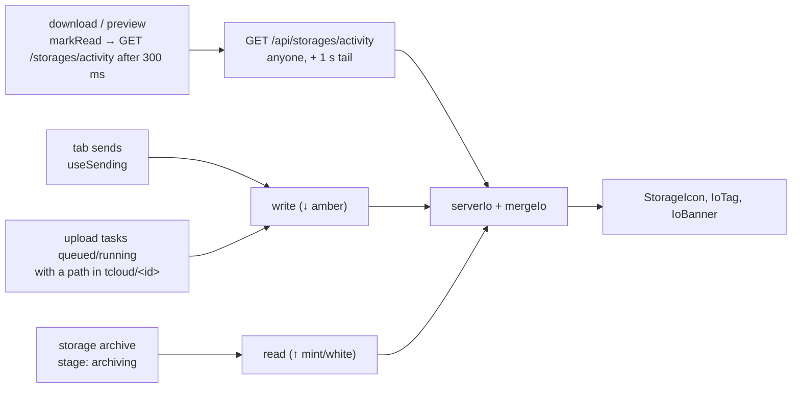

# Interface: pages and features

What the user sees and where it is in the code. For the mechanics of queries and settings see
[data-flow.md](data-flow.md), for uploads and tasks [uploads-and-tasks.md](uploads-and-tasks.md), for style
[theming.md](theming.md).

## General rules

- **Permissions** are not duplicated in the frontend: buttons are visible to everyone, and a backend refusal (`403`)
  arrives as a notification. Only what is unavailable to a role as a whole is hidden: storage and user management
  (admin), Telegram (root).
- **Names instead of ids** (`src/lib/names.ts`): storage and file uuids are never shown, only the file name (for an
  archive, the archive name) and the path "Storage › folder › subfolder" (`humanPath`, `taskTitle`, `storageName`;
  without a name, "storage"). "Channel unavailable" is shown only for an explicit `available === false`
  (`isUnavailable`).
- **Encryption**: encrypted files have a lock in the listing and the file card; `size` in the API answer is the size of
  the original file.
- **Downloads** are plain links `/api/files/{id}/download` and `/api/tasks/{id}/archive` (the cookies go along on their
  own). The photo/video/audio preview in the file card loads from the same place, only when the card is opened.
- **Dates**: tables, tiles, search, tasks, users, sessions, keys and devices use short dates (`formatShortDate`:
  `Intl.DateTimeFormat` short/short without seconds, cached per language), the full date with seconds in `title`; a
  full date is visible only in the file card.
- **Phones**: no horizontal scroll from 360 px; on touch screens buttons, fields and menu items are ≥ 44 px
  (`pointer: coarse`), checkboxes have a larger hit area; in the file list columns collapse and file actions move to a
  "…" menu; dialogs are full screen, confirmations at the bottom; `safe-area-inset` is respected.

## Sign-in

`/login` (`pages/login.tsx`): autofocus on the login (`maxLength` 64, like the backend), show/hide password, a Caps Lock
warning, the button is disabled during the request. `POST /api/auth/signin` errors are translated by `code`
(`describeError` in `src/lib/auth.ts`): `invalid_credentials`, `account_locked` (after `JWT_MAX_FAILED_LOGINS` wrong
passwords), `rate_limited` (attempt limit per IP), `user_blocked`. For `account_locked`/`rate_limited` the backend
sends `retry_after` (s): a countdown, and the button stays disabled until it ends. The sign-in and refresh flow is in
[architecture.md](architecture.md#auth-and-session-refresh).

On `/account` the password change form is hidden for root: root's password comes from the backend's `ROOT_PASSWORD`
(`POST /api/auth/password` answers root with an error).

## Telegram sign-in

`/telegram` (root): a "1 / 3 → 2 / 3 → 3 / 3" wizard over the `api`, `upload`, `download` sessions (the backend needs
three separate sign-ins, `tcloud-backend/docs/flows/auth.md`). State comes from `GET /api/telegram`; authorized steps
are marked and skipped, and the next step starts on its own (`nextSession`/`activeSession`). A step offers a QR code
(requested at once, `POST /api/telegram/{session}/qr`, and again when `expires_at` passes or sign-in fails with
`login_expired`, see `qrExpired`) or a code by phone number (`/code`, `/sign-in`), then the 2FA password (`/password`)
if needed. `flood_wait` shows a countdown by `retry_after`. Signing a session out is in the step row; below are the
devices and the system health rack.

The QR code is rendered locally (`qrcode.react`): the sign-in token must never be given to external generators. The
center holds the logo (`favicon.svg`, 22 %, `excavate`, error correction `H`), always black on white
([theming.md](theming.md#logo)).

## Navigation

- **Sidebar** (`components/layout.tsx`): Dashboard, Storages (the list from `GET /api/storages` right under the item,
  each with a pixel storage icon with read/write lamps), Tasks, Settings; the "Administration" group (Users for
  admin/root, Telegram for root): a dotted divider and an 11 px uppercase label (`role="group"`, not clickable), only
  the divider in the collapsed panel. The active item has a frame that moves between items (its position comes from
  the element with `aria-current`). The panel collapses into a column of icons (`tcloud.sidebar`). The profile is a
  tile at the bottom: login, role, account, theme, language, sign-out. On a narrow screen the panel is a drawer (Radix
  Dialog) with a search button in the header; on desktop a "CTRL K" hint sits in the corner.
- **Command palette** (`Ctrl/Cmd+K` or a button, `components/command-palette.tsx`): pages, storages, subfolders of the
  current listing (from the cache), file and folder search through the API, and folder actions (upload files/folder/by
  URL, new folder, archive) via the `tcloud:folder-action` window event (`src/lib/commands.ts`). `combobox` +
  `listbox`, arrows/Home/End/Enter. From two characters it searches all storages (8 files plus folders; a file opens
  its card, a folder navigates) and adds an "All results" item. Commands match in both languages (`keywords`, `tAll`).
- **First-run checklist** (dashboard, root, `src/lib/onboarding.ts`): "Sign in to Telegram (3 sessions) → Create a
  storage → Upload the first file"; the checks come from `GET /api/telegram`, `GET /api/storages` (`files`) and tracked
  tasks (an upload finished in this browser counts too). It hides when everything is done, or via its cross
  (`tcloud.onboarding.dismissed`).

## Search

`components/search-bar.tsx`, the `/search` page (`pages/search.tsx`), logic in `src/lib/search.ts`.

- A bar above the content of every page and a "This folder / Storage / Everywhere" scope (defaults: the current
  folder, the storage at a storage root, everywhere outside folders; the scope from a folder is kept in the `in`
  parameter). `/` focuses the bar, `Esc` clears it.
- Input waits 300 ms and opens `/search`; the text and filters live in the URL (`q`, `in`, `scope`, repeated `kind` and
  `mime`, `size_min`/`size_max` in bytes, `from`/`to` as days, `enc=1`, `sort`, `order`): the link can be shared and
  "back" works (typing replaces the history entry, changing filters adds one).
- The request is `GET /api/files/search` (`searchQuery`: `path` from the scope, dates as whole local days in ISO,
  `limit` 50, "Show more" loads the next page by `offset`; `useSearch` is a `useInfiniteQuery`; a file that shifted
  between pages because of new uploads is shown once, as `foundFiles` removes duplicates by `uuid`). Without text and
  filters no request is sent (`hasCriteria`; the backend would answer `422 empty_search`).
- Filters (collapsible, collapsed on phones): type as chips (several), format as a checkbox list (up to 50) from
  `GET /api/files/search/mimes?path=` with file counts, size from–to in KB/MB/GB, modification date (`updated_at`),
  "encrypted only", sort (relevance/name/size/date, ▲/▼). The backend sets the order by `lang` = the UI language (ICU
  name comparison across pages); the client does not re-sort.
- Results: matching folders first (the backend returns them only on the first page and without filters), then files
  with a thumbnail, the name (opens the card), the location "Storage › folder" (`foundLocation`, click to navigate),
  size and date.
- There is no name filter inside a listing: search with the "This folder" scope also looks in subfolders.

## Folder listing

`components/folder-view.tsx`, logic in `src/lib/files.ts`, columns in `src/lib/columns.ts`.

- **Pages**: by `interface.page_size` (20/50/100/200, default 20; "Settings" → "Interface" → "Files per page"). The
  first page loads at once, the next ones on scroll (`useInfiniteQuery`,
  `GET /api/folders?…&limit=<page_size>&cursor=<next_cursor>`; a sentinel in an `IntersectionObserver` with a 600 px
  margin, "Loading…", a "Show more (N)" button for the keyboard and browsers without `IntersectionObserver`; after a
  next-page error (`isFetchNextPageError`) the sentinel is no longer observed, so requests do not loop, and only the
  button remains).
- **Sorting** happens on the backend (`sort_by`, `sort_order`, `folders_first`, `lang`), like Windows Explorer: click
  "Name", "Type", "Size", "Modified" (`updated_at`), "Uploaded" (`created_at`), click again for the reverse order, ▲/▼
  and `aria-sort`; in the tile view and on phones there is a sort menu. Names use ICU natural order by `lang` (file2 <
  file10, case-insensitive; in the Russian UI Cyrillic comes before Latin, in the English UI the other way round), equal
  sizes and dates fall back to `id`. "Folders first" is a toggle (on by default). Changing the sort or page size starts
  from the first page again; after an upload/delete/rename/task the loaded pages are refetched and the scroll stays.
  The choice is stored in `interface.sort_by`/`sort_order`/`folders_first` and changes only inside a folder.
- **Columns**: type is the extension ("folder" for a folder); subfolders show size and file count (`size`, `files`; a
  subtree sum, readable files only); the current folder shows `size` and `total_files` of the first page next to the
  breadcrumbs (`listingTotals`; cursor pages have `null` totals). "Name" takes the free width (cut with an ellipsis,
  full name in `title`). Widths change by dragging the header border (pointer events), a double click fits the widest
  content, and from the keyboard there is a `role="separator"` handle (←/→ by 11 px, with Shift by 44 px); limits:
  name 160, others 48, at most 2000 px; wider than the screen scrolls horizontally inside the table container. Widths
  are saved after release (keys after 500 ms) to `interface.file_columns`; "Reset column widths" is in the view menu;
  below 640 px the widths are not applied. Which columns are shown depends on the table's own width (`fitColumns`,
  the panel's `ResizeObserver`): in order size → "Modified" → "Uploaded" → type, while the default widths fit; below
  `sm` only the name.
- **View** "list/tiles" is `interface.folder_view`. Tiles use `repeat(auto-fill, minmax(18rem, 1fr))`: columns follow
  the content width, not the screen.
- **Thumbnails** (`Thumb`, `thumbUrl` in `src/lib/thumbs.ts`): `GET /api/files/{id}/thumb?v=<updated_at>` (a JPEG ≤
  320 px from the Telegram message; `v` busts the browser cache after `replace`) in tiles, as a small square in rows,
  in search, and as the video poster in the card. For photos, videos, animations and documents, encrypted ones too,
  not for audio; `loading="lazy"`, `image-rendering: pixelated`. An error (`404 thumbnail_not_found` is normal for
  documents) silently falls back to the `kind` icon, and the URL is not requested again until the tab reloads (a module
  `Set` in `thumb.tsx`). The full photo from `/download` is never loaded in the listing.
- **Selection**: checkboxes (look in [theming.md](theming.md#tile-selection)), Shift for a range (`selectRange`),
  "Select all" and `Ctrl/Cmd+A` take the loaded rows, the toolbar says "N of M selected" (M = `total_folders +
  direct_files`). Actions: "Delete" (one `DELETE` per file/folder) and "Download as archive".
- **Archives**: "Download folder" is in the subfolder menu and above the listing
  (`POST /api/folders/archive?path=&format=`); an archive of the selection is `POST /api/folders/archive/selection`
  (`{files: [uuid], folders: [path], format, priority}`, `selectionPayload` in `src/lib/archive.ts`), all from one
  storage. Zip by default, the other formats in a submenu. When the task is done, `TaskWatcher` shows a notification
  with a "Download" button (`/api/tasks/{id}/archive`). Errors (`empty_selection`, `too_many_items` with `limit` for
  selection items or files after expanding folders, `too_large` with `limit` in bytes, `storage_mismatch`, `forbidden`,
  `*_not_found`, `telegram_unauthorized`, `insufficient_storage`, `body_too_large` for a selection body over 1 MiB with
  thousands of long paths; `archive_in_progress` when the user already has an archive being built) get readable
  phrases (`archiveError`). At a storage root the frontend sends `name` "<storage>-selection" (`archiveName`), otherwise
  the backend would name the archive by uuid; `taskTitle` everywhere replaces the storage uuid in an archive name with
  its name.
- **Keys**: `/` search, `Ctrl/Cmd+A` select all, `Esc` clear the selection, `Del`/`Backspace` delete the selection
  (with confirmation). Copy the path and the download link with a button in the row and in the file card.
- **Folder uploads**: "Upload folder" (`webkitdirectory`) and drag and drop (`src/lib/dir-upload.ts`) keep the
  relative path in `path` (`tcloud/<storage>/<folder>/a/b/file.jpg`); the backend creates missing folders, and empty
  folders are not uploaded. Ctrl+V in a folder uploads files from the clipboard. Above the listing are this folder's
  uploads (`FolderUploads`). Details in [uploads-and-tasks.md](uploads-and-tasks.md).

## Settings

`/settings` (`pages/settings.tsx`, store `src/lib/settings.ts`, mechanics in [data-flow.md](data-flow.md#settings)).
Every change is saved at once (no "Save" button), except the webhook URL: it is saved with a button, and errors
(`422 unsafe_url`, `validation_error` with `loc` `webhook_url`) show under the field (`settingsError`). Under the URL is
"Show signing key" (`GET /api/account/webhook-secret` → `{user_id, secret}`, 64 hex; kept only in component state,
"Hide" and leaving the page forget it) with copy and an explanation: `X-Tcloud-Signature: sha256=HMAC-SHA256(key, raw
body)`, the owner in `X-Tcloud-User`. "Reset to defaults" sends a `DELETE` after confirmation.

Groups:

- **Uploads**: how to send, encryption, name conflicts, priority, unscannable files; for root, previews of encrypted
  files for everyone (`uploads.previews`) and the maximum file size `uploads.max_file_size` in MiB with a "Save"
  button (0 or empty means no limit; larger files get `413 too_large` with the limit).
- **Archives**: format, priority. **Telegram**: `telegram.chat_folder` puts storage channels into a "TCloud" chat folder
  (turning it off deletes the folder, the channels stay). **Extras** (`fx_*`), **Webhooks**.
- **Interface**: theme, language, start page, folder view, files per page, task filter, animations, delete
  confirmation.

How they apply:

- Upload dialogs (files, drag and drop, Ctrl+V, folders, URLs) take values from `uploads` (`uploadOptions`) and change
  only for that upload; archive menus put `archives.format` first and send `archives.priority`.
- Only admin and root can choose `high` priority (`isAdmin`): for others the "high, admins only" item is disabled in
  settings, the upload dialog and on Tasks. A `high` saved earlier by a `user` is silently lowered to `normal` by the
  backend.
- `/` and unknown addresses lead to `start_page` (`startPath`); sign-in returns to the original page or to `/`.
- `tasks_filter = active_and_failed` hides done and cancelled tasks on Tasks (the "All / Active and failed" toggle there
  saves the setting) and in the dashboard's "Activity" (`visibleTasks`).
- `confirm_delete = false` deletes a file or folder without asking; deleting several selected items is always
  confirmed, as is deleting storages, users, keys and sessions.

## Dashboard

`/dashboard` (the default start page, `pages/dashboard.tsx`, logic in `src/lib/dashboard.ts`). Only data the API
already returns.

- **Totals** (`summary`): large pixel numbers for files and size (the sum of `files`/`total_size` from
  `GET /api/storages`, `null` not counted), storages, running tasks.
- **Previews** (`previews`): count and size (the sum of `preview_count`/`preview_bytes`, `previewTotals`); the block is
  absent while the backend does not return the fields, and for everyone while root has previews off
  (`previews_enabled: false` in `GET /api/account`). Root sees "Clear" (confirmation, `DELETE /api/files/previews` →
  `{cleared, bytes}`, a "Deleted N previews · X" notification, `storages` and `account` refresh; `404`/`405` from an
  old backend is a readable error), the only place to clear them.
- **Channels** (`channels`): the limit ring (`channelUsage`: `channels_used` from `GET /api/account` against
  `channels_limit`, otherwise 500, 1000 with Premium; `channels_used: null` shows the storage count labelled "total
  channels: no data"), the Premium and part size rings (`file_limit` is the size of one Telegram message; the backend
  stores large files in parts, so it does not limit uploads). `GET /api/account` is always `200`; before Telegram
  sign-in `telegram_connected: false` and the other fields are `null`, shown as "Telegram not connected", with the
  Premium and part rings hidden.
- **Storages** (`storages`): cards with the storage icon, size and file count.
- **Activity** (`tasks`): task rings by status from `GET /api/tasks/counts` (`taskRings`: without "done", cancelled
  ones are not counted as errors and not included in the total) and a ring with a percentage for each running
  upload/archive.
- **Upload map** (`activity_map`): a grid of days over a year from `GET /api/files/activity` (`useFileActivity`,
  `activityGrid`; without the endpoint, an empty grid and "no data").
- **System** (`system`): the `HealthRack` rack (`components/health.tsx`, rows `healthRows` by `HEALTH_GROUPS`;
  `GET /api/health`, `useHealth`, polled every 15 s). Telegram, Workers and Infrastructure groups with a lamp for the
  worst status, and "healthy / failing · N of M" on top. A row is a lamp, the name, "what it does", and a metric from
  `details` (`latency_ms` → "3 ms", <1 → "<1 ms"; `last_seen_s` → "2 s ago"; local Telegram checks and no data → "ok").
  A failure is a blinking red lamp (no blinking without animations) and "✗ no signal 40 s" / "✗ failing". In a narrow
  container the metric goes under the name (container queries). The same rack is on `/telegram`.
- **Users** (`users`): admin/root only, `GET /api/users`.

A hidden block is not rendered, and its query is not sent.

**Block order and visibility.** "Customize" turns on edit mode: above each block, in a dashed frame, there is a drag
handle (pointer events, mouse and finger), the name, a "Show" toggle (a hidden block shows dimmed and struck through)
and "up/down" buttons with `aria-label` (visible on hover/focus, always on touch; the new position is announced via
`aria-live`). "Cancel" or Esc drop the draft, "Default" restores the default order with everything visible, "Done"
saves `interface.dashboard_layout` and `interface.dashboard_hidden` (a separate `PATCH`, only if they changed). While
the draft is unsaved, leaving through an app link asks for confirmation (`useBlocker` + `Confirm`), and closing the tab
triggers `beforeunload`. Block ids are `DASHBOARD_BLOCKS`; the checklist does not move. Rendering (`blockOrder`): known
ids in the saved order, then missing ones in the default order, unknown ones skipped; reordering is `moveBlock`,
visible ones are `visibleBlocks`. The old `interface.activity_map = false`, while the server does not return
`dashboard_hidden`, reads as a hidden map (`hiddenBlocks`).

## Storages

`/files` without `?path` (`components/storages.tsx`): totals (files, size, storages), the channel limit ring with a
reminder (to get more storages, delete unneeded channels/groups in Telegram or unneeded storages) and cards with size
and file count (`total_size`, `files`; `null` shows "no data"). There are no "fill" bars: a Telegram channel has no
size limit.

The storage form (`StorageForm`, admins only) takes its fields from the storage on every open (`name: null` → empty),
and "Cancel" resets the draft. The description is sent as is, and an empty string clears it (the backend reads `null`
as "do not change"). The photo must be `image/jpeg|png|webp|heic|heif|gif` up to 10 MB (the backend's `PHOTO_MAX`,
checked before sending). `PUT /storages/{id}/photo` is a separate mutation after a successful `POST`/`PATCH`: the form
closes and the list refreshes at once, and a photo error gets its own toast "Storage saved, but the photo failed to
upload", so sending again does not create a second channel.

## Read and write lamps

`StorageIcon`, `useStorageIo`, `storageIo`/`lingerIo` in `src/lib/dashboard.ts`. Each storage icon has two pixel arrow
lamps.

- For downloads and previews (`<a download>`, ``, `<video>`) the browser reports no end, so their lamp is
  server-only: `markRead` (`src/lib/reads.ts`) asks for a fresh `GET /api/storages/activity` after `READ_POKE_MS`
  (300 ms) and keeps the file name for 5 s for the "reading" line.
- A local lamp goes off the moment the operation ends: a send on XHR load/error/abort (a cancelled one at once, even
  though the "Cancelled" card stays for 3 s), a task when polling returns `done/failed/cancelled`. A short operation
  stays lit at least `IO_MIN_MS` (500 ms) from its start (`lingerIo`), a long one goes off at once.
- After a local operation ends, the server's `true` of the same kind for that storage is ignored until an answer
  received later than the end + 1 s (`endIo`, `freshServerIo`): otherwise the server's tail and a stale answer would
  keep the lamp on.
- `['storage-activity']` is polled every `IO_FAST_POLL_MS` (500 ms) while any lamp is lit, otherwise every
  `IO_IDLE_POLL_MS` (3 s), only while the tab is visible.
- An unavailable channel has both lamps red. During a write, a running strip "uploading N · P%" shows under the icon
  (`useStorageActivity`), afterwards "written"; next to it a "write"/"read" tag (`IoTag`), and above the folder listing
  "writing: <file> · 42%" / "reading" (`IoBanner`).

## Extras behind flags

`src/lib/features.ts`, the `interface.fx_*` flags, the "Extras" group in settings; off by default except easter eggs
and tips (`fx_easter_eggs: true`). 8-bit sounds via WebAudio without files (`src/lib/sounds.ts`: click, done, error;
`TaskWatcher` sends the completion events as `tcloud:task-finished`) and easter eggs (the Konami code unlocks a secret
amber theme, `src/lib/eggs.ts`; pixel art in an empty folder and on the 404 page, a random tip at the bottom of the
page) live in `components/extras.tsx`. The pet, pixel cursor, confetti and achievements are gone: their
`fx_pet`/`fx_cursor`/`fx_confetti` flags are ignored, and `tcloud.achievements` is removed with the other old keys
(`migrateLegacy`).
