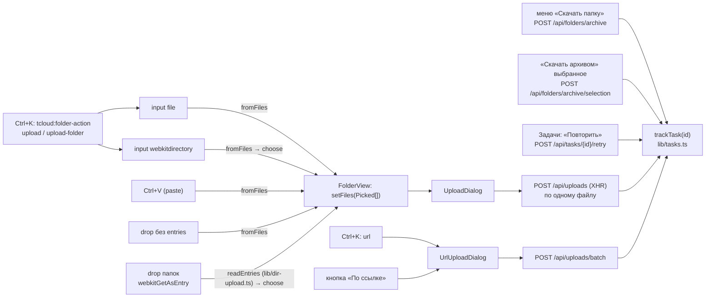
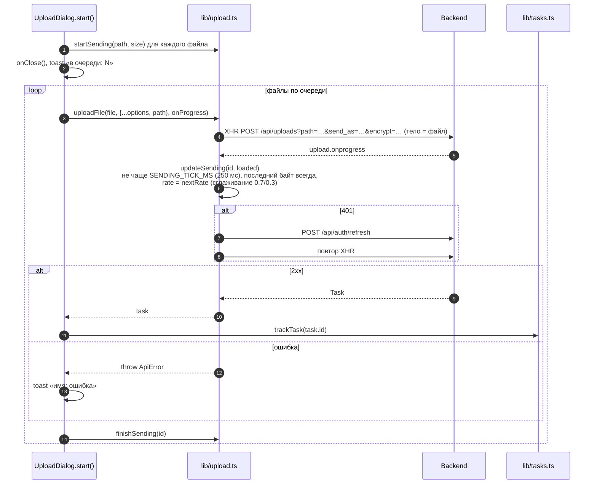
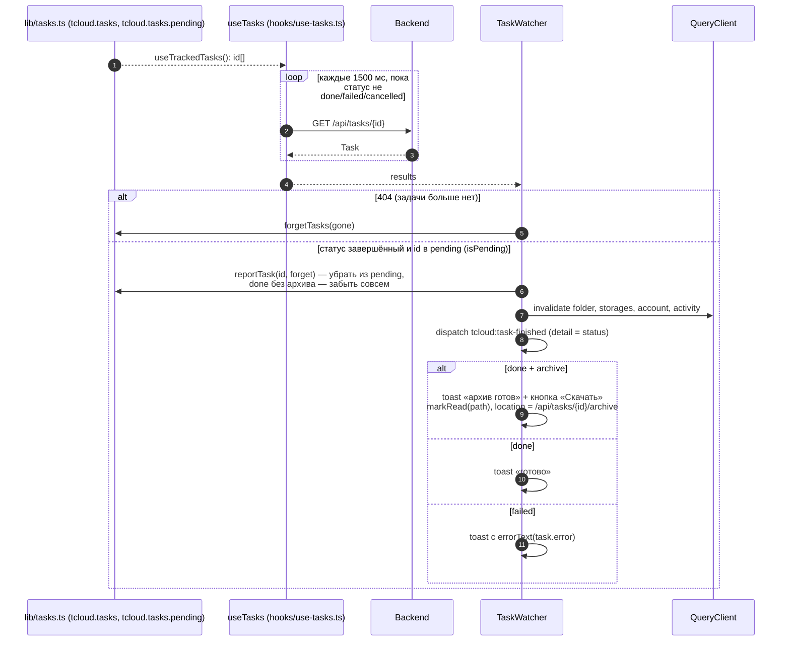
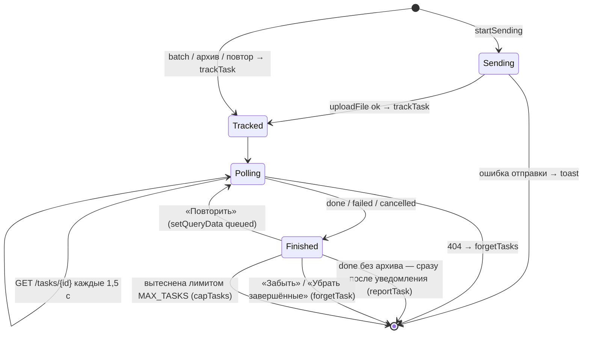
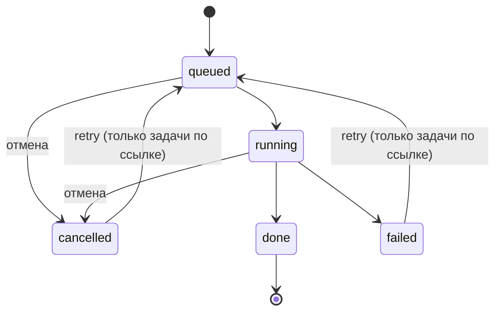

# Загрузки и задачи

У API нет списка «моих задач» (только по id или `batch_id`), поэтому браузер сам помнит id запущенных задач и опрашивает
их. Загрузка с устройства проходит два этапа: отправка тела в вкладке (XHR) и задача на сервере.

## Точки входа

Все файлы с устройства попадают в `UploadDialog` (`components/upload-dialog.tsx`) через состояние `files` в
`FolderView` (`components/folder-view.tsx`). Ссылки — в `UrlUploadDialog`.

- `choose` пустой список не открывает диалог, а показывает «нет файлов»; пустые папки не загружаются.
- `Picked.path` — относительный путь (`webkitRelativePath` или путь из обхода); итоговый путь
  `joinPath(folder, path)`, недостающие папки создаёт бэкенд.
- Параметры: `uploadOptions(settings.uploads)` как стартовые, правки в диалоге — только для этой загрузки;
  `withSendAs` выключает `encrypt` для `media` и включает для `file`. Все параметры уходят явно в query-строке.

## Отправка файлов

- Прогресс отправки живёт только в памяти вкладки (`useSending`). Пока список не пуст, `TaskWatcher` вешает
  `beforeunload`, чтобы браузер спросил перед закрытием.
- Ссылки: `parseUrlLines` (строка `url` или `url | имя`) → `POST /api/uploads/batch {items}`; для каждого элемента с
  `task` — `trackTask`, с `error` — уведомление.

## Отслеживание задач

`TaskWatcher` смонтирован в `Layout` один раз на всё приложение. `trackTask` кладёт id и в `tcloud.tasks`, и в
`tcloud.tasks.pending` (задачи, о завершении которых ещё не сообщили); повтор задачи кладёт её в pending снова.
Завершённая задача из pending вызывает уведомление ровно один раз, даже если уже завершена при первом опросе или
завершилась, пока вкладка была закрыта; после `reportTask` перезагрузка страницы её не повторяет.
Готовые задачи без архива забываются сразу после уведомления; `failed`/`cancelled` и готовые архивы (кнопка «Скачать» на «Задачах») остаются до «Забыть». Список ограничен
`MAX_TASKS` (50): `trackTask` сначала выкидывает самые старые уже объявленные задачи, потом самые старые вообще.
Завершённые задачи в кэше не устаревают (`staleTime: Infinity`), их не перезапрашивают при монтировании.
Другие вкладки подхватывают оба ключа по событию `storage`.

### Жизнь элемента в браузере

### Статусы задачи (как их показывает фронт)

`TASK_STATUS` и `TASK_STAGE` в `src/lib/tasks.ts`; `FINISHED` — в `hooks/use-tasks.ts`.

Стадии — подписи `TASK_STAGE` (`downloading`, `scanning`, `uploading_tg`, `archiving`, `done`); порядок стадий и
правила повторов задаёт бэкенд (`tcloud-backend/docs/flows/uploads.md`, `docs/background-tasks.md`). Повтор
возвращает ту же задачу (тот же id) в `queued`. `task.progress` — проценты 0–100, во фронте только через
`taskFraction` (0–1).

## Кто читает задачи и отправки

| Потребитель | Что показывает |
|---|---|
| `components/folder-uploads.tsx` | над листингом: отправки и не-архивные задачи `queued/running/failed` внутри текущей папки, спидометр |
| `pages/tasks.tsx` | все отслеживаемые задачи, фильтр `visibleTasks(tasks_filter)`, отмена/приоритет/повтор/забыть |
| `pages/dashboard.tsx` | «Активность»: кольца по статусам, прогресс идущих, чек-лист первого запуска (`lib/onboarding.ts`) |
| `hooks/use-storages.ts` `useStorageIo` | лампы чтения/записи хранилищ: отправки + задачи загрузки = запись, `archiving` + `markRead` = чтение, удержание `IO_HOLD_MS` (`lingerIo`) |
| `components/extras.tsx` | реакции на `tcloud:task-finished` (за флагами `fx_*`) |
