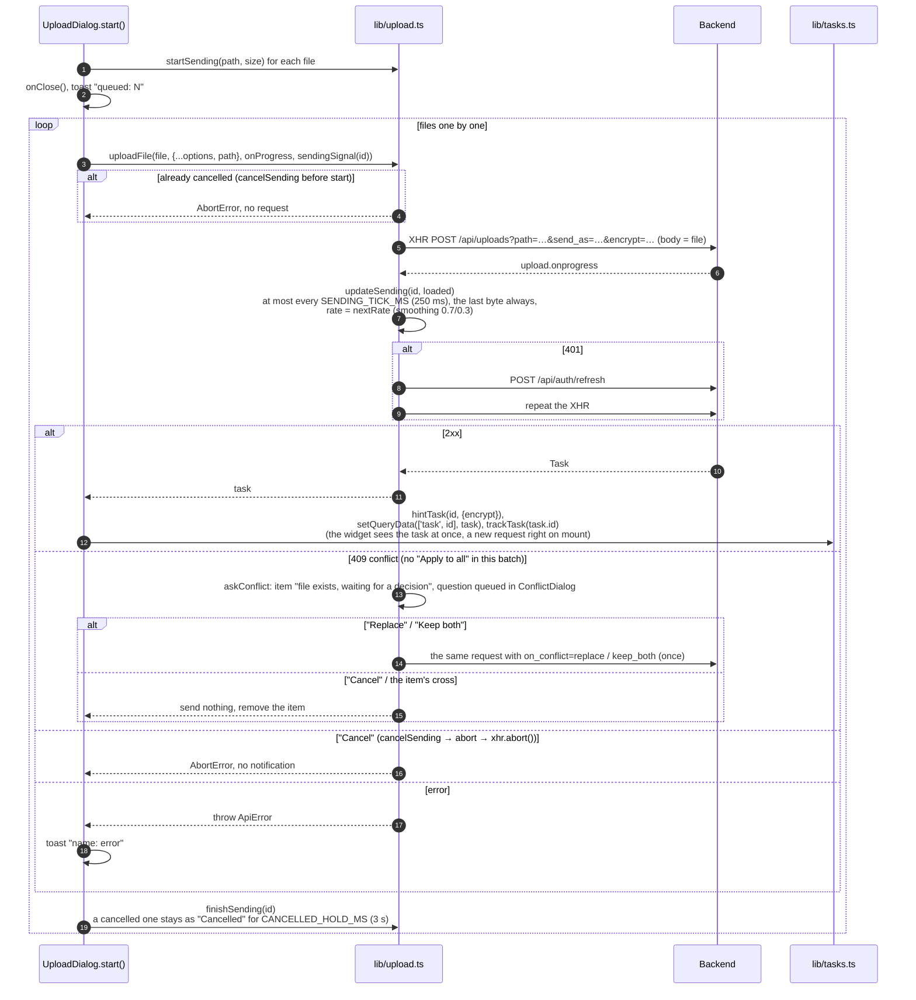
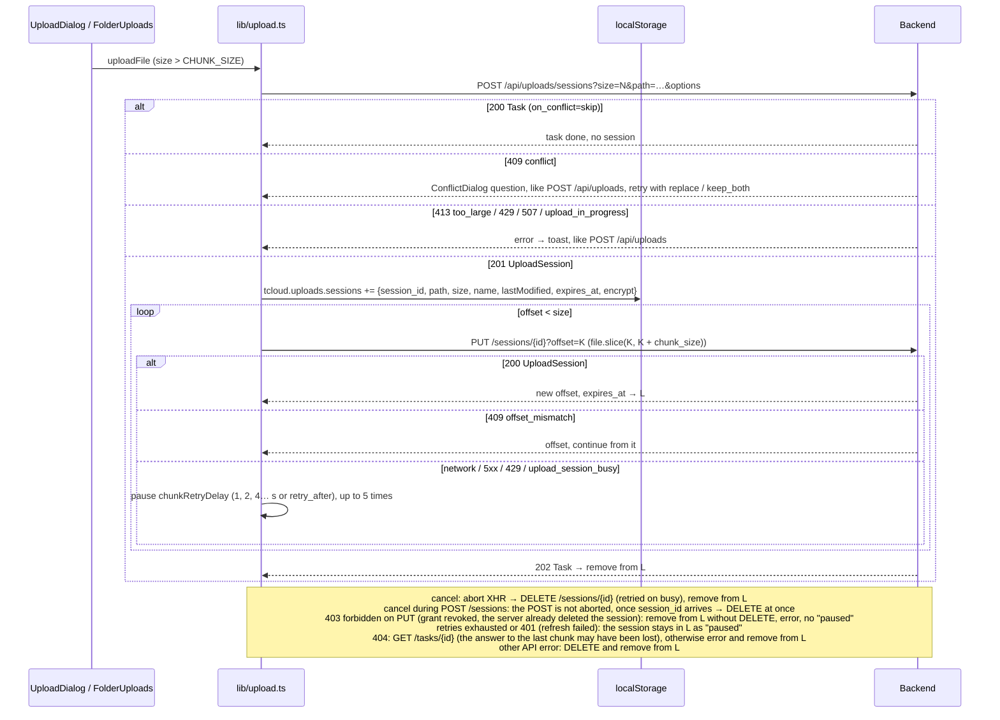
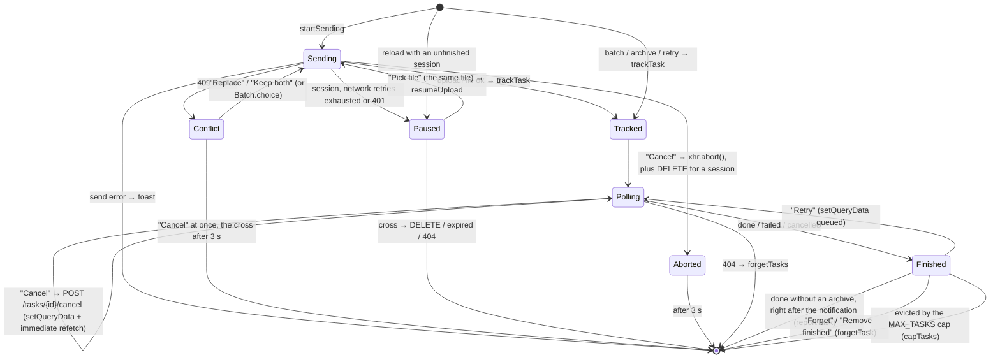
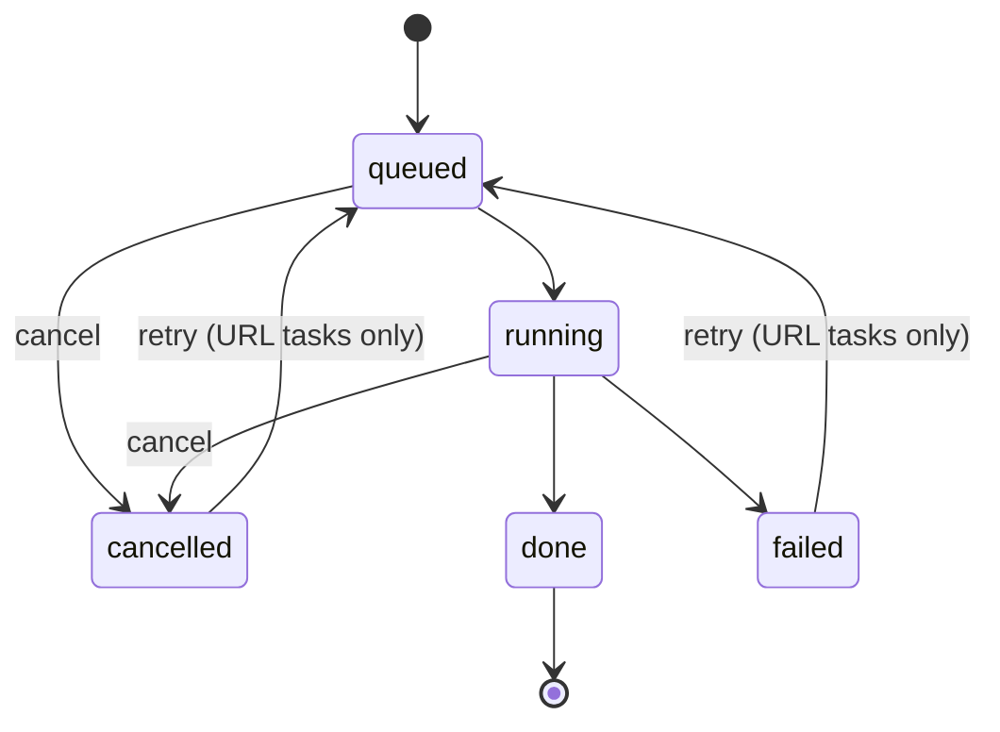
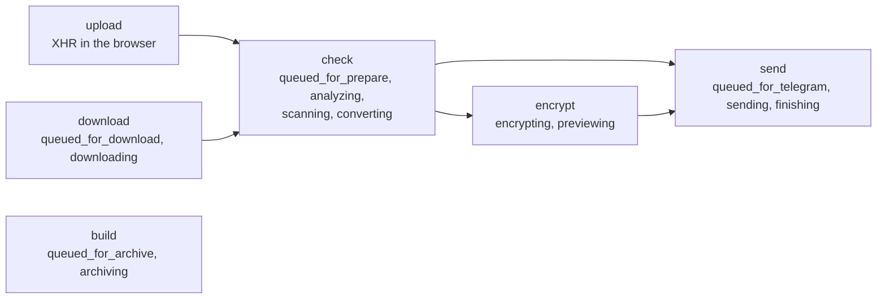

# Uploads and tasks

The API has no "my tasks" list (only by id or `batch_id`), so the browser remembers the ids of the tasks it started and
polls them in batches: `taskLoader` (`lib/tasks.ts`) collects the ids requested by the `['task', id]` caches within one
tick into one `GET /api/tasks?ids=…` (`TASKS_PER_REQUEST` = 100 per request); ids missing from the answer count as gone
(like a 404). Poll timers of tasks with the same status run in sync (the answer reaches all of them at once), so there
is one request per interval. An upload from the device has two stages: sending the body from the tab (XHR) and a task
on the server.

## Entry points

All files from the device reach `UploadDialog` (`components/upload-dialog.tsx`) through the `files` state in
`FolderView` (`components/folder-view.tsx`). URLs go to `UrlUploadDialog`.


- `choose` with an empty list does not open the dialog but shows "no files"; empty folders are not uploaded.
- `Picked.path` is the relative path (`webkitRelativePath` or the path from the traversal); the final path is
  `joinPath(folder, path)`, and the backend creates missing folders.
- Options: `uploadOptions(settings.uploads)` as the starting values; changes in the dialog apply to this upload only;
  `withSendAs` turns `encrypt` off for `media` and on for `file`. Every option is sent explicitly in the query string.
- Upload dialog: the file list (name with an ellipsis, size on the right) scrolls inside itself and the dialog is never
  taller than the screen; the "Send as", "If the file exists" and "Priority" fields show a hint for the chosen option
  under the field; "Encrypt" is disabled (not hidden) unless sending as a file; at the bottom, "N files · size" on the
  left and "Upload" on the right.

## Sending files



- Sending progress lives only in the tab's memory (`useSending`); each item has its own `AbortController`
  (`startSending`/`sendingSignal`/`cancelSending` in `lib/upload.ts`). While the list is not empty, `TaskWatcher` adds a
  `beforeunload` handler so the browser asks before closing.
- URLs: `parseUrlLines` (a line is `url` or `url | name`; split at the first " | " with spaces, so a `|` inside the URL
  and " | " in the name do not interfere; the default name is the last path segment, broken `%` sequences stay as is) →
  `POST /api/uploads/batch {items}`; for each item with a `task`, `setQueryData(['task', id], task)` and `trackTask`;
  with an `error`, a notification.
- Name conflict: `UploadDialog` sends `on_conflict` from the settings/dialog; only when it is `error` and the path is
  taken does the server answer `409 conflict` with `suggested_name` (the same for `POST /api/uploads` and for session
  creation). `sendTracked` with a `Batch` (one per "Upload") queues the question (`askConflict`, `useConflicts`);
  `ConflictDialog` (in `Layout`, `components/upload-dialog.tsx`) shows the first one: "Replace" (retry with `replace`;
  the frontend does not know the delete permission, so the button is always there and a `403` arrives as a regular
  error), "Keep both" (retry with `keep_both`, captioned "will most likely be named `suggested_name`"; without read
  access to the folder the backend sends no `suggested_name`, so there is no caption, same buttons), "Cancel" (and Esc)
  sends nothing and the item disappears at once. The "Apply to all" checkbox (when the batch has more than one file)
  answers all waiting questions of this batch at once and is remembered in `Batch.choice` for the next ones. While a
  question is open, the other files of the batch wait (sending is sequential), and the item shows in `FolderUploads` as
  "file exists, waiting for a decision"; its cross or "Cancel all" removes the question. A retry asks at most once;
  `409 upload_in_progress` is still a notification. Resuming a session (`resumeUpload`) does not ask: the conflict was
  checked when it was created.
- A finished task with `skipped_exists` can arrive with `file: null` (an upload-only grant): the frontend does not read
  `task.file` and takes the title and folders from `task.path` (`taskTitle`, `taskFolders`).
- After the answer (plain or session), `sendTracked` calls `hintTask`, `setQueryData`, `trackTask`, and shows an error
  as a "name: error" notification (a cancel stays silent). `413 too_large` and `chunk_too_large` show `limit` as a size
  (`errorParams` in `lib/api.ts`).

### Large files in chunks

`uploadFile` sends a file larger than `CHUNK_SIZE` (64 MiB, like the backend's `UPLOAD_CHUNK_SIZE`) through a session
(backend `docs/flows/uploads.md`, "From the device in chunks"); smaller ones go as before in one `POST /api/uploads`.



- Progress is the bytes accepted by the server plus `upload.onprogress` of the current chunk, through the same
  `updateSending`.
- Sessions live in `localStorage` `tcloud.uploads.sessions` (every access in try/catch; ones expired by `expires_at`
  are dropped on read). Sessions that are not running in this tab (`usePausedSessions`), after a reload or exhausted
  retries, show in the `FolderUploads` of their folder as "paused, pick the file again" with a "Pick file" button and a
  cross (`discardSession`: `DELETE` and forget). The picked file is checked by name, size and `lastModified`
  (`sameFile`; a different one is an error and can be picked again), then `resumeUpload`: `GET` the session for its
  `offset` and the same loop.
- On app start, `TaskWatcher` shows a "N unfinished uploads" notification once, with an "Open" button (the first one's
  folder).

## Task tracking

```mermaid
sequenceDiagram
    autonumber
    participant T as lib/tasks.ts (tcloud.tasks, tcloud.tasks.pending)
    participant Q as useTasks (hooks/use-tasks.ts)
    participant B as Backend
    participant W as TaskWatcher
    participant C as QueryClient
    T-->>Q: useTrackedTasks(): id[]
    loop queued every 5 s, running every 1 s (pollInterval), until done/failed/cancelled
        Q->>Q: queryFn ['task', id] → loadTask(id) (taskLoader):<br/>ids of one tick are collected (10 ms)
        Q->>B: GET /api/tasks?ids=a&ids=b… (up to 100 ids per request, more means several)
        B-->>Q: {items, summary}, visible tasks only
    end
    Q-->>W: results (an id missing from items → ApiError 404)
    alt 404 (the task is gone)
        W->>T: forgetTasks(gone)
    else finished status and the id is in pending (isPending)
        W->>T: reportTask(id, forget): remove from pending,<br/>done without an archive is forgotten entirely
        W->>W: collects the finished ones of this answer
        W->>W: dispatch tcloud:task-finished (detail = status)
        alt done + archive
            W->>W: toast "archive ready" + "Download" button<br/>markRead(path), location = /api/tasks/{id}/archive
        else done
            W->>W: toast "done"
        else failed
            W->>W: toast with errorText(task.error)
        end
    end
    opt something finished in this answer
        W->>C: invalidate task-counts; if there are non-archives, ['folder', the task's folder and its ancestors] (taskFolders),<br/>storages, account, activity, search, mimes, at once, once per answer
    end
```

`TaskWatcher` is mounted in `Layout` once for the whole app. `trackTask` puts the id into both `tcloud.tasks` and
`tcloud.tasks.pending` (tasks whose completion has not been reported yet); retrying a task puts it into pending again.
A finished task from pending triggers a notification exactly once, even if it was already finished at the first poll
or finished while the tab was closed; after `reportTask` a page reload does not repeat it. Done tasks without an
archive are forgotten right after the notification; `failed`/`cancelled` ones and finished archives (the "Download"
button on Tasks) stay until "Forget". The list is capped at `MAX_TASKS` (50): `trackTask` first drops the oldest
already reported tasks, then the oldest overall. Finished tasks never go stale in the cache (`staleTime: Infinity`)
and are not refetched on mount. Other tabs pick up both keys via the `storage` event. Invalidation happens at once,
one per batch answer (all tasks of one `GET /tasks?ids=` are handled in one effect pass, and running tasks are polled
every 1 s, so listings are not hit more than once a second); only the listings of each task's parent folder and its
ancestors are refreshed (folders show their size), and archives do not touch listings.

### Lifecycle of an item in the browser



### Task statuses (as the frontend shows them)

`TASK_STATUS` and `TASK_STAGE` in `src/lib/tasks.ts`; `FINISHED` in `hooks/use-tasks.ts`.



Steps are `task.step`, see "Steps and cancel" below. Stages are the `TASK_STAGE` labels (fallbacks while `step` is still
`null`) (`downloading`, `scanning`, `uploading_tg`, `archiving`, `done`); the stage order and retry rules are set by the
backend (`tcloud-backend/docs/flows/uploads.md`, `docs/background-tasks.md`). A retry returns the same task (same id)
to `queued`. The "Retry" button appears only with `task.retryable` (backend: `source = url` in `failed`/`cancelled`).
`task.progress` is a percent 0–100, used in the frontend only through `taskFraction` (0–1).

Waiting reasons and warnings are translated by backend codes (`waitingText`, `warningText` in `lib/tasks.ts`):
`task.waiting.code` → the `taskWaiting.<code>` key (for `queue`, `taskWaiting.queue.<params.queue>`), each
`task.warning_details[]` → `taskWarning.<code>` with `params` (`count` goes into the plural as `n`, a `limit` in bytes
is formatted by `formatBytes`, e.g. `too_big_to_scan`). An unknown code (and `other`) is shown as the backend's English
text (`reason` / `message`). The code table is in `tcloud-backend/docs/flows/uploads.md`.

### Steps and cancel in the upload widget

`task.step` (the backend step code, table in `tcloud-backend/docs/flows/uploads.md`, "Steps") is labelled by
`stepLabel` (`step.<code>` keys, an unknown code as is); `stepFraction` gives the bar from `step_progress` (`null` → a
striped indeterminate `Progress`); speed/remaining time are shown only for measured steps (`isMeasured`:
`downloading`, `analyzing`, `scanning`, `encrypting`, `sending`, `archiving`); `progress`/`speed`/`eta` refer to the
current step. The phase chain (`lib/steps.ts`):



`taskPhases` takes only the phases that apply: an archive (`archive` or `source = archive`) has a single "build";
"upload"/"download" depend on `task.source` (`device`/`url`), "encrypt" on the `hintTask(id, {encrypt})` hint that the
dialogs keep in the tab's memory when the task is created. Without them (`source: null` on old tasks, no hint after a
reload) the phases are guessed from the current step: "download" shows only while downloading, "encrypt" only while
encrypting/previewing. `trail` fills the phases before the current one (`done`), the current one is `active`, for
`failed`/`cancelled` it is `stopped` (where the task stopped), and for `done` everything is filled.

Cancel: the cross on a file has no confirmation; "Cancel all" (when more than one is open) goes through `Confirm`.
Sending in the browser is cancelled by `cancelSending` (the XHR is aborted, there is no task); a task by
`POST /api/tasks/{id}/cancel`, with the answer put into the cache; the button is disabled while the request runs or
while `cancel_requested` (`canCancel`), labelled "Cancelling…", then "Cancelled" (`409 task_finished` silently).
`TaskWatcher` shows no "done" for `cancelled`. Cancelled tasks stay in the widget until the "Forget" cross, like
errors.

## Who reads tasks and sends

| Consumer | What it shows |
|---|---|
| `components/folder-uploads.tsx` | above the listing: sends and non-archive `queued/running/failed/cancelled` tasks inside the current folder, with step, bar, phase chain, per-item cancel and "Cancel all" |
| `pages/tasks.tsx` | all tracked tasks, the step label (`stepLabel`, for failed/cancelled where it stopped), the `visibleTasks(tasks_filter)` filter (the toggle saves `interface.tasks_filter`), cancel/priority/retry/forget |
| `pages/dashboard.tsx` | "Activity": rings by status from `GET /api/tasks/counts` (`useTaskCounts`, own tasks for 7 days, polled every 5 s; `taskRings`: with `tasks_filter = active_and_failed` without "done" and cancelled), progress of running tracked tasks, the first-run checklist (`lib/onboarding.ts`) |
| `hooks/use-storages.ts` `useStorageIo` | storage read/write lamps: sends (not cancelled) + upload tasks = write, `archiving` = read, plus `GET /api/storages/activity` (anyone, while an operation runs + 1 s; polled every 500 ms while a lamp is lit, otherwise 3 s, only in a visible tab, `serverIo`/`mergeIo`); `markRead` (download/preview) queries the server at once; after a local operation ends, the server's `true` is ignored until a fresh answer (`endIo`/`freshServerIo`); short ones stay lit ≥ `IO_MIN_MS` (`lingerIo`) |
| `components/extras.tsx` | reactions to `tcloud:task-finished` (behind the `fx_*` flags) |
