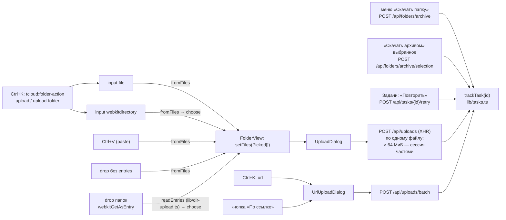
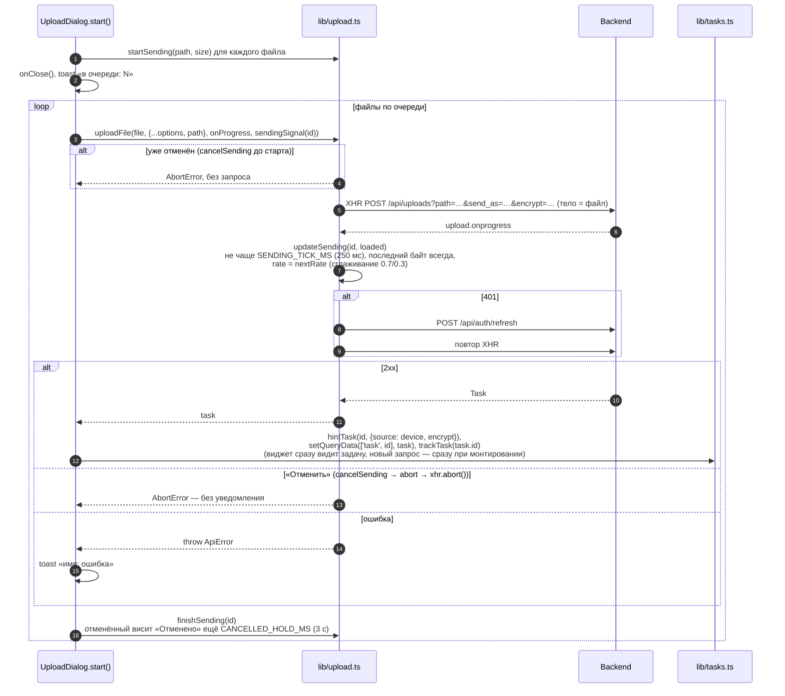
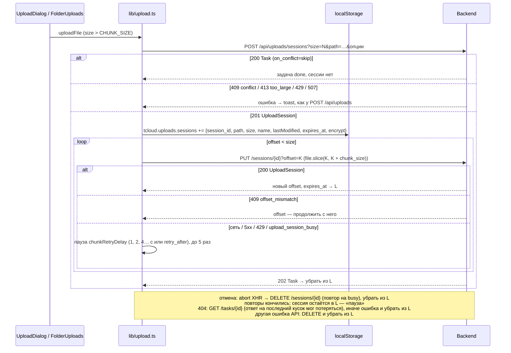
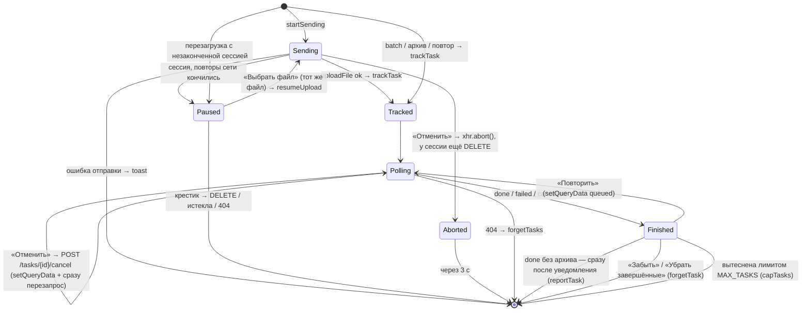
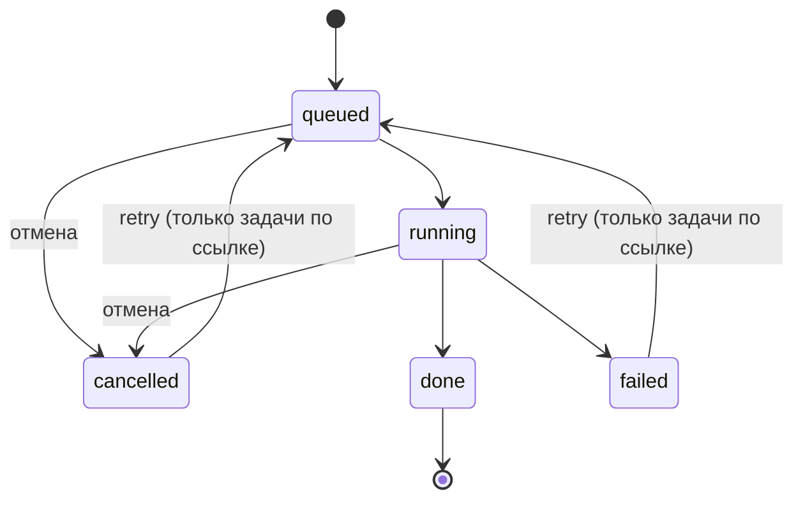
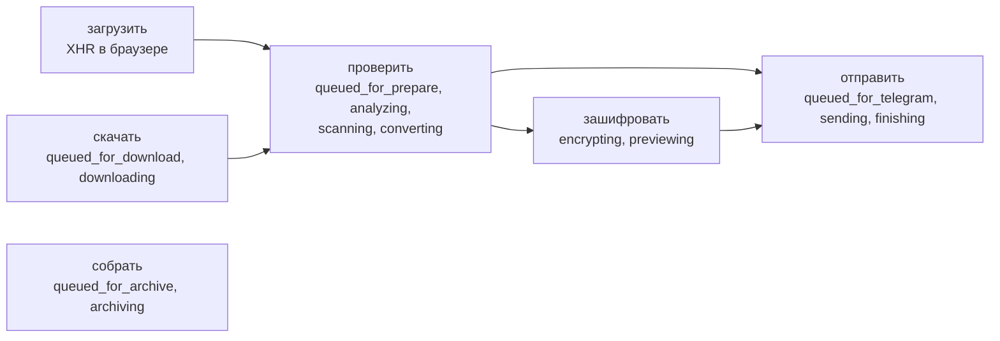

# Загрузки и задачи

У API нет списка «моих задач» (только по id или `batch_id`), поэтому браузер сам помнит id запущенных задач и опрашивает
их пачкой: `taskLoader` (`lib/tasks.ts`) собирает id, запрошенные кэшами `['task', id]` в одном тике, в один
`GET /api/tasks?ids=…` (`TASKS_PER_REQUEST` = 100 на запрос); id, которых нет в ответе, считаются пропавшими (как 404).
Таймеры опроса задач с одним статусом идут синхронно (ответ приходит всем сразу), поэтому на каждый интервал — один
запрос. Загрузка с устройства проходит два этапа: отправка тела в вкладке (XHR) и задача на сервере.

## Точки входа

Все файлы с устройства попадают в `UploadDialog` (`components/upload-dialog.tsx`) через состояние `files` в
`FolderView` (`components/folder-view.tsx`). Ссылки — в `UrlUploadDialog`.



- `choose` пустой список не открывает диалог, а показывает «нет файлов»; пустые папки не загружаются.
- `Picked.path` — относительный путь (`webkitRelativePath` или путь из обхода); итоговый путь
  `joinPath(folder, path)`, недостающие папки создаёт бэкенд.
- Параметры: `uploadOptions(settings.uploads)` как стартовые, правки в диалоге — только для этой загрузки;
  `withSendAs` выключает `encrypt` для `media` и включает для `file`. Все параметры уходят явно в query-строке.
- Диалог загрузки: список файлов (имя с многоточием, размер справа) прокручивается внутри себя, сам диалог не выше
  экрана; поля «Отправить как», «Если файл есть», «Приоритет» с пояснением выбранного варианта под полем;
  «Зашифровать» выключено (не скрыто), пока отправка не файлом; внизу слева «N файлов · размер», справа «Загрузить».

## Отправка файлов



- Прогресс отправки живёт только в памяти вкладки (`useSending`); у каждого элемента свой `AbortController`
  (`startSending`/`sendingSignal`/`cancelSending` в `lib/upload.ts`). Пока список не пуст, `TaskWatcher` вешает
  `beforeunload`, чтобы браузер спросил перед закрытием.
- Ссылки: `parseUrlLines` (строка `url` или `url | имя`) → `POST /api/uploads/batch {items}`; для каждого элемента с
  `task` — `setQueryData(['task', id], task)` и `trackTask`, с `error` — уведомление.
- После ответа (обычного или сессии) `sendTracked` делает `hintTask`, `setQueryData`, `trackTask`, а ошибку показывает
  уведомлением «имя: ошибка» (отмена — молча). `413 too_large` и `chunk_too_large` показывают `limit` размером
  (`errorParams` в `lib/api.ts`).

### Большие файлы частями

`uploadFile` отправляет файл больше `CHUNK_SIZE` (64 МиБ, как `UPLOAD_CHUNK_SIZE` бэкенда) сессией
(backend `docs/flows/uploads.md`, «С устройства — частями»); меньшие — как раньше одним `POST /api/uploads`.



- Прогресс — принятые сервером байты плюс `upload.onprogress` текущего куска, через тот же `updateSending`.
- Сессии в `localStorage` `tcloud.uploads.sessions` (каждый доступ в try/catch; просроченные по `expires_at`
  отбрасываются при чтении). Сессии, которые не идут в этой вкладке (`usePausedSessions`), — после перезагрузки или
  исчерпанных повторов — видны в `FolderUploads` своей папки как «пауза — выберите файл снова» с кнопкой «Выбрать файл»
  и крестиком (`discardSession`: `DELETE` и забыть). Выбранный файл сверяется по имени, размеру и `lastModified`
  (`sameFile`; не тот — ошибка, можно выбрать снова), затем `resumeUpload`: `GET` сессии за `offset` и тот же цикл.
- При старте приложения `TaskWatcher` один раз показывает уведомление «N незаконченных загрузок» с кнопкой «Открыть»
  (папка первой).

## Отслеживание задач

```mermaid
sequenceDiagram
    autonumber
    participant T as lib/tasks.ts (tcloud.tasks, tcloud.tasks.pending)
    participant Q as useTasks (hooks/use-tasks.ts)
    participant B as Backend
    participant W as TaskWatcher
    participant C as QueryClient
    T-->>Q: useTrackedTasks(): id[]
    loop queued — раз в 5 с, running — раз в 1 с (pollInterval), пока не done/failed/cancelled
        Q->>Q: queryFn ['task', id] → loadTask(id) (taskLoader):<br/>id одного тика копятся (10 мс)
        Q->>B: GET /api/tasks?ids=a&ids=b… (до 100 id на запрос, больше — несколько)
        B-->>Q: {items, summary} — только видимые задачи
    end
    Q-->>W: results (id, которого нет в items → ApiError 404)
    alt 404 (задачи больше нет)
        W->>T: forgetTasks(gone)
    else статус завершённый и id в pending (isPending)
        W->>T: reportTask(id, forget) — убрать из pending,<br/>done без архива — забыть совсем
        W->>W: копит завершённые этого ответа
        W->>W: dispatch tcloud:task-finished (detail = status)
        alt done + archive
            W->>W: toast «архив готов» + кнопка «Скачать»<br/>markRead(path), location = /api/tasks/{id}/archive
        else done
            W->>W: toast «готово»
        else failed
            W->>W: toast с errorText(task.error)
        end
    end
    opt в этом ответе что-то завершилось
        W->>C: invalidate task-counts; если есть не-архивы — ['folder', папка задачи и её предки] (taskFolders),<br/>storages, account, activity, search, mimes — сразу, один раз на ответ
    end
```

`TaskWatcher` смонтирован в `Layout` один раз на всё приложение. `trackTask` кладёт id и в `tcloud.tasks`, и в
`tcloud.tasks.pending` (задачи, о завершении которых ещё не сообщили); повтор задачи кладёт её в pending снова.
Завершённая задача из pending вызывает уведомление ровно один раз, даже если уже завершена при первом опросе или
завершилась, пока вкладка была закрыта; после `reportTask` перезагрузка страницы её не повторяет.
Готовые задачи без архива забываются сразу после уведомления; `failed`/`cancelled` и готовые архивы (кнопка «Скачать» на «Задачах») остаются до «Забыть». Список ограничен
`MAX_TASKS` (50): `trackTask` сначала выкидывает самые старые уже объявленные задачи, потом самые старые вообще.
Завершённые задачи в кэше не устаревают (`staleTime: Infinity`), их не перезапрашивают при монтировании.
Другие вкладки подхватывают оба ключа по событию `storage`.
Инвалидация идёт сразу, одна на ответ пачки (все задачи одного `GET /tasks?ids=` обрабатываются за один проход эффекта, опрос идущих —
раз в 1 с, так что чаще раза в секунду листинги не дёргаются); обновляются только
листинги родительской папки каждой задачи и её предков (у папок показан размер), архивы листинги не трогают.

### Жизнь элемента в браузере



### Статусы задачи (как их показывает фронт)

`TASK_STATUS` и `TASK_STAGE` в `src/lib/tasks.ts`; `FINISHED` — в `hooks/use-tasks.ts`.



Шаги — `task.step`, см. ниже «Шаги и отмена». Стадии — подписи `TASK_STAGE` (запасные, когда `step` ещё `null`) (`downloading`, `scanning`, `uploading_tg`, `archiving`, `done`); порядок стадий и
правила повторов задаёт бэкенд (`tcloud-backend/docs/flows/uploads.md`, `docs/background-tasks.md`). Повтор
возвращает ту же задачу (тот же id) в `queued`. `task.progress` — проценты 0–100, во фронте только через
`taskFraction` (0–1).

Ожидание и предупреждения переводятся по кодам бэкенда (`waitingText`, `warningText` в `lib/tasks.ts`):
`task.waiting.code` → ключ `taskWaiting.<code>` (для `queue` — `taskWaiting.queue.<params.queue>`), каждый
`task.warning_details[]` → `taskWarning.<code>` с `params` (`count` идёт в плюрал как `n`). Неизвестный код (и `other`)
показывается английским текстом бэкенда (`reason` / `message`). Таблица кодов — `tcloud-backend/docs/flows/uploads.md`.

### Шаги и отмена в виджете загрузок

`task.step` (код шага бэкенда, таблица — `tcloud-backend/docs/flows/uploads.md`, «Шаги») подписывается `stepLabel`
(ключи `step.<code>`, неизвестный код — как есть), `stepFraction` даёт полосу из `step_progress` (`null` → полосатая
неопределённая `Progress`), скорость/остаток показываются только у измеряемых шагов (`isMeasured`: `downloading`,
`analyzing`, `scanning`, `encrypting`, `sending`, `archiving`); `progress`/`speed`/`eta` относятся к текущему шагу.
Цепочка этапов (`lib/steps.ts`):



`taskPhases` берёт только применимые этапы: архив — один «собрать»; «загрузить»/«скачать» и «зашифровать» — по
подсказке `hintTask(id, {source, encrypt})`, которую диалоги кладут в память вкладки при создании задачи. Без подсказки
(после перезагрузки) этапы угадываются по текущему шагу: «скачать» видно только пока идёт скачивание, «зашифровать» —
пока идёт шифрование/превью. `trail` закрашивает этапы до текущего (`done`), текущий — `active`, у `failed`/`cancelled` —
`stopped` (где задача остановилась), у `done` закрашено всё.

Отмена: крестик у файла без подтверждения; «Отменить всё» (если открытых больше одного) — через `Confirm`. Отправка в
браузере — `cancelSending` (XHR обрывается, задачи нет); задача — `POST /api/tasks/{id}/cancel`, ответ кладётся в кэш,
кнопка выключена, пока запрос идёт или `cancel_requested` (`canCancel`), подпись «Отмена…», затем «Отменено»
(`409 task_finished` молча). `TaskWatcher` не показывает «готово» для `cancelled`. Отменённые задачи остаются в виджете до
крестика «Забыть», как ошибки.

## Кто читает задачи и отправки

| Потребитель | Что показывает |
|---|---|
| `components/folder-uploads.tsx` | над листингом: отправки и не-архивные задачи `queued/running/failed/cancelled` внутри текущей папки — шаг, полоса, цепочка этапов, отмена по одному и «Отменить всё» |
| `pages/tasks.tsx` | все отслеживаемые задачи, подпись шага (`stepLabel`, у failed/cancelled — где остановилась), фильтр `visibleTasks(tasks_filter)` (переключатель сохраняет `interface.tasks_filter`), отмена/приоритет/повтор/забыть |
| `pages/dashboard.tsx` | «Активность»: кольца по статусам из `GET /api/tasks/counts` (`useTaskCounts`, свои задачи за 7 дней, опрос 5 с; `taskRings`: при `tasks_filter = active_and_failed` без «готово» и отменённых), прогресс идущих отслеживаемых, чек-лист первого запуска (`lib/onboarding.ts`) |
| `hooks/use-storages.ts` `useStorageIo` | лампы чтения/записи хранилищ: отправки (не отменённые) + задачи загрузки = запись, `archiving` = чтение, плюс `GET /api/storages/activity` (кто угодно, пока идёт операция + 1 с; опрос 500 мс, пока горит лампа, иначе 3 с, только при видимой вкладке, `serverIo`/`mergeIo`); `markRead` (скачивание/превью) сразу запрашивает сервер; после конца локальной операции серверное `true` игнорируется до свежего ответа (`endIo`/`freshServerIo`); короткие горят ≥ `IO_MIN_MS` (`lingerIo`) |
| `components/extras.tsx` | реакции на `tcloud:task-finished` (за флагами `fx_*`) |
